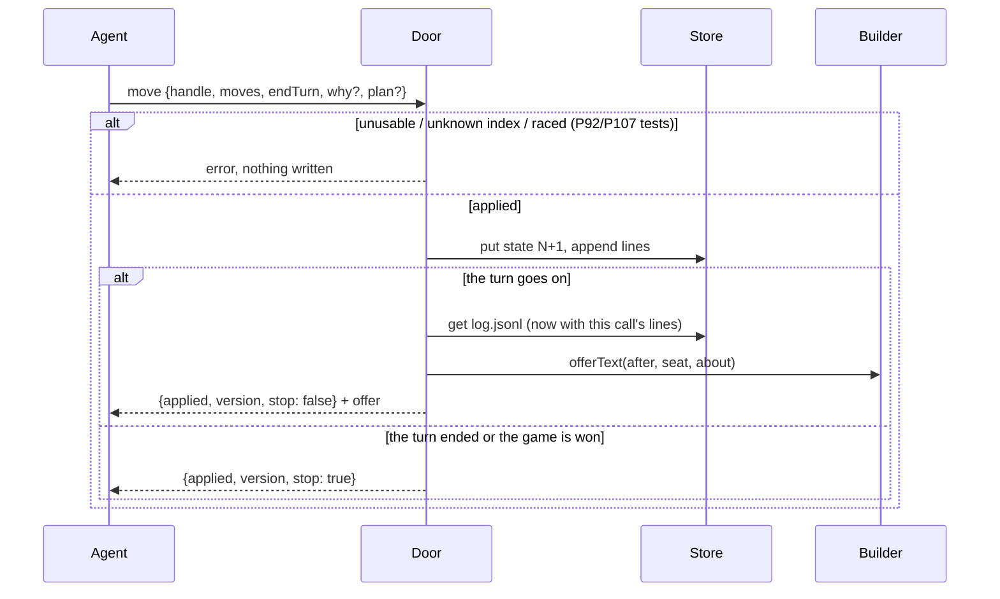
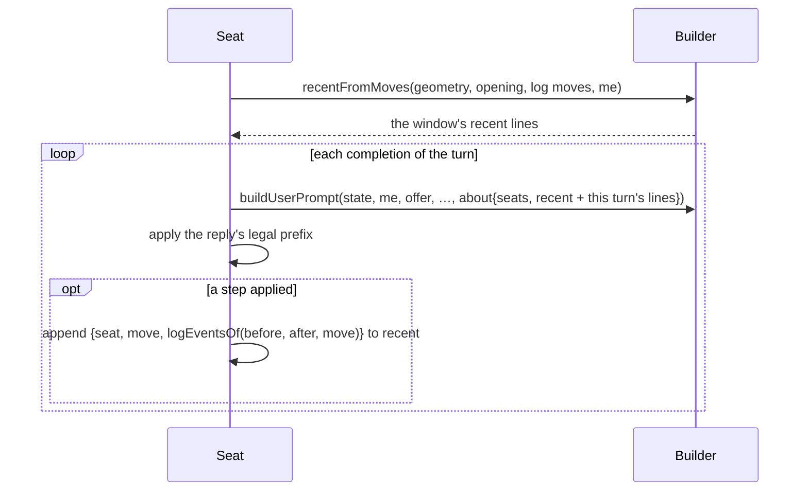
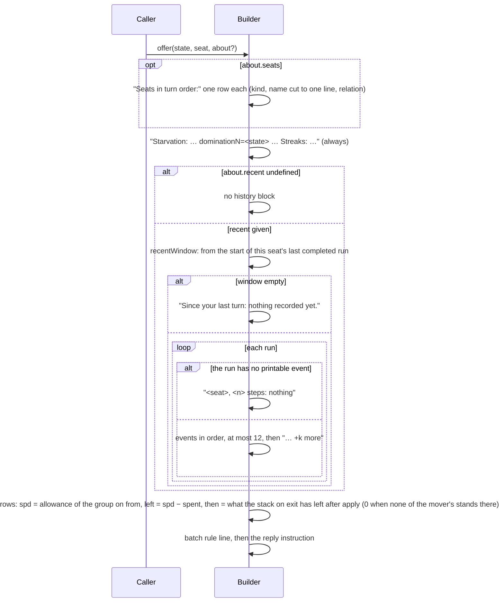

# agent-context-v2 — sequence diagrams

Participants are the seams the tests probe:

- **Agent**: an MCP client calling `tools/call` (`observe`, `move`, `tools/list`).
- **Door**: `mcp-door.ts` (`offerResult`, `offerAbout`).
- **Store**: the object store (`invite`, `state.json`, `log.jsonl`).
- **Seat**: the web's BYOK seat (`playLlmBotTurn`), with its local match log.
- **Builder**: `@conquarrow/byok-offer` (`offerText` / `buildUserPrompt`, `recentWindow`, `recentFromMoves`).

[Overview](./agent-context-v2.md). Every `alt` and `opt` below has a test
whose name starts with the diagram number. The door paths are in
`packages/online-api/test/agent-context-v2.scenarios.test.ts`, the builder in
`packages/byok-offer/test/agent-context-v2.*.test.ts`, and the BYOK seat in
`packages/web/test/agent-context-v2.byok.test.ts`.

## 1. The door's offer says who is who and what happened

```mermaid
sequenceDiagram
  participant Agent
  participant Door
  participant Store
  participant Builder
  Agent->>Door: observe {handle, board?}
  Door->>Store: invite, heal, state N
  alt stop (not seated / not your turn / game over — P92/P95 tests)
    Door-->>Agent: {stop: true, reason}
  else offer
    Door->>Store: get log.jsonl
    Door->>Door: about = seat rows (relation you / also you / your owner) + recent lines (P107 lines with seat and events; older lines skipped)
    Door->>Builder: offerText(state, seat, about)
    Builder-->>Door: offer text
    Door-->>Agent: JSON block, offer block (+ map)
  end
```

## 2. A move's next offer includes the moves it applied



## 3. The `move` tool says what it takes

```mermaid
sequenceDiagram
  participant Agent
  participant Door
  Agent->>Door: tools/list
  Door-->>Agent: move.inputSchema: moves.items integer (minimum 0), why string, plan string; description states the batch rule
```

## 4. A BYOK seat gives its model the same offer



## 5. The builder renders the about blocks


