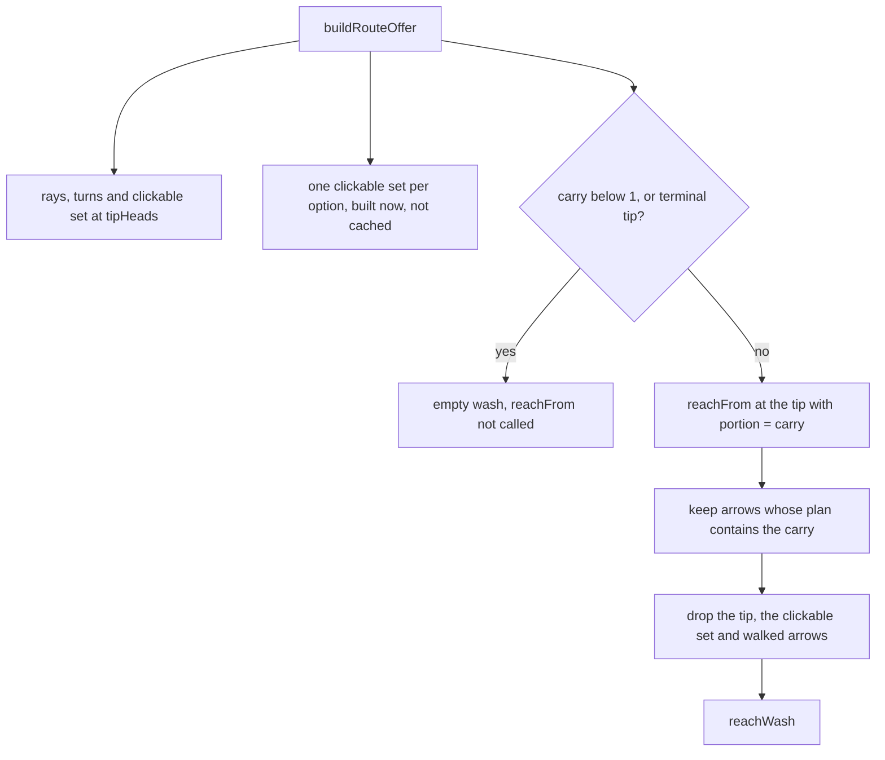

# big-stack-selection — a large stack's markers appear without an N-fold walk

**Packet:** [P99](../../design/packets/P99-big-stack-selection.md). Issue
[#121](https://github.com/hochgi/conquarrow/issues/121).
**SPEC:** not edited. No game rule is added, changed, or implied. Nothing is
owed to SPEC §11.
**Amends:** the cost of the reach wash in
[ray-run-input](../ray-run-input/ray-run-input.md). The set definition there is
unchanged: arrows the carry can reach this turn, minus ray arrows, turn arrows,
draft arrows and the tip. P35's rule that the offer (rays, turns, clickable
set) is measured at `tipHeads` is unchanged. What changes is that the wash no
longer discovers that set by walking every portion.
**Layer:** `packages/web` (`reach.ts`, `route.ts`). No `online-api` change.
No protocol, so there is no `SCENARIOS.md` and no `@hochgi/test-kit` test.
The component is the pure helper. Probe it with a counting `RulesPort`, as
`countingRules` already does for ray-run.
**Features:** [core](./big-stack-selection.core.feature) ·
[edge cases](./big-stack-selection.edge-cases.feature)

## Purpose

Selecting a stack of 16 or more heads stalls before the move markers appear.
`buildRouteOffer` asks `reachFrom` for a full depth-first walk of `rules.apply`
at every portion from 1 through N, then keeps the arrows whose plan map contains
the carry. The wash needs that one portion. The other walks are the lag.

## Terms

| Term | Means |
|---|---|
| **carry** | `RouteInputs.carry`. The portion the wash is painted for. Production sets it to `tipHeads`. A test may set it lower. The wash follows this number, never `tipHeads` |
| **tipHeads** | Heads standing on the tip. Rays, turns and the clickable set are measured here (P35). This packet does not change that |
| **portion** | The optional `reachFrom` query `{ portion }`. When present and an integer in 1..heads, the walk tries only that count. When the argument is omitted, or the property is absent, the walk tries every count from 1 through heads, as today |
| **full reach** | `reachFrom` with no portion argument. The golden and the cost baseline. Must keep walking 1..heads |
| **reach wash** | `RouteOffer.reachWash`, which `routePaint` copies onto the route phase. Arrows the carry can reach, minus the tip, the clickable set and the walked arrows |
| **wash calls** | On an empty-draft open field: `rules.apply` invocations of `buildRouteOffer` at `carry = heads`, minus the invocations of the same offer at `carry = 0`. The subtraction isolates the wash because `carry < 1` returns before any reach walk, and rays, turns, previews and `runCarries` do not read `carry` on an empty draft |
| **full calls** | `rules.apply` invocations of the full reach on that same field and tip |
| **open field** | The generated tiling. One group, the active player's, `spent` 0, no `speedOverride`, no trail, no territory, no other group. The tip is that group's arrow |
| **opening board** | `makeMatch()`, with the active player's group rewritten to the stated head count and `spent` 0. Other groups, territory and spawners stay as setup left them |

`rules.apply` is counted on every invocation, including those that throw. A
wrapping port that increments before the inner call is the instrument. No clock.

## Decisions (adapter BSSN)

### D1 — the wash walks the carry

`reachWashOf` calls `reachFrom(geometry, rules, state, tip, { portion: carry })`.
It still keeps an arrow only when `entry.plans.has(carry)`, and it still drops
the tip, the clickable set and the walked arrows. The short-circuit is
unchanged: a terminal tip, or a carry below 1, returns an empty wash and does
not call `reachFrom`.

The walk body stays one function. The portion only selects the count loop's
bounds. The cap stays `Math.min(MAX_DEPTH, group.speedOverride ?? speed(count))`.
Do not copy the walk. Do not re-derive allowance, combat, closure or a merge
bar. A hop is recorded only because `rules.apply` accepted it, and a hop onto
occupied ground is still a destination that is not extended, as today.

### D2 — a portion outside 1..heads is an empty reach

A present `portion` is walked only when it is an integer ≥ 1 and ≤ the heads
on the tip. Otherwise `reachFrom` returns an empty map and does not call
`rules.apply`. No throw. The same empty map as a tip the active player does
not hold.

`Number.isInteger` is the integer test. `1.0` is an integer. `1.5`, `NaN` and
a non-number are not. This is an adapter guard, not a game rule. Production
passes a head count.

### D3 — the no-portion call is the golden

Omitting the options argument keeps today's 1..heads walk, including
`minCount`, `maxCount`, `distance` and the shortest plan per count. Existing
`reach.test.ts` callers stay valid. Do not "optimise" this path: the perf
guard compares the wash against it, and the equivalence oracle is it.

The golden wash, for a carry `c`, is the full reach's arrows whose `plans` has
`c`, minus the tip, the clickable set and the walked arrows. Not a checked-in
list of arrow ids. Set equality, not iteration order.

### D4 — previews are not cached, and hover is not deferred

The published bench at 16 heads is 186 ms inside `reachFrom` and 240 ms for the
whole offer. The remainder does not dominate, and it does not scale with N.
Each preview inside one offer has a different tip and a different scratch
state, so a memo keyed by (state, tip, carry) does not fire on the first
selection. There is no state version to key. A cross-call cache would speed
the second identical selection and hide a bug in the first, which is the lag
the issue names.

Do not add a cache. Do not build previews on hover. P34's "built once per
selection, not per hover" stands. Two successive offers on equal inputs make
the same number of `rules.apply` calls.

If a later playtest still lags on a 16+ stack, that is a new packet. It is not
a licence, in this one, to defer hover or to add web to Stryker.

### D5 — the guard is a count

On an open field, empty draft:

- `washCalls(16) > 0` and `washCalls(16) < fullCalls(16)`
- `washCalls(32) > 0` and `washCalls(32) < fullCalls(16)`

The first fails today because the wash *is* the full walk, so the two counts
are equal. The second fails today because a 32-fold walk is larger than a
16-fold walk. After D1, the wash is one walk of depth `speed(heads)` (5 at 16,
6 at 32), and one such walk is strictly cheaper than sixteen walks. The
comparison is against `fullCalls`, not against a hardcoded ceiling, so a
slower `apply` does not flake it.

`washCalls` is defined only for the empty-draft open field. Do not use the
subtraction on a board where rays read `carry` — they must not. A drafted tip
is covered by equivalence, not by this budget.

Web is not added to Stryker. A mutant that ignores `portion` fails the count
guard. A mutant that skips the wash entirely fails `washCalls > 0`. A mutant
that washes the wrong portion fails equivalence.

### D6 — rays do not start reading carry

The clickable set, the three rays and every preview stay measured at
`tipHeads`. A lower carry shrinks the wash only. That is the P34 reason the
wash exists: a smaller clickable set must not read as a smaller reach, and
P35 moved the click off the carry. This packet must not move it back.

## Flow



No literal semicolon, so none is escaped.

## What this packet does not decide

The skill's edge catalogue, and where each one sits:

| Case | In this packet? |
|---|---|
| A cut landing mid-closure | No. Rules. `apply` still decides the hop |
| A cut on a fork stem versus one branch | No |
| A chord that coincides | No new rule. A refused hop is absent because `apply` threw |
| A traversal that is not a cut | No |
| A pincer whose arms land on different turns | No |
| A closure that encloses nothing, or that encloses heads | No new rule. A terminal tip still yields an empty wash (D1) |
| An accumulator at 11/12, or an arrow fed by two spawners | No |
| A stack of one head, and a carry of 1 on a large stack | Yes. Edge cases |
| A single head cut and removed | No |
| A stranded head | No |
| A head spawning onto a contested arrow | No |
| A cell far from the origin | The board is the tiling, which has no edge. The algorithm does not special-case distance from the origin |

## Implementation seam

`reachFrom` gains an optional last argument:

```ts
reachFrom(geometry, rules, state, from, options?: { readonly portion?: number }): Reach
```

Existing calls omit it. The wash passes `{ portion: inputs.carry }`. The
comment at the top of `reach.ts` keeps the reason the full walk tries every
portion (bigger is not always further). It must also say that a present
portion walks only that count, because the caller already chose it.

No new port method. No change to `RulesPort`, `GeometryPort`, or any DTO in
`contracts`.

## Invariants

1. When a route offer is built for a non-terminal tip and a carry of at least 1, the system shall walk the reach wash for that carry alone.
2. The system shall include an arrow in the reach wash if and only if the full reach has a plan for the carry to that arrow, and the arrow is not the tip, not in the clickable set, and not walked.
3. When `reachFrom` is called with no portion, the system shall walk every portion from 1 through the head count.
4. If a present portion is not an integer in 1..heads, then the system shall return an empty reach and shall not call `rules.apply`.
5. If the carry is below 1, or the tip is terminal, then the system shall return an empty reach wash and shall not call `reachFrom`.
6. While `rules.apply` refuses a hop, the system shall not record that hop in the portion's reach.
7. On an open field, the system shall spend strictly fewer `rules.apply` calls on the 16-head wash than on the full reach of that stack, and the wash count shall be greater than zero.
8. On an open field, the system shall spend strictly fewer `rules.apply` calls on the 32-head wash than on the full reach of a 16-head stack, and the 32-head wash count shall be greater than zero.
9. If two route offers are built from equal inputs, then the system shall make the same number of `rules.apply` calls for each, and shall yield equal reach washes.
10. While painting a hover from an offer already built, the system shall not call `rules.apply`.
11. The system shall not derive a wash hop from `speed` in place of `rules.apply`.
12. When a group carries a speed override, the system shall cap the portion walk at that override, as the full walk does.
13. The system shall measure rays, turns and the clickable set at `tipHeads`, and shall not shrink them when the carry is lower.

## Counts

Scenarios: 3 core headers (5 cases once the outline's 3 examples are expanded)
+ 12 edge headers (17 cases once the outlines expand to 3 and 4 examples)
= **22 cases**. Invariants: **13**. Diagram paths: **0** (not a protocol).
No `SCENARIOS.md`.

## BSSN recorded here

- **Packet number is P99**, not the P98 the issue text names. P98 shipped as
  session-expired.
- **Golden is the live full reach**, not a snapshot of arrow ids.
- **Previews are not memoised.** The published 186/240 ms split is the
  measurement. A post-fix profile that still lags is a new packet.
- **No web Stryker config.** The count guard is the regression net.
- **Perf subtraction is the empty-draft open field only.** The opening board
  is an equivalence fixture, not a budget fixture, because its other groups
  make the absolute count noisier and the subtraction is only proved where
  rays ignore `carry`.
