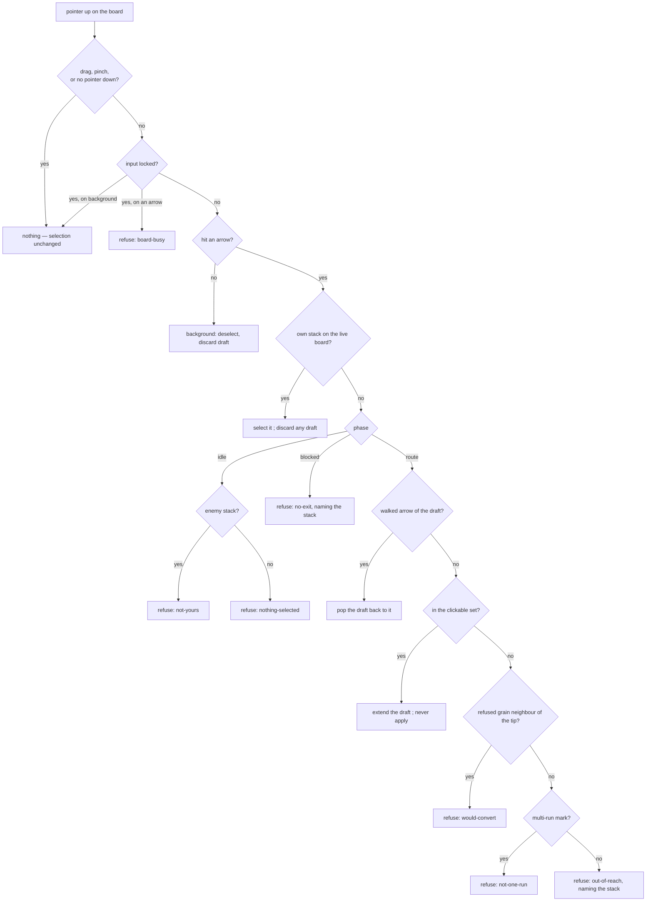
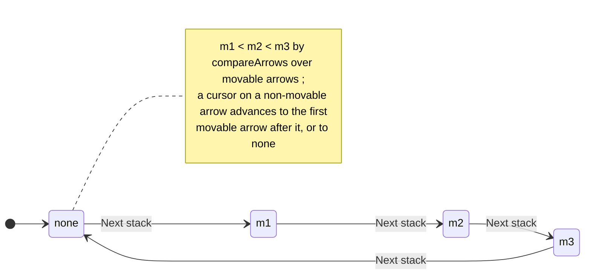

# board-selection-model — one selection model for the human seat

**Packet:** [P77 — The board selection model](../../design/packets/P77-board-selection-model.md)
**SPEC:** none — presentation and input only. **No game rule is added, changed or
implied**; `contracts` and `rules-core` are not touched.
**Layer:** `packages/web` only — the human seat's board input. Not the BYOK seat
(`byokBot.ts`, `docs/byok-teaching.md`), not the spectated camera (P48, P70).
**Evidence:** [playtest 2026-10-29 FINDINGS §4](../../research/playtest-2026-10-29/FINDINGS.md),
[seat-B reasoning](../../research/playtest-2026-10-29/seat-B-reasoning.md) turns 2, 16, 17, 18, 32, 37.
**Amends:** [ray-run-input](../ray-run-input/ray-run-input.md) (P34) ·
[count-after-route](../count-after-route/) (P35) ·
[next-stack-cursor](../next-stack-cursor/next-stack-cursor.md) (P50) ·
[selection-chrome](../selection-chrome/selection-chrome.md) (P31) ·
[refuse-self-convert](../refuse-self-convert/refuse-self-convert.md) (P28, web half only)
**Features:** [core](./board-selection-model.core.feature) ·
[edge cases](./board-selection-model.edge-cases.feature)

## Purpose

Make it impossible to lose a move to selection ambiguity. On 2026-10-29 an
attentive player lost a move or a whole turn on five separate turns, twice after
writing the warning down. Three behaviours composed into "no safe click once a
seat has two stacks":

1. the app **auto-selects** a movable stack (turn start, after each send);
2. a click with **one legal count and nowhere further to go applies at once**;
3. **nothing on screen says which stack is selected**.

On top of that, the selection itself was moved through the *click* path: the
P50 cursor called `onArrowClick(cursor)`, so `Next stack` landing on the
already-selected arrow **deselected** it (the "alternates between one stack and
nothing" finding), and landing on an arrow inside the current stack's offer
**extended the draft** instead of selecting.

This packet replaces the patchwork with one model:

- **selection and destination never share a gesture** — a click on your own
  stack selects it, always, and nothing else selects;
- **nothing is applied by a click** — every move is drafted, then sent;
- **selection is always visible** — on the board as a marker and in the strip in
  words, with its position in the `Next stack` lap;
- **lit means legal**, and **every refused click says why**.

## Terms

Repo vocabulary is in [`AGENTS.md`](../../../AGENTS.md). Terms this spec adds or
pins (all adapter concepts):

| Term | Means |
|---|---|
| **own stack** | an arrow where `state.groups.get(arrow)?.owner === state.activePlayer` on the **live** state — never the scratch state a draft walks |
| **selected stack** | `highlights.selected`: the phase's `from` in the `route` or `blocked` phase; nothing in `idle` |
| **select** | the explicit mode operation `InputMode.select(arrow, state, rules)`: open the route phase on `arrow` with an empty draft (or `blocked` with a `no-exit` refusal). Never a destination, never a deselect |
| **merge target** | an own stack, other than the tip, that the current offer can reach (`offer.clickable` holds it). Reached through `InputMode.mergeInto(arrow)`, never through a tile click |
| **lit** | painted as a click target: the **drafted** tier, the **one run away** tier (rays and turns), and merge targets |
| **multi-run mark** | the old faint "reach wash": arrows reachable this turn but not in one run. A *different kind of fact*, painted dashed and neutral — not lit |
| **refused** | a grain neighbour of the **tip** whose step would self-convert (P28), measured on the scratch state the draft leaves |
| **movable** | as P50: the `from` of at least one `step` in `rules.legalMoves(state)` |
| **lap** | the `Next stack` cycle: movable arrows in `compareArrows` order, then **none**, then wrap |
| **strip** | the dock under the board (`RouteDock`). Always mounted, fixed height. Row 1 the selection line, row 2 the count / merge / Cancel / Send controls, row 3 the message line |
| **selection line** | row 1 of the strip — names the selected stack and its lap position, or says nothing is selected |
| **message line** | row 3 of the strip — the last refusal's reason if the last click was refused, otherwise the turn status |
| **turn status** | the message-line text saying whether the turn will pass by itself |
| **leftover** | the heads a lowered count leaves standing where the **last leg** began (§5 sentry) |

## The click, decided

The **own-stack branch comes first**, before the walked-arrow and clickable
tests. That ordering is the packet: a click on your own stack can never be read
as a destination, even when the selected stack could legally merge there. Merges
go through the strip's **Merge** button instead.

## The lap

`Next stack` **selects** (via `InputMode.select`) or **deselects** (via
`reset`) — it never goes through `onArrowClick`, so it can neither toggle a
selection off nor extend a draft. Pressing it with an open draft discards the
draft (nothing was applied).

P50's post-commit auto-advance and turn anchor are **kept** (see Decisions), and
now also select through `InputMode.select`.

## Strip copy (normative — tests lock these strings)

Arrows are named by `String(arrow)` — on the generated tiling that is
`tiling:a:q,r,k` (the playtest quoted the `q,r,k` tail, `-4,6,2`). Shortening
the display form is out of scope; tests lock `String(arrow)`. `m` is the movable count, `n` the
1-based lap position of the selected stack, `h` its head count on the live board.

**Selection line** — `selectionLine({ selected, heads, movable })`:

| Case | Text |
|---|---|
| nothing selected, `m > 0` | `No stack selected · ${m} can move` |
| nothing selected, `m = 0` | `No stack selected · nothing can move` |
| selected, movable | `Selected: ${h} on ${arrow} · ${n} of ${m}` |
| selected, not movable | `Selected: ${h} on ${arrow} · no move left · ${m} can move` |

**Turn status** — `turnStatus(m)`:

| Case | Text |
|---|---|
| `m = 1` | `1 stack can still move · End turn when done` |
| `m > 1` | `${m} stacks can still move · End turn when done` |
| `m = 0` | `Nothing can move · the turn passes by itself` |

**Refusals** — `refusalText(reason, selected?)`. One sentence each:

| Reason | When | Text |
|---|---|---|
| `nothing-selected` | idle, clicked an arrow that is not a stack | `Nothing selected · click one of your stacks first` |
| `not-yours` | idle, clicked an enemy stack | `Not your stack` |
| `out-of-reach` | route, not clickable, not refused, not multi-run | `Too far for the stack on ${selected}` (`Too far this turn` with no selection) |
| `no-exit` | selecting a stack with nothing clickable, or any non-own click while blocked | `The stack on ${selected} has no move left this turn` (`Nowhere to go from here` with no selection) |
| `would-convert` | route, a refused grain neighbour of the tip | `No trail home — those heads would flip` |
| `not-one-run` | route, a multi-run mark | `Reachable, but not in one run · click a lit arrow on the way first` |
| `board-busy` | a click on an arrow while input is locked | `The board is not taking moves right now` |

`REFUSAL_TEXT[reason]` keeps the selection-free text for every reason;
`refusalText` adds the stack name where the table says so.

**Leftover** — `leftoverNote({ count, ceiling, start })`, the count strip's note.
The stepper's caption reads `Heads on the last leg`.

| Case | Text |
|---|---|
| `ceiling − count = 0` | `No head stays behind` |
| `ceiling − count = 1` | `1 head stays on ${start}` |
| `ceiling − count = k > 1` | `${k} heads stay on ${start}` |

`start` is the arrow the **last run** began on (`CountControl.start`): the source
for a one-run draft, the previous run's tip otherwise. This is the fix for "1
stays" being read as "stays home".

**Route hints** (`routeHint`, HUD):

| Constant | Text |
|---|---|
| `ROUTE_HINT_EMPTY` | `Click a lit arrow to draft a run · one turn at the end is free · dashed = needs more than one run` |
| `ROUTE_HINT_DRAFTED` | `Click to extend · click a walked arrow to go back · Send to move` |
| `ROUTE_HINT_FINISHED` | `This run can go no further · click a walked arrow to go back · Send to move` |

## Paint

- **Selected marker.** The selected stack's tile carries a **static** two-layer
  outline — a dark under-stroke (`SELECTED_UNDER_STROKE`) of width
  `SELECTED_STROKE_WIDTH + 4` under a cream over-stroke (`SELECTED_HALO_STROKE`)
  of width `SELECTED_STROKE_WIDTH ≥ 6` — so it reads on any fill at default zoom.
  Its colour differs from `PATH_STROKE` (drafted) and `PREVIEW_STROKE` (one run
  away). The P31 pulse may remain as an *extra* animated halo; the marker itself
  is never animated, and under `prefers-reduced-motion: reduce` nothing on the
  selection animates.
- **Two shades plus a label.** `drafted` (`PATH_STROKE`) and `one run away`
  (`PREVIEW_STROKE`, rays and turns alike) stay visually distinct.
  The **multi-run mark** stops being a third shade of that hue: it is a dashed
  neutral outline (`MULTI_RUN_STROKE`, with a `strokeDasharray`) and no blue
  fill, and `ROUTE_HINT_EMPTY` names it. A pure `tierStyle(tier)` in
  `selectionChrome.ts` returns `{ stroke, width, dash? }` for
  `'drafted' | 'one-run' | 'multi-run' | 'merge'` and Board reads it.
- **Merge targets** are painted with the `merge` tier (dashed, never
  `PREVIEW_STROKE`; Board may tint it with the active player's colour) — legal, but a click on the tile
  selects; the strip's **Merge into `${arrow}`** button drafts it.
- **Refused** grain neighbours keep P28's refused treatment and `not-allowed`
  cursor — measured at the **tip** on the scratch state, not at the source.

## Layout

- **The HUD's action row comes before every variable-length line.** The order is
  `h1`, then the action row, then the turn banner, hint, coach, refusal, BYOK and
  illegal lines. So no status text above the buttons can move them.
- **Every action slot is always mounted.** `Pause` is rendered when not offered
  as a hidden, disabled placeholder that still takes its width (`visibility:
  hidden`), so `Download log` and `Lobby` never shift when Pause comes and goes.
  The tutorial's two buttons stay last.
- **The strip's three rows are fixed-height**; text is one line, ellipsised. The
  strip is always mounted (P35 already reserves its height) — the selection line
  and message line are present even with no draft.

## Auto-pass (decided: always, when nothing can move)

Hot-seat already passes a turn exactly when the active seat has **no legal
step** (`passIfExhausted`), and online posts `endTurn` on the same predicate
(`onlinePassMove`). That rule is kept and now stated: **the turn passes by itself
when, and only when, no stack can move.** A parked sentry that *can* still move
keeps the turn open — the 2026-10-29 surprise was the absence of a message, not
the rule. The message line therefore says which state the turn is in
(`turnStatus`) whenever no refusal is showing.

## Scope

- **In:** `input/modes.ts` (own-click selects, `select`, `mergeInto`, no
  apply-on-click, refusals named by the mode, refused at the tip, merges split
  from targets), `route.ts` (retire `autoApplies`, `CountControl.start`, hints,
  `leftoverNote`), `selection/cursor.ts` (`nextStack` lap), a new pure
  `selection/status.ts` (`selectionLine`, `turnStatus`), `fx/present.ts`
  (reasons + `refusalText`), `selectionChrome.ts` (marker constants,
  `tierStyle`), a pure `pointerUpIntent` for the board's pointer-up decision,
  `Board.tsx` / `RouteDock.tsx` / `Hud.tsx` / `App.tsx` wiring, `styles.css`,
  and the HUD help text.
- **Out:** any rules change; the spectated camera (P48, P70); touch/gesture
  redesign; keyboard shortcuts; the BYOK seat; the tutorial's scripted rails
  (see Decisions); the spawner tooltip and territory-loss findings (§4 items 7–8).

## Invariants

EARS one-liners. These become the property tests (fixture boards, several
seeds of own/enemy stacks and territory).

1. **Ubiquitous** — The system shall never return `pending` from
   `onArrowClick`; a move reaches the host only through `send`,
   `requestEndTurn`, or the turn auto-pass.
2. **Event-driven** — When an own stack on the live board is clicked, the system
   shall return a snapshot whose selected stack is that arrow and whose draft is
   empty, whatever the phase, draft or offer before the click.
3. **Ubiquitous** — The system shall change the selected stack only through a
   click on an own stack, `select`, `reset` / `cancel` / `send` /
   `requestEndTurn`, or a background click — never through a click on any other
   arrow.
4. **Unwanted** — If a click changes the selected stack, then it shall not also
   change the draft of the stack selected before it into a move (no click both
   selects and commits).
5. **Ubiquitous** — Every arrow in `targets ∪ merges` shall be the last exit of
   a draft that `rules.apply` accepts step by step on the live board.
6. **Ubiquitous** — `refused` shall be disjoint from `targets`, `merges`, the
   multi-run marks and the draft.
7. **Ubiquitous** — `merges` shall hold only own stacks, and `targets` shall hold
   none.
8. **Event-driven** — When a click on an arrow that is neither an own stack nor
   a walked arrow of the draft leaves phase, draft and selection unchanged, the
   snapshot shall carry a `refusal` for that arrow. (Re-selecting the selected
   stack and popping to the current tip are a select and a pop, not refusals.)
9. **Ubiquitous** — `nextStack` shall visit every movable arrow exactly once and
   *none* exactly once per lap, in `compareArrows` order, independent of the
   order the movable list is given in.
10. **Event-driven** — When `Next stack` is pressed, the system shall emit no
    move and leave the `GameState` identical.
11. **State-driven** — While a stack is selected, the selection line shall name
    its arrow; while none is, it shall begin `No stack selected`.
12. **Ubiquitous** — The HUD markup before the end of the action row shall not
    depend on the hint, refusal, coach, BYOK, banner or illegal text.
13. **Ubiquitous** — A pan or pinch shall not change the input snapshot.
14. **Ubiquitous** — Equal inputs shall produce equal snapshots, lap positions,
    strip text and paint (no clock, no randomness, no iteration-order drift).

## Counts

14 invariants. 16 core scenarios, 28 edge-case scenarios (44 in all; three `Scenario Outline`s add 15 `Examples` rows).

## Decisions recorded here (BSSN, adapter-level — no game rule involved)

- **Auto-select is kept.** The packet locks *visible* selection, own-click
  selects, and no apply-on-click; it does not retire P50's turn anchor or
  post-commit advance. With those three in place an auto-selected stack can no
  longer steal a click (a click on another own stack selects it; a destination
  click drafts and waits for Send), and the selection line plus the stack-naming
  `out-of-reach` text answer "which one is selected". Retiring it would be a
  second behaviour shift with no incident behind it.
- **Clicking the selected stack re-selects it** (draft cleared, still
  selected) rather than deselecting. A toggle is what made selection
  unpredictable ("two clicks to select"). Deselect is a background click,
  Escape / Cancel, or the lap's *none* step.
- **Merge affordance is a strip button**, one `Merge into ${arrow}` per merge
  target in `compareArrows` order, drafting exactly what the old merge click
  drafted. A ray cannot express "stop on the own stack" without a tile click,
  and a modifier key is out of scope (keyboard shortcuts).
- **`Next stack` discards an open draft.** A draft is not a move; keeping a
  hidden draft for a stack that is no longer selected would be invisible state.
- **`Next stack` uses its own `nextStack` lap**; P50's `advanceCursor` keeps the
  post-commit preemption rule. P50's decision "one advance function for the
  button and the auto-advance" is amended: the button's lap now has a *none*
  step and the auto-advance does not.
- **A click while input is locked says `board-busy`** instead of nothing. It is a
  refused click like any other (DoD: every refused click produces a reason). A
  background click while locked stays silent — it refuses nothing.
- **Refusals are named by the mode**, not patched in App. P28's
  `would-convert` used to be substituted in `commitSnap` from the source's refused
  set; the mode now measures `refused` at the tip and returns the reason itself.
- **`not-yours` is narrowed to enemy stacks**; an idle click on any other
  non-own arrow is `nothing-selected`. "Not your stack" on an empty arrow was
  true and unhelpful.
- **The tutorial's scripted rails keep their auto-send** (`railAutoSends`). A
  rail admits exactly one legal click, so there is nothing to confuse it with;
  its on-rail landing on an own head (L2) calls `mergeInto` instead of a tile
  click. Revisiting tutorial pacing is out of scope.
- **The multi-run mark is no longer called a wash** in copy; the code field
  keeps its name `reachWash` (a rename would touch P34's suite for nothing).
- **The refusal moves to the strip's message line** (next to the board) and
  leaves the HUD; the fx overlay on the clicked arrow (Event 11) is unchanged.

## Superseded

Scenarios this packet retires are tagged `@superseded-P77` in place and keep
their text as history; their tests are deleted or inverted by phase 2:

- [count-after-route core](../count-after-route/count-after-route.core.feature):
  *A click with nothing left to decide applies the move* (5 scenarios);
  [edge cases](../count-after-route/count-after-route.edge-cases.feature):
  *The auto-apply test is exact at its boundaries* (5) and the merge-by-click
  scenarios (2).
- [ray-run-input core](../ray-run-input/ray-run-input.core.feature):
  *Clicking the source with an empty draft deselects*;
  [edge cases](../ray-run-input/ray-run-input.edge-cases.feature): the two
  merge-by-click scenarios.
- [next-stack-cursor](../next-stack-cursor/next-stack-cursor.md): the button's
  wrap (`a3 → a1`) becomes `a3 → none → a1`; `advanceCursor` itself is unchanged.
