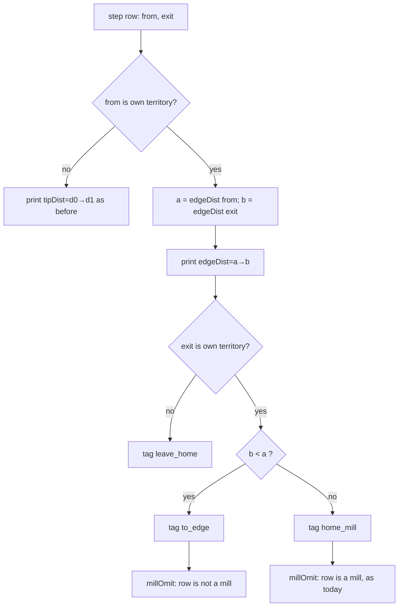

# byok-interior-mill — `home_mill` must not call a walk to the edge "waste"

**Packet:** [P80 — Interior stacks: `home_mill` must not call a walk to the edge "waste"](../../design/packets/P80-interior-mill-paralysis.md)
**Depends on:** P15, P32, P64, P66, P79 (the gate).
**SPEC:** none. **No game rule is added, changed, or implied.** Nothing is owed
to SPEC §11. Teaching stays non-normative.
**Layer:** `packages/web` adapter only — `byokBot.ts` (`annotateMove`,
`millOmit`), `botEvaluate.ts` (private BFS generalisation), and one sentence in
`docs/byok-teaching.md`. No `contracts`, `rules-core`, `geometry-*` or
`online-api` change. No new port method.
**Features:** [core](./byok-interior-mill.core.feature) ·
[edge cases](./byok-interior-mill.edge-cases.feature)

**Counts:** 11 scenarios (5 core, 6 edge) · 8 invariants · 0 SPEC §11 items.

**Arm discipline.** P80 is one arm of the P79 gate, measured alone. P74 and P75
are separate arms. Nothing else in the offer, the tags, the header or the
prompt changes here; any extra change contaminates the measurement.

## Purpose

Audit of archived grok matches
([benchmark ledger §1](../../research/byok-benchmark.md#1-interior-paralysis-passing-with-nowhere-useful-to-go-5-of-42-calls)):
match `2026-09-10T0657` calls 10–13 (corpus position
`grok-2026-09-10T0657#56` and the turns after it) passed four turns running.
Both of B's stacks sat **inside** B's territory. Every legal step was tagged
`home_mill,onto_home` with `tipDist=0→0`; the teaching calls a mill with an
empty trail "wasted tempo"; `millOmit` withheld the baseline suggestion. The
offer told the seat something false.

P80 makes the offer true: a step that shortens the walk to the territory's
edge is tagged `to_edge`, not `home_mill`, and every row that starts on own
territory says how far the edge is.

> P66's spec records hit 13 of the same match as "correctly passed a mill-only
> offer". The P79 audit reclassifies that pass as the stall P80 targets. P66's
> recorded-offer fixtures are frozen tag strings and are not re-rendered, so
> their assertions stand unchanged.

## Terms

| Term | Means here |
|---|---|
| **own territory** | `state.territory.get(arrow) === me` |
| **edgeDist(x)** | grain BFS distance (out-arrows via `geometry.outArrows(geometry.target(·))`) from arrow `x` to the nearest arrow **not** in `me`'s territory. `0` when `x` itself is not own territory. `DIST_CAP + 1` (= 17) when none is found within `DIST_CAP` (16), exactly as `distanceToTerritory` caps |
| **interior step** | a step whose `from` and `exit` are both own territory |
| **`to_edge`** | tag on an interior step with `edgeDist(exit) < edgeDist(from)` |
| **`home_mill`** | tag on an interior step with `edgeDist(exit) ≥ edgeDist(from)` |
| **row** | one `step` line of `LEGAL_MOVES` (output of `annotateMove`) |

## Decisions (BSSN, recorded here)

1. **Which rows print `edgeDist`.** Every step row whose `from` is own
   territory — interior steps *and* `leave_home` steps — prints
   `edgeDist=a→b` in the slot where `tipDist=d0→d1` was. It never prints both.
   A `leave_home` row therefore reads `edgeDist=1→0` (its exit is not own
   territory, so `b = 0`, and `from` is one step from that exit, so `a = 1`).
   Source: packet "every step row whose `from` is own territory" and the
   task brief; read literally rather than narrowed to interior rows.
2. **Other tags keep their old inputs.** `homeward` / `outward` are still
   derived from `distanceToTerritory` (the old `d0`, `d1`), so a `leave_home`
   row keeps `outward` even though it no longer prints `tipDist`. `onto_home`,
   `leave_home`, `borders_spawner`, `share+N`, `on_target`, cut/near-trail and
   `combat` are untouched.
3. **Tag position.** `to_edge` takes the slot `home_mill` occupied in the tag
   list (immediately after where `leave_home` would be). Interior steps carry
   exactly one of `home_mill` / `to_edge`.
4. **`millOmit`.** A row tagged `to_edge` is not a mill; one such row makes
   `millOmit` false. Rows tagged `home_mill` / `onto_home` without `to_edge`
   behave as today.
5. **Capped distances.** If both ends are capped (`17→17`) the step is
   `home_mill` (`b ≥ a`). No special case.
6. **Exposed tips line** (`Exposed tips: … tipDist=…`) is not a row and is
   unchanged; it lists only stacks on trail, never on territory.
7. **Teaching.** `docs/byok-teaching.md` gains exactly one sentence:
   *Crossing your own territory toward its edge (`to_edge`) is how an interior
   stack gets back to work; it is not a mill.* The existing mill sentence is
   scoped to `home_mill` only (drops `/ onto_home`). No other prose change.
   The tag enumeration sentence is unchanged.
8. **One BFS.** `homewardPath` in `botEvaluate.ts` is generalised to take a
   goal predicate; `homewardPath`, `distanceToTerritory` and the new edge
   distance are thin callers. Frontier order is geometry order; `seen` is
   membership only. Existing callers' results are byte-identical.
9. **Budget.** Offer growth ≤ 5% on a mid-game position (measured on a corpus
   position, recorded in the PR).

## Flow

## Invariants

- **I1** (ubiquitous) The system shall print `edgeDist=` and not `tipDist=` on
  every step row whose `from` is own territory, and `tipDist=` and not
  `edgeDist=` on every other step row.
- **I2** (ubiquitous) The system shall tag every interior step with exactly
  one of `home_mill` and `to_edge`, and shall tag no non-interior step with
  either.
- **I3** (event-driven) When an interior step has `b < a`, the system shall
  tag it `to_edge`; otherwise `home_mill`.
- **I4** (ubiquitous) On every row printing `edgeDist=a→b`, `b ≥ a − 1`
  unless `a` is capped (exit is one grain step from `from`, so the edge is at
  most one step closer). The grain is directed, so `b` may exceed `a + 1`.
- **I5** (unwanted) If any row is tagged `to_edge`, then `millOmit` shall be
  false.
- **I6** (ubiquitous) For rows whose `from` is not own territory, the row text
  shall be identical to the pre-P80 text.
- **I7** (ubiquitous) The system shall produce identical offer text for the
  same position under both geometry implementations (`geometry-tiling` and
  `geometry-fixtures`), and on repeated calls.
- **I8** (ubiquitous) `homewardPath` and `distanceToTerritory` shall return
  the same results as before the generalisation.

## Out of scope

`borders_spawner` (P75), teaching breadth (P74), multi-step lookahead, the
heuristic seat (`chooseMove` is unchanged), the exposed-tips line, the threat
header.
