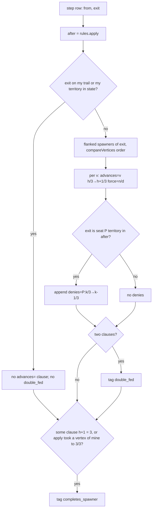

# byok-offer-vertex-join — offer rows name the spawner vertices they advance

**Packet:** [P75 — Offer rows name the vertices they advance](../../design/packets/P75-offer-row-vertex-join.md)
**Depends on:** P15, P32, P64, P66, P79 (the gate). Built on main with P80 merged.
**SPEC:** §7 (spawners, shares, force). **No game rule is added, changed, or
implied.** Nothing is owed to SPEC §11.
**Layer:** `packages/web` adapter only. Code: `byokBot.ts` (`annotateMove`,
`pickSpawnerRows`, the threat header's named tags, the `LEGAL_MOVES` legend)
and the one `borders_spawner` mention in `targets.ts`'s empty-targets line.
Prose: the `borders_spawner` mentions in `docs/byok-teaching.md`. No
`contracts`, `rules-core`, `geometry-*`, `online-api` or `mcp` change. **No new
port method**: `GeometryPort.flankVertices` and `borderArrows` already exist.
**Features:** [core](./byok-offer-vertex-join.core.feature) ·
[edge cases](./byok-offer-vertex-join.edge-cases.feature)

**Counts:** 17 scenarios (8 core, 9 edge) · 9 invariants · 0 SPEC §11 items.

**Arm discipline.** P75 is one arm of the P79 gate, measured as an increment
over main (= P80). P74 is parked. Nothing in the offer, tags, header or prompt
changes beyond what this spec names; any extra change contaminates the
measurement.

## Purpose

The offer hands the seat two tables: spawner rows (`vertex`, `force`, `held`,
`unclaimed`) and step rows carrying a boolean `borders_spawner`. The seat must
join them to know which spawner a step feeds and how far. A human seat got that
join wrong for four turns (playtest 2026-10-29 §2.2), and the audit of archived
grok matches
([benchmark ledger §2](../../research/byok-benchmark.md#2-border-walk-cycle-re-walking-its-own-trail-for-shares-9-of-12-calls))
found grok walking a 3-cycle of its own trail for 9 calls because
`borders_spawner` fired on every arrow of it — including arrows already on its
trail, which advance nothing. Corpus position `grok-2026-09-10T1442#34` is that
cycle.

P75 retires the boolean. Each row names the vertices it advances and by how
much, and says nothing on a re-walk.

## Terms

| Term | Means here |
|---|---|
| **row** | one `step` line of `LEGAL_MOVES` (output of `annotateMove`) |
| **`state` / `after`** | the position before the step, and `rules.apply(state, move)` |
| **flanked spawner** | a vertex `v` in `geometry.flankVertices(exit)` with `state.spawners.has(v)`. At most 2 per arrow |
| **re-walk** | a step whose `exit` is, in `state`, on `me`'s trail (`state.trails.get(me)`) or `me`'s territory (`state.territory.get(exit) === me`) |
| **h(v)** | number of `v`'s border arrows **other than `exit`** that are `me`'s territory in `after`. Trail is not a holding; unowned is not a holding |
| **k(P, v)** | number of `v`'s border arrows that are seat `P`'s territory in `after` |
| **`advances=` clause** | `advances=<v> <h>/3→<h+1>/3 force=<n>/<d>`, optionally followed by ` denies=
:<k>/3→<k−1>/3` |

## Decisions (BSSN, recorded here)

1. **Clause.** For a step that is **not** a re-walk, every flanked spawner `v`
   yields one clause `advances=<v> <h>/3→<h+1>/3 force=<n>/<d>`, where `<v>` is
   `String(v)` and `force` is the spawner's `force` as `num/den` (same
   formatting as the spawner row's `force`). `h+1` counts `exit` as the seat's:
   it is the seat's hold on `v` once this exit is its territory, which happens
   on a later close.
   This is the *potential*; `share+N` stays the *realised* gain.
2. **Re-walk emits nothing.** A re-walk row carries no `advances=` clause and
   no `double_fed` tag, whatever it flanks. This is the audit's cycle.
3. **Post-`apply`.** `h` and `k` are read from `after`, exactly as `share+N`
   is. *Amended in phase 2:* this is not observably different from reading
   `state`. `apply` changes territory only on a closure, and a closure's exit
   is already the seat's territory (`closureOf`), so a closing row is a
   re-walk and carries no clause. Over the 1,421 non-re-walk corpus rows,
   `apply` changed no territory for any seat. The packet's scenario
   "`advances=` reflects post-`apply` ownership, not pre" therefore has no
   satisfiable Given and is dropped; the `after` reading is kept for parity
   with `share+N` and pinned by I4. Post-`apply` *is* observable in
   Decision 7(b), which reads a closing row's completed vertex.
4. **Order.** Clauses are emitted in `compareVertices` order (the vertex twin
   of `compareArrows`; both are the opaque-id order). Never `flankVertices`'
   own order, never a `Set`'s.
5. **Placement.** Clauses sit after `trailLen=N` and before ` tags=`, each
   preceded by one space. A row with no clause is byte-identical to the
   pre-P75 row except for the removed `borders_spawner` tag and the tag
   additions below.
6. **`double_fed`.** Tag a row `double_fed` iff it emits two clauses.
7. **`completes_spawner`.** Tag a row `completes_spawner` (once) iff either
   (a) some clause has `h + 1 = 3` — the row walks the last missing border —
   or (b) some spawner vertex has `k(me, v) = 3` in `after` and fewer than 3
   in `state` — the row's `apply` completed it (a closing row). (b) holds even
   on a row with no clause, so a closing row that completes a vertex carries
   both `share+N` and `completes_spawner`.
8. **Tag slot.** `borders_spawner` is removed. `completes_spawner` then
   `double_fed` take its slot, immediately after `share+N`. Every other tag,
   its order and its inputs are unchanged.
9. **Denial.** When `exit` is another seat `P`'s territory in `after`, each
   clause gains ` denies=
:<k>/3→<k−1>/3` with `k = k(P, v)`: closing over
   this exit takes one of `P`'s shares. This is how a vertex wholly held by an
   opponent shows that opponent's hold. (The spawner rows' interest filter
   omits such a vertex — measured: 36 of 250 advanced vertices over the 155
   corpus positions — so the clause must carry it.) No `denies=` when `exit` is
   unowned or the seat's own.
10. **Spawner-row cap: option (b).** The packet picks (a) unless measurement
    shows the cap hides a vertex an offer row advances. **It does**: over all
    155 corpus positions, 11 advanced vertices that pass the interest filter
    were cut by `MAX_SPAWNER_ROWS = 12` (the cap is reached in 153 of 155
    positions). So in `pickSpawnerRows`, **tier 0** (incident: touched by an
    arrow of the seat's groups or an offer exit) is **never capped**, and
    tier-1 rows fill only while the total is below `MAX_SPAWNER_ROWS`. The
    interest filter (`mine || contested || unclaimed === 3`) is unchanged;
    `spawnersShown` still equals the number of rows. No prompt sentence for
    option (a).
11. **Header.** `NAMED_OFFER_TAGS` becomes `['cut', 'closes',
    'completes_spawner']`: the threat line names the spawner outcome that is a
    tag. `No cut/contest/deny row` keeps its `cut`/`closes` condition.
12. **Legend.** The `LEGAL_MOVES` legend line gains one sentence:
    `advances=<vertex> h/3→h+1/3 force=f: your territory shares of that spawner now → once this exit is your territory (absent when the exit is already your trail or territory); denies=<seat>:k/3→k-1/3: that seat's shares if you take this exit.`
    No other prompt line changes, except the `TARGETS: none` line in
    `targets.ts`, which names `advances=` rows where it named
    `borders_spawner`.
13. **Teaching.** Every `borders_spawner` mention in `docs/byok-teaching.md` is
    rewritten to the `advances=` row (or, in the header sentence,
    `completes_spawner`). No other prose change (P74 is the teaching arm and is
    parked).
14. **Frozen fixtures.** P64/P66 recorded rows
    (`docs/design/fixtures/P64-*.json`, `P66-*.json`) are historical offers
    and are not re-rendered; their `borders_spawner` strings stay. Tests that
    assert the *live* header or teaching text with `borders_spawner` are the
    repealed assertions and change to the new names.
15. **Budget.** Offer growth is measured as the `buildUserPrompt` text
    (`chars / 4`) on mid-game corpus positions before and after, plus the
    whole call (system + user). **Gate: user-prompt growth ≤ 15%** on
    `grok-2026-09-10T1442#34`. Over budget → drop the `force=` part of the
    clause first, never the vertex id. Recorded in the PR. Baseline on main
    `fc19f5a`: `grok-2026-09-10T1442#34` user prompt **3,871 chars**, system
    prompt 6,437 chars (other positions: `#13` 3,624, `#24` 3,855, `#43`
    3,815, `#53` 3,770; `grok-2026-09-10T0657#45` 3,726;
    `playtest-2026-10-29#212` 5,706). A committed test pins the #34 ceiling at
    `⌊3871 × 1.15⌋ = 4451` chars.
16. **`mcp` is out of scope.** `packages/mcp/src/annotate.ts` has its own copy
    of `borders_spawner`; it is a different adapter and not in this arm.
17. **Determinism.** No `Date`, no `Math.random`, no ordered output from an
    unordered collection. `bordersOpenSpawner` is deleted.

## Flow

## Invariants

- **I1** (ubiquitous) The system shall emit no `borders_spawner` text in any
  offer row, threat header, legend, targets line or system prompt.
- **I2** (unwanted) If a step's exit is on the seat's own trail or territory in
  `state`, then its row shall contain no `advances=` clause and no `double_fed`
  tag.
- **I3** (ubiquitous) Every non-re-walk row shall contain exactly one
  `advances=` clause per flanked spawner, at most two, in `compareVertices`
  order.
- **I4** (ubiquitous) In every clause `advances=<v> a/3→b/3`, `b = a + 1` and
  `0 ≤ a ≤ 2`, and `a` equals the count of `v`'s other borders that are the
  seat's territory in `after`.
- **I5** (ubiquitous) A row shall carry `double_fed` iff it carries two
  `advances=` clauses.
- **I6** (event-driven) When a clause reads `2/3→3/3`, or `apply` takes a
  spawner vertex to 3 of the seat's shares, the row shall carry
  `completes_spawner`; otherwise it shall not.
- **I7** (ubiquitous) Every vertex named by an `advances=` clause that passes
  the spawner interest filter shall have a spawner row in `STATE_JSON`.
- **I8** (ubiquitous) The system shall produce identical offer text for the
  same position on repeated calls, and identical text under both geometry
  implementations after ids are replaced by placeholders.
- **I9** (ubiquitous) A row that touches no flanked spawner shall be
  byte-identical to its pre-P75 text with `borders_spawner` removed, except
  for `completes_spawner` on a closing row (Decision 7(b)).

## Out of scope

Teaching prose beyond the `borders_spawner` mentions (P74), lookahead past one
step (P76), scoring or ranking rows, the JSON reply contract, the heuristic
seat, `packages/mcp`'s annotator, P80's `home_mill`/`to_edge`/`edgeDist`.
