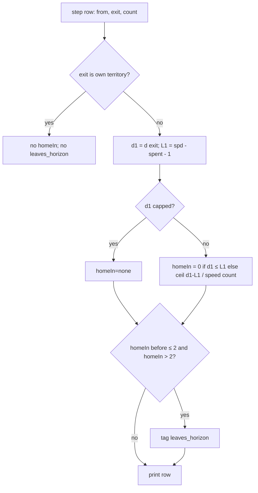

# byok-opening-horizon — say how far home is, in turns

**Packet:** [P83 — BYOK opening: say how far home is, in turns](../../design/packets/P83-byok-opening-close-near-home.md)
**Depends on:** P79 (the gate), P80, P75, P82.
**SPEC:** none. **No game rule is added, changed or implied.** Nothing is owed
to SPEC §11. Every new token is a fact the adapter prints about a legal step
or about the seat's own stack.
**Layer:** `packages/web` only:
- `byokBot.ts`: the rows, the tips line, the legend, and the replies on
  `LlmBotTurn`;
- `docs/byok-teaching.md`: one tag name;
- `packages/web/bench/src/match.ts`: the `byokTurns` record.

There is no `contracts`, `rules-core`, `geometry-*` or `online-api` change,
and no new port method. **The heuristic seat is untouched**: `opponent.ts`,
`botEvaluate.ts`, `botFinish.ts` and `botSearch.ts` are read-only here.
**Features:** [core](./byok-opening-horizon.core.feature) ·
[edge cases](./byok-opening-horizon.edge-cases.feature)

**Counts:** 17 scenarios (7 core, 10 edge) · 9 invariants · 0 SPEC §11 items.

**Arm discipline.** P83 is one arm, measured as an increment over main
(P80 + P75 + P81). Nothing else in the offer, the header, the teaching or the
reply contract changes. Any extra change contaminates the measurement.

## Purpose

In P82 the BYOK seat lost every long game on production. Its opening walked
one stack away from home with nothing to close
([results](../../research/byok-long-game.md)). The offer told it the distance
home in grain steps (`tipDist=a→b`), which hides the two things that
matter:

- **How many of this portion's turns that is.** A 3-stack walks 2 arrows a
  turn, so `tipDist=9` is 5 turns of an exposed trail.
- **Whether the number is a distance at all.** `17` is `DIST_CAP + 1`, the
  "nothing within 16" sentinel. It printed as an ordinary number for runs of
  up to 31 turns.

P83 prints the distance home in turns. It marks the one step that carries a
portion past a 2-turn horizon. It prints `none` for the sentinel. For each
exposed tip, it shows what landing home by the shortest walk would claim.

## Terms

| Term | Means here |
|---|---|
| **own territory** | `state.territory.get(arrow) === me` |
| **d(x)** | `distanceToTerritory(geometry, state, me, x)`, the existing grain BFS (`DIST_CAP` = 16). **Capped** when `d(x) > DIST_CAP` |
| **portion speed** `spd` | what `portionSlot` already prints: `from`'s `speedOverride` if set, else `speed(count)` |
| **later-turn speed** `v` | `speed(count)`. An override is a this-turn fact, so later turns use the plain speed |
| **left before** `L0` | `spd − spent` (`spent` from `from`'s group, 0 if none) |
| **left after** `L1` | `L0 − 1`: the steps this portion still has this turn after the row's step |
| **turnsHome(d, L, v)** | `none` if `d` is capped. Else `0` if `d ≤ L`. Else `⌈(d − L) / v⌉` |
| **homeIn** (row) | `turnsHome(d(exit), L1, v)` |
| **homeIn before** (row) | `turnsHome(d(from), L0, v)`. It is `0` when `from` is own territory |
| **H** | the horizon, **2** turns |
| **crossing step** | a row with `homeIn before ≤ H` and `homeIn > H`, where `none` counts as > H |
| **exposed tip** | an own stack on an own trail arrow, as the existing `Exposed tips:` line lists them |
| **shortest walk home** | `homewardPath(geometry, state, me, tip)`: the BFS path, start included, landing excluded |
| **ifHome claim** | the set `C` = (own trail ∪ walk ∪ `rules.enclosedBy(own ∪ trail ∪ walk, me)`) minus own territory. Land `L` = \|C\|. Shares `S` = the number of arrows in `C` that border a spawner vertex. An arrow bordering two vertices counts once per vertex, as `shareCount` does |

## Decisions (BSSN, recorded here)

1. **Which rows get `homeIn=`.** Every step row whose exit is **not** own
   territory: trail rows and `leave_home` rows. A row whose exit is own
   territory has landed, so it gets nothing; this covers `onto_home`,
   `closes`, `land_bridge` and `to_edge`. The value is computed from the
   pre-step state, the same as `tipDist`.
2. **Where it prints.** `homeIn=<t>` goes immediately after the distance slot
   (`tipDist=a→b` or `edgeDist=a→b`) and before `trailLen=`.
3. **Unit and speed.** Turns of this portion. This turn's remaining steps
   (`L1`) count first, and later turns walk at `speed(count)`. The packet's
   "including a merge override" is honoured where it applies: an override
   sets `spd`, which sets this turn's `L0`/`L1`. It does not carry into
   later turns, because the engine applies an override to one turn only.
4. **`leaves_horizon`.** A tag on the crossing step only, *H* = 2. It is
   appended to the tag list after `outward`/`homeward` and before
   `onto_home`. It is never on a row whose exit is own territory, because
   such a row has no `homeIn`.
   - *H* = 2 was chosen by measurement. Replaying P82's long150 openings
     (rounds 1–20), crossing steps were 1–8 of 37–41 played BYOK steps per
     cell, and 0 were homeward rows.
   - A non-crossing variant (tag every row with `homeIn > 2`) tagged 167–338
     of 275–372 rows, including 40–146 homeward ones. That is noise.
   - *H* = 3 first fires at r2–r10, which is after most of the damage.
5. **The sentinel prints `none`.** On a row, a capped `d(from)` or `d(exit)`
   prints as `none` inside `tipDist=a→b`, and a capped `homeIn` prints
   `homeIn=none`.
   - On the tips line, a capped `tipDist` prints `tipDist=none` and
     `homeIn=none`, and has no `ifHome=`.
   - `edgeDist` is unchanged. It is P80's slot, and it is not where the
     walk-away failure showed.
   - `homeward`/`outward` keep their numeric inputs (17 compares as before),
     so their tagging is unchanged.
6. **Tips line.** Each `Exposed tips:` entry becomes
   `<arrow> tipDist=<d> homeIn=<t> ifHome=+<L> share+<S> heads=<n>`.
   - `homeIn` there is `turnsHome(d(tip), speed(heads) − spent, speed(heads))`
     for the whole stack, using its override if set, as for a row.
   - `share+<S>` always prints, including `share+0`, so the field has one
     shape.
   - `ifHome=` and `share+` are omitted when `tipDist` is `none`.
   - The tips line keeps its sort order and its "none" text.
   - A tip stack on an own-territory arrow is not a tip, as today.
7. **`ifHome` is a projection.** It is computed for the shortest walk only.
   It never compares walks, names a route, or names a row index. Arrows in
   `C` that another seat holds are counted (a close converts them). Enemy
   heads are not mentioned.
   - It uses `rules.enclosedBy`, which is a query, plus the existing
     `homewardPath`.
   - It is a private helper in `byokBot.ts`. `botFinish.ts`'s claim
     estimate counts enemy ground only and scores it, so it is a different
     quantity. Sharing a helper would change the heuristic's code, which the
     packet forbids.
8. **Legend.**
   - The `LEGAL_MOVES` legend sentence gains, word for word: *homeIn=t: this
     portion's turns until it can land home (0 = this turn, none = beyond 16
     steps); leaves_horizon: this step takes it past 2 turns from home.*
   - The tips line is prefixed, word for word: `Exposed tips (ifHome = claim
     if it walks home now):`.
   - **Amended after phase 3.** The first wording (a 240-character clause and
     a 110-character prefix) alone cost about 8.4 % of a 4,000-character
     prompt, which broke Decision 11 and P75's own ceiling at #34. The budget
     stands, so the text was shortened. Nothing it says was dropped except
     the word "projection", which the tips prefix keeps as "if … now".
   - With no tips, it stays `Exposed tips: none`.
9. **Teaching.** `docs/byok-teaching.md`'s tag-enumeration sentence gains
   `leaves_horizon`. No other prose changes.
10. **Bench hygiene.**
    - `LlmBotTurn` gains `replies: readonly ByokReply[]`, with
      `ByokReply = { plan: string | null; why: string | null }`. It has one
      entry per completion whose reply parsed to a usable batch, in call
      order.
    - Each text is the reply's `plan` / `why` value when it is a string,
      sanitised by the adapter's `sanitizePlan` (one line, capped at
      `PLAN_CAP`). Otherwise it is `null`.
    - An unusable reply or a failed fetch adds no entry. It is already a
      fallback.
    - `MatchRecord` gains `byokTurns: readonly { at: number; replies:
      readonly ByokReply[] }[]`. `at` is the index in `moves` of that
      seat-turn's first move.
    - A budget-aborted turn is not folded in, so it adds no entry.
    - The redaction still runs last, over the whole body.
11. **Budget.** Offer growth ≤ 10%, measured on the P75 measurement
    positions by `buildUserPrompt` characters. It is recorded in the PR.

## Flow

## Invariants

- **I1** (ubiquitous) The system shall print `homeIn=` on a step row if and
  only if the row's exit is not own territory.
- **I2** (ubiquitous) Every printed `homeIn` shall be `none` or a
  non-negative integer. It shall be `none` exactly when `d(exit)` is capped.
- **I3** (ubiquitous) The system shall print no `17` inside any `tipDist=`
  slot. Either a number ≤ 16 or `none` appears there.
- **I4** (event-driven) When a row is tagged `leaves_horizon`, its
  `homeIn before` shall be ≤ 2 and its `homeIn` shall be > 2 or `none`. When
  a row satisfies that and its exit is not own territory, it shall be tagged.
- **I5** (ubiquitous) For two rows with the same `from` and `exit`, the row
  with the larger `count` shall not print a larger `homeIn`.
- **I6** (ubiquitous) The rows' text, minus the `homeIn=` token,
  `leaves_horizon` and `none` in place of 17, shall equal the pre-P83 text.
  P83 adds and renames tokens. It changes no existing tag.
- **I7** (ubiquitous) The system shall produce identical offer text on
  repeated calls, and identical text under both geometry ports after arrow
  ids are replaced by placeholders, on a position whose distances match on
  both boards.
- **I8** (ubiquitous) Building the offer shall not change the state it reads,
  and shall not change the heuristic seat's choice on any position.
- **I9** (ubiquitous) Every `byokTurns[i].at` shall index a move of the BYOK
  seat that starts its seat-turn. Every reply text shall be `null` or a
  one-line string of at most `PLAN_CAP` characters.

## Out of scope

- The heuristic seat.
- P76's blocks.
- `edgeDist`'s cap.
- Any change to the `plan` contract or the reply JSON.
- Positions-tier records. They are not asked for, and position runs have
  one turn each.
