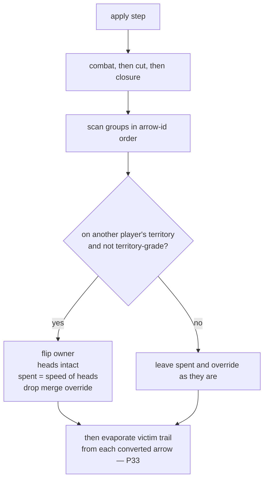

# convert-spent — a converted stack has no step left this turn

**Packet:** [P70 — A converted stack is spent for the capturing turn](../../design/packets/P70-convert-spent.md)
**SPEC:** §6.3, §11 item 40 (spent clause re-resolved by P70), §3 (`speed`)
**ADR:** [0005](../../adr/0005-converted-stack-is-spent.md)
**Amends:** [encirclement](../encirclement/encirclement.md) (`spent` 0 → `speed(heads)`) ·
[encircled-path](../encircled-path/encircled-path.md) (same clause; wipe unchanged)
**Features:** [core](./convert-spent.core.feature) · [edge cases](./convert-spent.edge-cases.feature)

## Purpose

Playtest: a cut converted a raider and the capturer stepped that head away in
the same turn, so the flip never sat on the tile where it happened. The rule
now leaves the stack spent. The adapter shows the colour change in place, and
spectated playback waits until a person can read it.

## Scope

In: `spent` on convert, the ordinary merge that follows, `legalMoves` / `apply`
for that arrow, the conversion overlay's hand-off, the spectated gap, and
framing a converted stack that is outside the shot.

Out: who converts, convert wipe, self-convert legality, vanish, the ordinary
400 ms gap, tutorial pacing, a banner, locking the human's own clicks.

Rules tests run against `RulesPort` and `speed`. Presentation tests call pure
helpers and read the stylesheet. No new port method. No React Testing Library.

## Terms

| Term | Means |
|---|---|
| **convert** | ownership flips to the territory owner; heads unchanged; `spent` becomes `speed(heads)`; no merge override |
| **speed** | the group's allowance, `1 + floor(log2 heads)` (§3) |
| **capturing turn** | the turn of the `apply` that converted the stack |
| **hand-off** | four equal beats on the converted tile: old colour, new colour, old colour, hold on the new colour |
| **conversion hold** | 500 ms of stillness after the hand-off has settled, spectated playback only |
| **shot** | the central `SAFE_BOX` of the current viewport |

Do not say *exhausted*, *stunned*, or *boxed*. A box is a group with no legal exit.

## How a convert spends the stack

`endTurn` still sets every group's `spent` to 0 and drops every override. The
next time the capturer plays, the stack's allowance is its plain speed.

A merge onto the stack in the capturing turn uses the existing landing rule:
the destination's `spent` is kept, the arrival's spending is discarded, and the
override is recomputed. Because `spent` is already the old speed, and a merge
sets the allowance to 0 or 1, the merged group still has no step.

## Hand-off

Same event (`unitsConverted`), same overlay kind (`conversion`). Offset stays
300 ms. Duration becomes 700 ms. Every stack that one step converts shares that
offset. No stagger.

The overlay paints the tile and the head count. Old beats use the previous
owner's fill and ink. New beats use the new owner's. The outgoing plate is
fully opaque on old beats and fully transparent on new beats, and its 100%
keyframe is transparent, so the committed new colour remains. The un-animated
plate is transparent, so reduced motion shows the new colour at once. The same
transparent plate holds through the 300 ms offset; the beats start when that
offset ends, and they step from one colour to the next. There is no ring in
the new owner's accent.

This is not flicker-then-fade. Vanish dips a ghost and fades it out. The
hand-off never fades the head away.

## Spectated gap and framing

Spectated playback is P48's predicate: a local AI seat, or an online move-log
replay. Hot-seat and the human's own turn are not spectated.

| Playback | Step converted a stack | Gap before the next spectated step |
|---|---|---|
| spectated, motion on | yes | 1500 ms (`300 + 700 + 500`), unscaled |
| spectated, reduced motion | yes | 500 ms, unscaled |
| spectated | no | `400 / playbackSpeed`, as today |
| not spectated | either | the ordinary scaled gap; no conversion hold |

When any converted centroid is outside the shot, the camera eases to
`groupTarget` of the step's arrow centroids plus those converted centroids
(`SAFE_BOX`, hard cut when the padded half-diagonal exceeds `FIT_CAP_RADIUS`).
The hand-off does not start until that ease finishes. The ease scales with
playback speed. When every converted centroid is already inside the shot, the
target is unchanged and there is no ease.

Several stacks converted by one step share that one fit and the one hand-off.

## Invariants

- When a group converts, the system shall set its `spent` to `speed` of its heads and shall drop any merge override.
- While the capturing turn has not ended, the system shall offer no step from a converted group's arrow.
- When the capturing turn ends, the system shall clear that group's `spent` along with every other group's.
- When a friendly group merges onto a converted group during the capturing turn, the system shall keep the destination's `spent`.
- The system shall not change the `spent` of a group that did not convert on that apply.
- When conversion runs, the system shall conserve the total head count.
- When a spectated step converts a group, the system shall not start the next spectated step until the hand-off has settled and the conversion hold has elapsed.
- When a converted group lies outside the shot, the system shall frame it before the hand-off begins.
- The system shall not present a conversion as flicker-then-fade.

## Counts

- Scenarios: 10 core, 14 edge.
- Invariants: 9.
- §11 item 40 spent clause re-resolved here and in SPEC.md. No new §11 gap.
