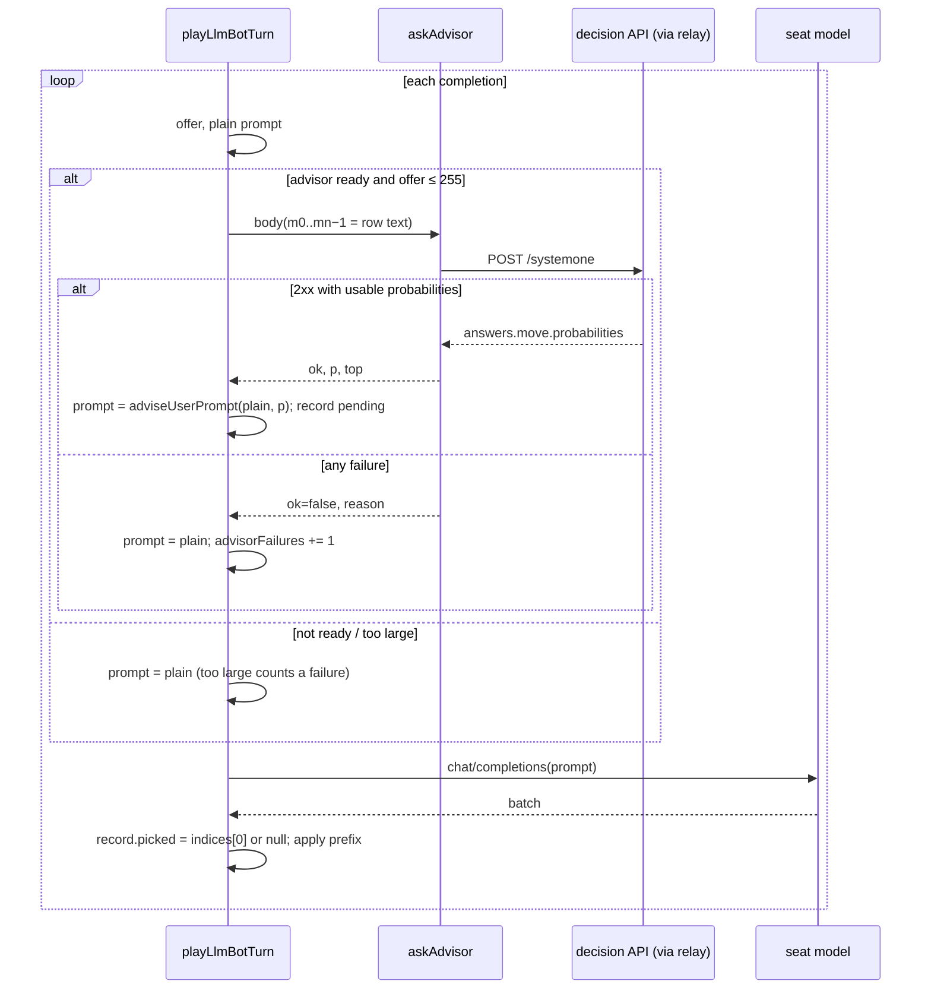

# decision-api-advisor — a decision API advises a BYOK seat

**Packet:** [P72 — Decision-API advisor on a BYOK seat](../../design/packets/P72-decision-api-advisor.md)
**ADR:** [0006](../../adr/0006-decision-api-advisor.md). The shape is decided there.
This spec makes it executable.
**Depends on:** P15 (BYOK seat), P32 (match summary), P79 (the gate). Built on
main after P81.
**SPEC:** none. **No game rule is added, changed or implied.** Nothing is owed
to SPEC §11.
**Layer:** `packages/web` adapter only. No `contracts`, `rules-core`,
`geometry-*`, `online-api` or `mcp` change, and no port method.
**Features:** [core](./decision-api-advisor.core.feature) ·
[edge cases](./decision-api-advisor.edge-cases.feature)

**Counts:** 23 scenarios (11 core, 12 edge) · 10 invariants · 0 SPEC §11 items.

**Arm discipline.** P72 is a P79 arm, measured as an increment over main.
With the advisor **off**, nothing changes: not the request, not the prompt,
not the log. Any drift there would contaminate the measurement and the
unadvised half of every comparison.

## Terms

| Term | Means here |
|---|---|
| **offer** | `movesForLlm(rules.legalMoves(at))` for one completion, in engine order; row `i` is `[i]` in the prompt |
| **plain prompt** | `buildUserPrompt(...)` exactly as today |
| **row text** | the text of offer row `i` in the plain prompt's `LEGAL_MOVES` block, without its `[i] ` prefix |
| **state prefix** | the plain prompt up to, not including, the line beginning `LEGAL_MOVES` (no trailing blank line) |
| **advised completion** | a completion whose advisor call succeeded |
| **top** | the lowest index `i` attaining the maximum probability |
| **picked** | the first index of the parsed reply batch for that completion, or null |

## Seams (names fixed here so phases 2 and 3 agree)

- `packages/web/src/byokConfig.ts`
  - `AdvisorConfig {enabled, baseUrl, apiKey, model}`.
  - `DEFAULT_ADVISOR = {enabled: false, baseUrl: 'https://api.typesafe.ai/v1', apiKey: '', model: 'jev-latest'}`.
  - `isAdvisorReady(c)`: enabled, and all three strings non-empty after trimming.
  - `systemOneUrl(baseUrl)` → `${trimmed base without trailing /}/systemone`.
  - `ByokConfig.advisor: AdvisorConfig`, with `DEFAULT_BYOK.advisor = DEFAULT_ADVISOR`.
  - `'api.typesafe.ai'` joins `BYOK_UPSTREAM_ALLOWLIST`.
- `packages/web/src/seatPlan.ts`: `SeatByokFields.advisor: AdvisorConfig`,
  parsed with defaults, carried by `byokFieldsFromConfig` / `byokConfigForSeat`.
- `packages/web/src/advisor.ts` (new; the I/O leaf and its pure helpers):
  - `ADVISOR_MAX_OPTIONS = 255` and `ADVISOR_TIMEOUT_MS = 10_000`.
  - `ADVISOR_LEGEND`: the legend line, verbatim below.
  - `advisorRequestBody(advisor, me, systemPrompt, plainPrompt, offerSize)`,
    which returns the JSON body.
  - `askAdvisor(byok, body, offerSize, fetchImpl)` →
    `Promise<{ok: true, model, probabilities, top} | {ok: false, reason}>`.
  - `adviseUserPrompt(plainPrompt, probabilities)`, which returns the advised prompt.
- `packages/web/src/byokBot.ts`: `LlmBotTurn` gains `advisorRecords`,
  `advisorFailures` and `advisorLastError`. The values are `[]`, `0` and
  `undefined` when the advisor is off.
- `packages/web/src/matchLog.ts`:
  - `AdvisorRecord` and `LoggedAdvisorRecord`.
  - `MatchLog.advisorRecords?`.
  - `withAdvisorRecords(log, records, movesBefore)`.
  - `formatMatchSummary(summary, advisorRecords?)` and
    `matchSummaryLine(over, summary, advisorRecords?)`.
- `App.tsx` threads a BYOK turn's records into the log, using the moves
  logged before that seat-turn. `Lobby.tsx` shows the toggle and the fields.

## Decisions (BSSN, recorded here)

1. **Per seat, persisted with the seat plan.** The advisor is configured like
   the seat's own key, per browser profile. A saved plan without `advisor`
   parses to `DEFAULT_ADVISOR` (off). A non-boolean `enabled` parses as off,
   and a non-string field takes its default.
2. **Toggle keeps the fields.** Unchecking sets `enabled: false` only.
3. **Not ready means off.** `isAdvisorReady` false → no call, no failure
   counted, and nothing blocks Start.
4. **When it is asked.** Once per completion, after the plain prompt is built
   and before that completion's chat POST. Each completion re-asks on its own
   offer.
5. **Body.**
   - `model` is the advisor model, trimmed.
   - `state` is `systemPrompt + '\n\n' + statePrefix`. The system prompt is
     `buildSystemPrompt(me, reasoning)`, the same string the chat call sends.
   - `questions` holds one key, `move`:
     `{type: 'choice', instructions, criteria}`.
     - `instructions` is `You are advising seat <P> in Conquarrow. Which single legal step should seat <P> play next to make the most progress toward winning?`
     - `criteria` maps `m0 … m<n−1>` to row text, inserted in index order.
   - No other fields.
6. **Transport.**
   - **URL.** POST to `systemOneUrl(advisor.baseUrl)`, through the same relay
     resolution as the seat (`resolveByokProxyUrl(byok)`). With a relay, the
     URL is the relay and `X-Arrows-Byok-Upstream` carries the System One URL.
   - **Headers.** `Content-Type: application/json` and
     `Authorization: Bearer <advisor key, trimmed>`. The seat's key is never
     sent to the advisor, and the advisor's key is never sent to the seat's
     model.
   - **Timeout.** The init carries `signal: AbortSignal.timeout(ADVISOR_TIMEOUT_MS)`.
7. **Reading the reply.** Read `answers.move.probabilities`. For each `i`,
   `p_i` is the value at `m<i>` if it is a finite number, else 0. `model` is
   the reply's top-level string `model` if present, else the configured
   model. Unknown keys are ignored.
8. **Failure, which leaves the completion unadvised.**
   - Any of:
     - the fetch throws, including the timeout's abort;
     - the status is not 2xx;
     - the body is not JSON;
     - `answers.move.probabilities` is not an object;
     - no `m<i>` maps to a finite number.
   - **Reasons.** `fetch failed: <message>`, `HTTP <status> from <System One URL>`,
     `response was not JSON`, `missing answers.move.probabilities`,
     `no usable probabilities`. None of them ever include a key.
   - **Effect.**
     - The completion uses the plain prompt.
     - `advisorFailures` goes up by 1, and `advisorLastError` takes the reason.
     - No record is kept, and the turn continues.
9. **Over the cap.** An offer of more than `ADVISOR_MAX_OPTIONS` rows makes no
   call. It is unadvised, counts as a failure, and has reason
   `offer too large (<n> > 255)`.
10. **The advised prompt.**
    - **Legend.** `ADVISOR_LEGEND` =
      `advisor=p on a row is an independent decision model's probability that the row is the best next step. It is advice; you choose.`
      It is inserted as its own line directly after the `LEGAL_MOVES …` header
      line.
    - **Rows.** Every offer row line `[i] …` gets ` advisor=<p_i.toFixed(2)>`
      appended.
    - **Everything else.** No other line changes.
11. **Records.** An advised completion yields one record:

    ```ts
    {
      seat,
      turnMoveIndex: movesAppliedThisSeatTurnSoFar,
      model,
      offerSize,
      top,
      probabilities: p.map(x => Math.round(x * 1000) / 1000),
      picked,
    }
    ```

    `picked` is set after the reply is parsed: `indices[0]` if the batch
    parsed and is non-empty, else null. A failed chat fetch also gives a
    record with `picked: null`, because the advisor did answer.
12. **Log.**
    - **Writing.** `withAdvisorRecords(log, records, movesBefore)` appends
      each record with `at = movesBefore + turnMoveIndex`, in completion
      order. With zero records it returns the log unchanged, so the key stays
      absent.
    - **Loading.** `loadLastMatchLog` tolerates its absence.
13. **Summary line.** `formatMatchSummary(summary, records)` appends
    ` · advisor agreed <a>/<n>` iff `records` is non-empty, where
    `a = count(picked === top)` and `n = records.length`.
    `matchSummaryLine` passes the log's records through.
14. **Lobby.**
    - A local BYOK seat's block gets a checkbox labelled `Advisor (decision API)`.
    - When it is checked, three inputs follow: `Advisor base URL`,
      `Advisor API key` (`type="password"`) and `Advisor model`.
    - Unchecked, the inputs are hidden but their values kept. Online seats
      never show any of it.

## Flow



## EARS invariants

1. **Off is identity.** *While* the advisor is not ready, the chat request
   bodies, the prompts and the returned moves *shall* equal those of a config
   with no advisor, and no advisor POST *shall* be made.
2. **Order kept.** The advised prompt *shall* differ from the plain prompt
   only by the legend line and one ` advisor=d.dd` suffix per offer row. Its
   row indices, row order and every other line *shall* be equal.
3. **One call per completion.** *When* the advisor is ready and the offer has
   at most 255 rows, the seat *shall* make exactly one advisor POST before
   each chat POST.
4. **Options are the offer.** `criteria` keys *shall* be exactly `m0..m<n−1>`
   for an offer of `n` rows, and each description *shall* equal that row's
   text in the plain prompt.
5. **Failure is silent.** *If* an advisor call fails, *then* the seat's moves
   *shall* equal those it plays when unadvised against the same model replies,
   and the turn's `llmFallbacks` *shall* be unaffected.
6. **Deterministic top.** `top` *shall* be a pure function of the
   probabilities: the argmax, with ties to the lowest index.
7. **Records match advice.** The turn's record count *shall* equal its number
   of advised completions.
8. **No secrets.** No advisor key or seat key *shall* appear in a record, the
   match log, `advisorLastError`, or any prompt.
9. **Replay ignores advice.** Replaying a log with `advisorRecords` *shall*
   reproduce the same final state as the same log without them.
10. **Pure core untouched.** No file under `packages/rules-core`,
    `packages/contracts` or `packages/geometry-*` *shall* change.
