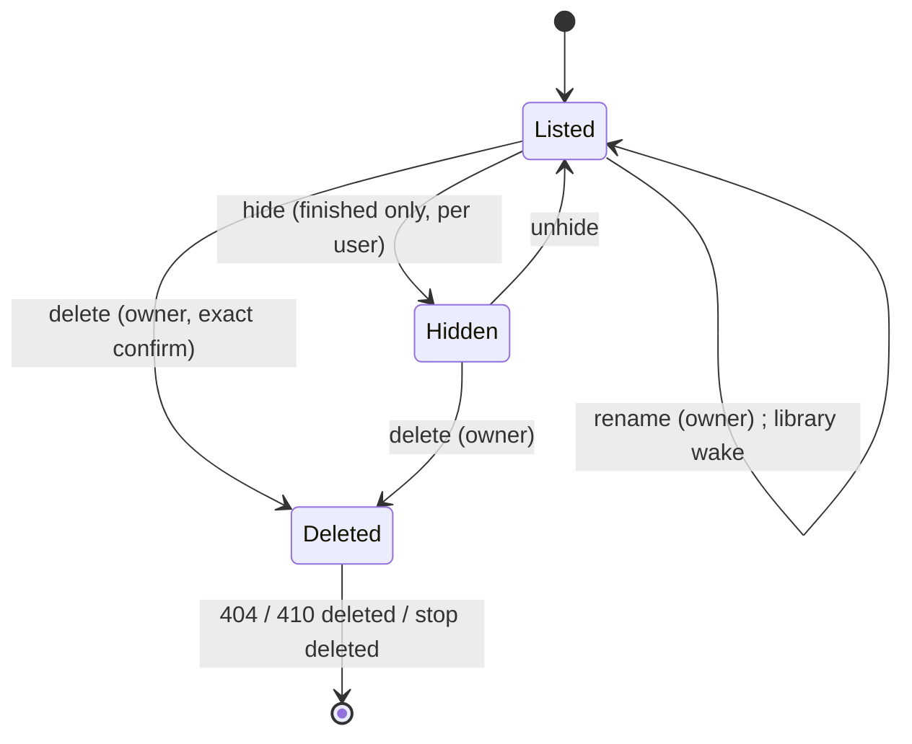

# game-management — the server's match export, and naming, deleting, hiding and listing games

**Packet:** [P96 — Match export and game management](../../design/packets/P96-game-management.md)
**SPEC:** no game rule is read or changed. Leaving (resigning) a game that is
still being played would be one, so it is not here.
**Builds on:** [P45 online-game-library](../online-game-library/online-game-library.md),
[P46 online-library-identity](../online-library-identity/online-library-identity.md),
[P49 online-move-log-replay](../online-move-log-replay/online-move-log-replay.md),
[P92 remote-agent-mcp](../remote-agent-mcp/remote-agent-mcp.md),
[P95 online-reliability](../online-reliability/online-reliability.md).
**ADR:** [0012 — a game has an owner; delete is permanent, hide is per user](../../adr/0012-game-owner-delete-hide.md).
**Layer:** `packages/contracts` (game names, library rows, the export, the
library wake, the pages port), `packages/online-api` (export, delete, hide,
rename, the listing, meta stamps, the MCP `export` tool), `packages/web`
(`online-pages.ts`, `online-host.ts`, `online-parse.ts`, `online-shell-ui.ts`,
`Lobby.tsx`, `Hud.tsx`, `App.tsx`), `infra/template.yaml` (four routes).
**Features:** [server core](./game-management.server.core.feature) ·
[server edge cases](./game-management.server.edge-cases.feature) ·
[web core](./game-management.web.core.feature) ·
[web edge cases](./game-management.web.edge-cases.feature) ·
[sequence diagrams](./SCENARIOS.md)

## Purpose

Playtest P95 ended with a Download log that held three moves and the wrong
seats: the online game exported the browser's own session (`vsBot: true`,
`botSeat: "A"`), which a re-login had emptied. The lobby's My games list only
grows, holds junk playtests nobody can remove, and names every game by a hash
and a number. This packet makes the server's log the export, and gives the
lobby a list a person can use: names, an owner who can delete, a per-user
hide, and sections sorted by activity.

## Terms

| Term | Means |
|---|---|
| **owner** | the user who created the invite the game started from (`creatorUserHash`) |
| **member** | a user bound to a human seat of the game, or the owner of a bound agent seat (P92) |
| **export** | the server's record of one game: config, seats, every log line, moves, summary |
| **own seat** | a seat bound to the caller, human or agent |
| **section** | where a library row is listed: `your-turn`, `waiting`, `finished` |
| **hidden** | a finished game one member has taken out of their own list |
| **game name** | an optional label, 1–48 characters after normalising (D6) |
| **last activity** | the server clock at the last persisted version of the game |
| **library wake** | `{type: "libraryChanged", groupHash, gameNumber, change}` sent after a delete or a rename |

## Decisions (online/web BSSN, recorded here)

### D1 — the export route

`GET /games/{g}/{n}/export` answers a member with 200 and the export below; a
non-member 403, an unknown game 404, no sign-in 401. It reads the game through
the P95 heal (`ensurePosition`), so what it exports is what `GET` serves.

```
{
  format: "conquarrow-online-export", formatVersion: 2,
  groupHash, gameNumber, name?, startedAt?, lastActivityAt?, exportedAt,
  config: MatchConfig,            // the config the server opened the game with
  seats: [{ seat, player, kind: "human"|"agent"|"heuristic", name, owner? }],
  version, activePlayer, winner?, turns,
  summary?,                       // P95 D4, finished games only
  moves: Move[],                  // every move in the log, in order
  log: ({ v?, at?, seat?, by?, move, events? } | { v, at?, seat?, agentReply })[],
  withheldReplies: number
}
```

- The log entries' fields and the version-2 changes are
  [match-log-v2](../match-log-v2/match-log-v2.md) D3–D6.
- `config` is the object the server passes to `makeMatch` (its
  `DEFAULT_MATCH_CONFIG` with the seat count), read from the same function
  that opens games, never restated. `replay(makeMatch(config), moves)` is the
  served state.
- `seats[i].name`: a human seat's profile name, else `Player A`…; a heuristic seat
  `AI`; an agent seat `Agent`, with `owner` its owner's profile name when
  known. No user hash, Google `sub` or email is in the export.
- `exportedAt` is the server clock; `startedAt` and `lastActivityAt` come from
  the meta (D7) and are omitted when the meta predates them.
- No field of the local match log appears (`vsBot`, `botMode`, `humanSeat`,
  `botSeat`, `byokStats`): they describe a browser session, not a game.

### D2 — agent replies in the export

An agent's reply record carries the seat that sent it (its shape is
[match-log-v2](../match-log-v2/match-log-v2.md) D4). While the game has no
winner the export holds only the reply records of the caller's own seats;
every other reply record (another seat's, or one written before P96 with no
`seat`) is left out and counted in `withheldReplies`. Once the game has a
winner every record is exported and `withheldReplies` is 0. An agent's
`why` and `plan` are its plan against the other seats; a rival should not
read them mid-game.

### D3 — the export over MCP

The agent door gains a fourth tool, `export {handle}`. It answers the same
export (D1, D2) from the same builder as the JSON block of the result. The
caller is the agent's user (its owner, P92), so its own seats are the same
seats the owner's browser export counts as its own. It answers `stop` with the reason
the other tools use (`not-seated`, `not-started`, `deleted`) when there is no
game to export. `observe` and `move` add the game's `name` to their JSON block
when it has one. The offer text and the map (the builder MCP and BYOK share,
`agentContext`) do not change, so BYOK and MCP still read the same offer.

### D4 — the owner

The game meta gains `ownerUserHash`, copied from the invite's
`creatorUserHash` at Start. A meta written before P96 has none; its owner is
then read from the invite record its `inviteToken` names. A game with neither
has no owner, and no one may delete or rename it. `GET` of a game and every
library row carry `owner: true` for the owner and `false` otherwise; the hash
itself is never served.

### D5 — delete

`POST /games/{g}/{n}/delete` with body `{"confirm": "Yes, permanently delete this game"}`.

- No sign-in 401; unknown game 404; a caller who is not the owner 403; a body
  whose `confirm` is not exactly that phrase 422. The phrase is the same text
  the lobby's confirm button shows (`DELETE_GAME_CONFIRM` in contracts).
- It deletes every object under `groups/{g}/games/{n}/` (meta, state, log),
  every member's hidden pointer for the game, and every bound user's lobby
  pointer for its invite; it rewrites the invite with status `deleted`; and it
  deletes a member's group pointer when the group then holds no game.
- Then it sends every connection of every member the library wake with
  `change: "deleted"`, and answers 200 `{deleted: true}`.
- Afterwards the game's routes answer 404, `GET /invites/{t}` answers 410
  `{reason: "deleted"}`, and the agent door answers `stop` `deleted`.
- The meta goes first, so a delete that stops partway leaves a game no route
  serves; repeating the delete then answers 404, and the rest stays as S3
  litter, not as a half-visible game.

### D6 — game names

`normalizeGameName(value)` in contracts decides every name, on the server and
in the lobby:

- absent, `null` or a string that is empty after normalising → no name (clear);
- a string: Unicode NFC, trimmed, every run of white space one space; then at
  most `GAME_NAME_MAX` (48) code points, each a letter, a mark, a digit, a
  space or one of ``- _ . , : ; ! ? ' " ( ) # & + / @``;
- anything else (another type, too long, another character) is invalid.

`POST /invites` takes an optional `name`; an invalid one answers 422. The
invite record keeps it, `GET /invites/{t}` serves it, and Start copies it to
the game meta. `POST /games/{g}/{n}/name` with `{name}` sets or clears it: the
owner only (403 otherwise), 422 on an invalid name, then the library wake with
`change: "renamed"`, and 200 `{name?}`. The name is served on `GET` of the
game, on every library row, in the export, and in the agent door's JSON block.
A game with no name is shown as `Game {gameNumber}`.

### D7 — activity and turns on the meta

Every persist of a version (`persistPosition`) stamps the meta with
`lastActivityAt` (ISO-8601 of the server clock) and `turns` (the `endTurn`
moves in the log, P95's `turnsInLog`) beside P45's summary fields. A meta
from before P96 has neither until its next version; its rows sort by
`startedAt` and show no turn.

### D8 — the listing

A library row (`StartedGameRow`) gains `section`, `name?`, `lastActivityAt?`,
`turns?`, `activeSeat?` (the seat to move, while there is no winner),
`winner?` (`{seat, label}`), `owner` and `hidden`. `section` is `your-turn`
or `waiting` for P45's statuses of the same names and `finished` for `won`
and `lost`.

Rows sort by section (your-turn, waiting, finished), then by last activity
(`lastActivityAt`, else `startedAt`) newest first, rows with neither last,
then by group hash ascending and game number descending.

`GET /my-games` answers `{lobbies, games, counts}`: `games` holds every
your-turn and waiting row and the first `FINISHED_PAGE` (10) finished rows;
`counts` is `{your-turn, waiting, finished, hidden}`. Hidden rows are in no
section and in no count but `hidden`.

`GET /my-games?section=S&offset=O&limit=L` pages one list, where `S` is a
section or `hidden`, `O` a non-negative integer (default 0) and `L` 1–50
(default `FINISHED_PAGE`). It answers `{section, offset, limit, total, games}`.
Any other `section`, `offset` or `limit` is 422.

### D9 — hide

`POST /games/{g}/{n}/hide` with `{hidden: true|false}`: any member; 401, 404,
403 as the other routes; 422 for a body without a boolean `hidden`; 409
`{reason: "not-finished"}` when hiding a game with no winner (a game still
being played stays in the list of everyone who may be asked to move).
It writes or deletes `users/{h}/hidden/{g}/{n}` for the caller only and
answers 200 `{hidden}`. It wakes no one.

Leaving a game that is still being played is not offered: a seat that leaves
mid-game is a game rule (who plays it, does it lose), and SPEC.md has none.

### D10 — auto-archive

Not built. Finished is collapsed and paged (D8, D11), which keeps the list
short without the server hiding a game nobody asked it to hide. A rule like
"finished more than N days ago" is a backlog item.

### D11 — the lobby

My games lists the three sections, each headed with its count: Your turn and
Waiting open, Finished collapsed until tapped, and Hidden (only when its count
is not 0) collapsed. A section whose rows are fewer than its count shows
"Show more", which pages it (`offset` = rows shown). Each row shows the name,
the seat chips (seat colour, the seat's label, "you" on the caller's seats,
the seat to move marked), the turn (`Turn {turns + 1}` while playing,
`{turns} turns` when finished), the last activity (UTC, P46's format) and,
when finished, `Won by {label}`. Actions on a row: Rename and Delete for the
owner; Hide on a finished row; Unhide on a hidden row. Delete asks first, with
a button whose text is exactly "Yes, permanently delete this game" and a
Cancel. The invite form has an optional Game name field, checked with
`normalizeGameName` as it is typed.

### D12 — the web adapter

The pages port gains:

- `setInviteName(name)`, sent as `name` by `createInvite`;
- `exportGame()`: `GET …/export` for the game on screen, answering the body
  text, or `undefined` on any failure;
- `deleteGame`, `hideGame`, `renameGame`, `loadMoreGames(section)`, each a
  POST or GET then a library refresh;
- `receiveLibraryChanged(payload)`: a deleted game that is on screen clears
  the board and the hash and sets `gameDeleted()`; otherwise the library is
  refreshed and, for a rename of the game on screen, the game is read again;
- `board().name` and `board().owner`, read from `GET` of the game;
- `gameDeleted()`: a `GET` of the game on screen answered 404, or a library
  wake deleted it. The lobby then says "That game was deleted."

The host forwards a socket message of type `libraryChanged` to
`receiveLibraryChanged`, as it forwards `stateChanged`.

In an online game the HUD's Download log saves `exportGame()`'s text as
`conquarrow-{gameNumber}.json` (the name slugged in front when there is one);
a failed export shows "Could not download the log — try again." and saves
nothing. A local match still downloads its local log. The HUD shows the game's
name, when it has one, under the action row.

## Flow



## Invariants (EARS)

1. *Ubiquitous*: The export shall hold every move of the game's log in log order, and replaying them from `makeMatch(config)` shall give the state `GET` serves at the same version.
2. *Ubiquitous*: The export shall hold no user hash, Google `sub`, email, or local-session field.
3. *State-driven*: While a game has no winner, the export shall hold no agent reply record of a seat other than the caller's own seats.
4. *Ubiquitous*: The browser export and the MCP export of one game to one seat shall be built by one builder and be equal but for `exportedAt`.
5. *Unwanted*: If a caller who is not the owner asks to delete or rename a game, then the server shall answer 403 and write nothing.
6. *Unwanted*: If a delete's `confirm` is not exactly "Yes, permanently delete this game", then the server shall answer 422 and write nothing.
7. *Event-driven*: When a game is deleted, every route of that game shall answer as for an unknown game, and every member shall be sent a library wake.
8. *Ubiquitous*: The server and the lobby shall accept exactly the names `normalizeGameName` accepts, and store and show the normalised form.
9. *Ubiquitous*: A hide shall change only the caller's own list.
10. *Unwanted*: If a member asks to hide a game with no winner, then the server shall answer 409 and write nothing.
11. *Ubiquitous*: Library rows shall be ordered by section, then by last activity newest first, and every page of one section shall be a slice of that order.
12. *Ubiquitous*: The online Download log shall save only what the server's export answered.

## Counts

12 invariants · 4 feature files · 5 sequence diagrams.
