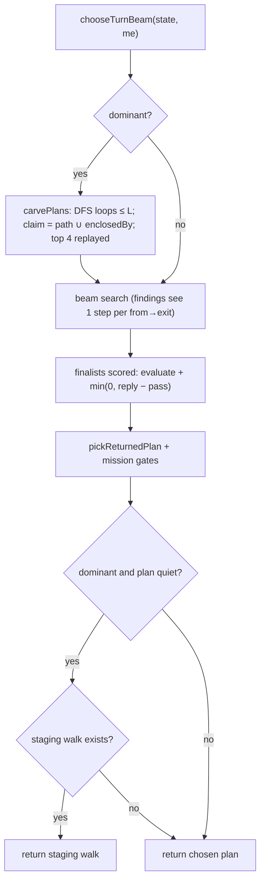

# heuristic-finishes — the heuristic seat turns a winning position into a win

**Packet:** [P81 — The heuristic seat finishes matches](../../design/packets/P81-heuristic-finishes-matches.md)
**Depends on:** P53 (beam), P55 (opponent ply), P57 (campaign), P59 (missions),
P78 (`reach` tier), P79 (`mirror` tier).
**SPEC:** none. **No game rule is added, changed, or implied.** Nothing is owed
to SPEC §11. The win conditions the seat plays toward are SPEC §9 as written
(a seat with no territory is lost; a seat with no share for *N* full rounds
starves).
**Layer:** `packages/web` heuristic seat only — `botSearch.ts`,
`botEvaluate.ts`, `botClose.ts`, `botMission.ts` (`remainingPath`), and a new
finder module `botFinish.ts`. No `contracts`, `rules-core`, `geometry-*`,
`byokBot.ts` or `online-api` change. No port method is added; the finisher
uses the existing `RulesPort.enclosedBy` query.
**Features:** [core](./heuristic-finishes.core.feature) ·
[edge cases](./heuristic-finishes.edge-cases.feature)

**Counts:** 20 scenarios (5 core, 15 edge; outlines count once) · 9 invariants · 0 SPEC §11 items.

## Purpose

No heuristic-vs-heuristic match had ever ended (P79 mirror: 6/6 capped at
400 rounds; P78 grid: 16/16 capped at 100). The packet named two symptoms —
late-game stasis while hoarding, and no finishing drive — and three
hypotheses. The diagnosis below says which held. The fix makes the seat
spend a head surplus on taking the losing seat's ground, under the rules as
they are.

## Diagnosis (recorded before the fix, as the packet requires)

Method: replay the archived P79 mirror moves (`mirror-b6c2c72…-p79-mirror.json`;
a rerun on `main` `6e0cee3` reproduces every cell move for move) to the start
of a seat's turn, call `chooseTurnBeam`, and instrument the search's complete
plans, apply count and selection. Seed 1, first seat (the hoarder):

| round | heads (me / them) | legal steps | applies used | complete plans | returned |
|---|---|---|---|---|---|
| 60 | 91 / 1 | 273 | 2000 (cap) | 43 | `[endTurn]` |
| 100 | 215 / 2 | 645 | 2000 (cap) | 19 | 1 step |
| 140 | 336 / 2 | 1006 | 2000 (cap) | 2 | 1 step |
| 160 | 403 / 5 | 1209 | 2000 (cap) | 7 | `[endTurn]` |

Seed 3's dominant seat at round 250 (1,046 heads): 3,136 legal steps, **one**
complete plan, `[endTurn]`.

- **(a) Horizon shorter than the walk — does not hold as stated.** At round
  160 all 51 of the seat's groups stand on own territory **1–3 arrows from its
  edge**, and 177 legal steps leave territory. There is no long interior walk.
  The horizon *is* short, but for a different reason: **search-budget
  starvation.** `legalMoves` lists every count of every stack, so legal steps
  grow with heads (273 → 1,209). `orderSteps` runs `collectFindings` through the
  beam's capped `RulesPort`, and `collectFindings` applies every legal step.
  The root node alone spends 1,209 of `MAX_APPLIES = 2000`; the first child
  spends the rest. The beam ends at depth ≤ 1 with a handful of plans.
- **Idle wins on a scoring asymmetry.** Only finalist plans are scored after
  the enemy reply; the rest keep their bare `evaluate`. The reply runs to the
  enemy's `endTurn`, which crosses the round boundary, so a finalist's score
  includes the next round's production (+660 at round 60, +1,180 at round
  160). With few plans, the finalist is the evaluate-fallback, and on ties
  `planKey` puts `endTurn` before `step:…`. So `[endTurn]` is scored with a
  free round of income and beats every stepped plan by far more than
  `IDLE_SLACK`.
- **(b) Evaluation rewards hoarding — does not hold.** At round 160 several
  one-step plans *raise* `evaluate` over passing (best +81). Holding heads is
  not valued over a sortie.
- **(c) No finishing objective — holds, once the search works.** With the two
  defects above fixed in a prototype, the dominant seat keeps moving and grows
  its land, but the losing seat keeps 7–16 arrows (with share arrows) to the
  200-round cap in all three seeds. Nothing plans a closure through enemy
  ground, single-turn loops that reach it rarely exist from where the stacks
  stand, and the loser's parked heads block the few that do.

Prototype trajectory (cap 200, mirror seeds 1–3): budget + reply fixes alone →
0/3 end; plus carve plans → 2/3 end (rounds 177, 182); plus the staging walk →
3/3 end (rounds 55, 94, 58).

## Fixture

`packages/web/test/fixtures/mirror-s1.moves.json` — the seed-1 mirror cell's
first 820 moves (P79 config, `spawnerSeed: 1`), taken from the baseline
`mirror` run on `main` `6e0cee3`. Replayed from `makeMatch`, move 382 is the
start of seat A's turn in round 60 and move 820 the start of seat A's turn in
round 160. The core scenarios name it `mirror-s1`.

## Terms

| Term | Means here |
|---|---|
| **dominant** | seat `me` with `heads(me) ≥ FINISH_RATIO × max(1, Σ heads of every other seat)`, and some other seat owns territory |
| **carve** | a path for one own group that starts on own territory, leaves it, and lands back on own territory within this turn — a closure that claims enemy ground |
| **claim estimate** | the path's non-own arrows plus `rules.enclosedBy(own territory ∪ path, me)` — what the landing would paint, computed without `apply` |
| **entry arrow** | an own-territory arrow with an out-arrow (`outArrows(target(·))`) onto another seat's territory |
| **staging walk** | a step sequence that moves one own stack across own territory toward the nearest entry arrow |
| **quiet plan** | a complete plan after which `me`'s territory has not grown, no other seat's territory has shrunk, and no other seat has lost heads |
| **finalist** | a complete plan that P59's `pickFinalists` sends to the P55 reply search |
| **enemy pass** | the same hypothesised chair as the reply (`hypothesiseChair(terminal, enemy)`) followed only by `endTurn` |

## Decisions (BSSN, recorded here)

1. **Findings see one step per (from, exit).** Inside the beam, `orderSteps`
   gives `collectFindings` a `RulesPort` view whose `legalMoves` keeps, for each
   `(from, exit)`, only the step with the **largest** count (`endTurn`
   unchanged). Every beam consumer of findings keys them by `(from, exit)`
   only (`findingRank`, `findingMatches`), so the ranking information is the
   same; the apply cost per node falls from "steps × counts" to "steps".
   `collectFindings` itself, the greedy `chooseMove` path and
   `bestFindingMove` are unchanged.
2. **Reply scores measure the enemy, not the clock.** A finalist's score is
   `evaluate(terminal) + min(0, min over reachable enemies e of
   [evaluate(after e's reply) − evaluate(after e passes)])`. A reply can only
   lower a plan's score, by the damage the enemy's moves do relative to the
   enemy doing nothing over the same turn boundary. Non-finalists keep
   `evaluate(terminal)`. This supersedes P55's "complete ranking uses
   `evaluate` after the reply" clause for `chooseTurnBeam`'s finalists;
   `exposure` (trail lost under the worst reply) is unchanged.
3. **Grain distances to many sources are one BFS.** `nearestOwnGroupDist`
   (`botSearch`), `remainingPath` (`botMission`) and `campaignTarget`
   (`botClose`) take the minimum of a per-source BFS. They use one
   multi-source grain BFS (`grainDistanceFromAny` in `botEvaluate`) with the
   same cap and the same result. Pure performance; no behaviour change.
4. **Dominance gate.** `FINISH_RATIO = 2`. The finisher (5–7) acts only for a
   dominant seat. It reads only the state, so a replay is unaffected.
5. **Carve plans join the search.** For a dominant seat, before the beam
   expands, `carvePlans` adds up to `CARVE_TOP = 4` validated carves to the
   search as **complete plans**. They compete on the normal score (decision 2)
   and pass the normal gates. A carve:
   - starts at an own group on own territory with
     `L = min(speed(heads) − spent, MAX_PLAN − 1) ≥ 2`;
   - follows the grain, never repeats an arrow, takes at most two steps over
     own territory before leaving it, and ends on the first own-territory arrow
     after leaving (the landing);
   - never enters an arrow holding an own group except as the landing, and
     never enters an own-territory arrow holding an enemy group; it may enter
     enemy-held arrows off own territory (an attack);
   - is kept only if its claim estimate holds at least one arrow of another
     seat's territory.
   Candidates are ranked by enemy share arrows claimed (desc), enemy arrows
   claimed (desc), path length (asc), then the path's arrow ids (asc). Each of
   the top four is replayed with `rules.apply`: every step moves all the
   group's heads, or all but one where the full count is illegal (an attack
   from trail must leave one, §6.2). A candidate is dropped if a step is
   illegal or the group does not stand on the arrow it stepped to (it lost the
   fight). `endTurn` is appended while it is still `me`'s turn.
6. **Staging walk when the choice is quiet.** After the existing swaps and
   mission gates, if the seat is dominant and the chosen plan is quiet, the
   seat returns a staging walk instead, when one exists. The walker is the own
   group on own territory, not on an entry arrow, with `heads ≥ 4` and
   `spent = 0`, that minimises `ceil(pathLength / speed(heads))`, then has the
   most heads, then the smallest arrow id. The path is the shortest grain path
   over own-territory arrows (occupied or not) to an entry arrow, searched to
   `DIST_CAP = 16`. The walk takes `min(speed(heads), MAX_PLAN − 1, length)`
   steps with all heads and stops at the first illegal step (a merge
   overrides speed to 1, §3); a walk of zero steps is no staging walk.
   `endTurn` closes it. Merging on the way is intended: the stack snowballs
   at the frontier.
7. **Where the code lives.** Decisions 4–6 are a new pure module
   `packages/web/src/botFinish.ts` (`isDominant`, `carvePlans`,
   `stagingWalk`, `isQuietPlan`), called from `chooseTurnBeamWithBudget` only
   when `withReplies` is true (the live seat; nested enemy replies stay
   P55's small search). `botSearch.ts` gains the wiring, not the logic.
8. **Unchanged.** `chooseMove` (greedy, and the "never pass while a step is
   legal" rule it carries), `evaluate`'s terms and weights, `BEAM`, `BRANCH`,
   `MAX_PLAN`, `MAX_APPLIES`, the P55 reply budgets, every P56–P59 swap and
   gate, `byokBot.ts`, and `online-api`'s `pagesHeuristic` (it calls
   `chooseMove`).
9. **MCP drift.** `packages/mcp/src` keeps its own copy of the bot
   (`opponent.ts`, `botEvaluate.ts`, `botClose.ts`, `botMission.ts`). It is
   parked and is not changed; it now differs from `web` by decisions 1–7.

10. **Packet scenario "the surplus decreases (spent)".** A closure costs no
    heads (§7), so taking ground does not shrink a head surplus; a seat that
    converts its position wins while its heads still grow. The scenario is
    encoded as its intent: from the archived round-160 position, self-play
    ends the match with the dominant seat as winner (core feature, "A won
    position is converted").
11. **Diagnostics stay out of the repo.** The instrumented replay used for the
    diagnosis was a throwaway; the evidence lives in the table above and the
    committed fixture reproduces its positions.

## Flow

## Acceptance (from the packet; thresholds fixed before the change)

Measured with `pnpm byok-bench mirror` (default 400-round safety cap, as in
the baseline run; a cell "ends within 200 rounds" when its `rounds ≤ 200` and
it has a winner) and `pnpm byok-bench reach --round-cap 200`; free tiers
only.

- ≥ 5/6 mirror cells and ≥ 12/16 reach-grid cells end with a winner within
  200 rounds.
- No late stasis: in no mirror cell does a seat take < 20 steps in a 40-round
  window while it holds more heads than its opponent.
- Combat's share of heads lost on the reach grid ≥ 50 %.
- Two runs of each mirror cell give byte-identical move lists.
- Mirror per-turn wall-time mean ≤ 1.5× today's.

Results are recorded in `docs/research/byok-benchmark.md` under "Mirror".

## Invariants

1. The system shall return the same move list for the same `(state, me)` on every call (no clock, no randomness, no iteration-order dependence).
2. When `chooseTurnBeam` returns, every move in the list shall be legal in sequence from `state`, and the list shall end the seat's turn or the match.
3. While a seat is not dominant, the system shall add no carve plan and return no staging walk.
4. When a carve plan is returned, the seat's territory after it shall be larger than before it.
5. When a carve plan is added to the search, its claim estimate shall include at least one arrow of another seat's territory.
6. When a staging walk is returned, every step of it shall start and end on the mover's own territory, and the mover's trail shall be unchanged.
7. If a finalist's enemy reply improves the bot's evaluate relative to the enemy passing, then its score shall equal its unreplied evaluate.
8. The system shall compute `nearestOwnGroupDist`, `remainingPath` and `campaignTarget` with the same results as the per-source BFS they replace.
9. While the beam orders steps at a node, the findings it consults shall be computed from at most one step per `(from, exit)`.
