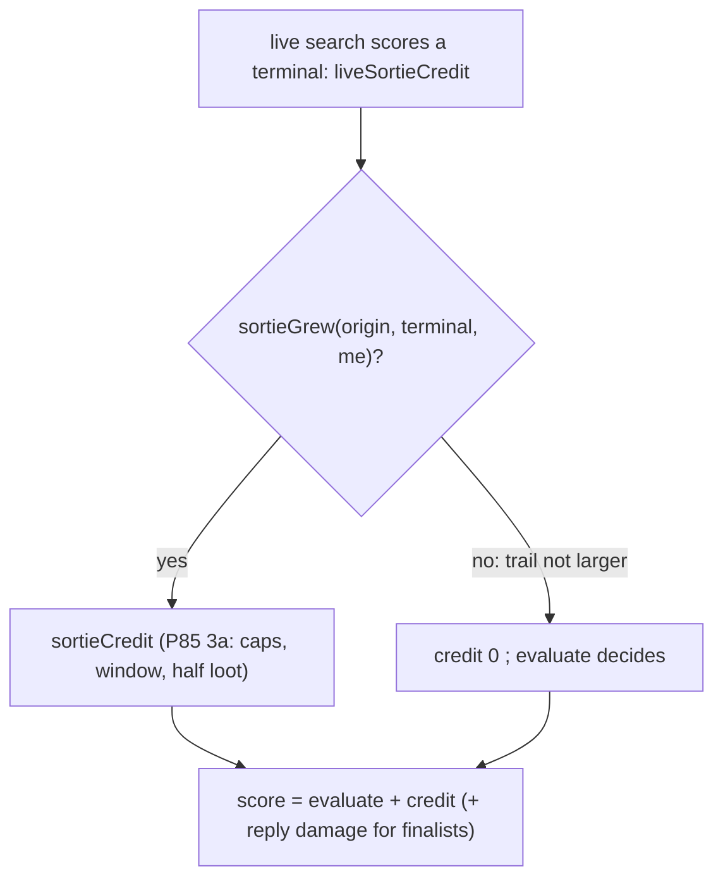

# heuristic-loop-of-doom — sortie credit pays only a sortie that grew

**Packet:** [P91 — The heuristic seat stops walking a ring of its own trail](../../design/packets/P91-heuristic-loop-of-doom.md)
**Depends on:** P85 (decision 3a, the sortie credit; decision 7, the caps),
P84 (never idle).
**SPEC:** none. **No game rule is added, changed, or implied.** Nothing is
owed to SPEC §11.
**Layer:** `packages/web` heuristic seat only: one pure predicate in
`botTempo.ts`, one call in `botSearch.ts`'s `liveCredit`. No port method.
**Features:** [core](./heuristic-loop-of-doom.core.feature) ·
[edge cases](./heuristic-loop-of-doom.edge-cases.feature)

**Counts:** 9 scenarios (3 core, 6 edge; outlines count once) · 4 invariants · 0 SPEC §11 items.

## Purpose

Two playtests saw a heuristic seat walk a short ring of its own trail turn
after turn, never driving home, although home was within one turn's reach.
This spec finds why and removes it without retuning the seat.

## Diagnosis

**Method.** On `main` `229892d`, with an uncommitted trace in
`chooseTurnBeamWithBudget` (the plan after the beam, after
`applyFinalistReplies`, after each stage to `liveReturn`), at the turn after
each fixture's stack entered its ring. Fixtures L1 (playtest 2026-11-06, move
208, A ×4) and L2 (2026-11-07, move 101, B ×2), in the minimal position of
`heuristic-loop-of-doom.support.ts`: no enemy stack or trail, other seats
pass.

**Ruled out.**
- *The horizon.* Home is 2–3 steps from every ring arrow; a ×4 moves 3 a
  turn and a ×2 moves 2.
- *`evaluate`.* The close is legal and large (L1 land 30 → 45, L2 15 → 24,
  trail to 0), and `evaluate` prefers it: L1 1125 against −571 for the ring
  turn, L2 −1201 against −2240.
- *Enemy replies.* There are no enemy heads; each finalist's reply score
  equals its unreplied score.
- *The mission gates, staging and `liveReturn`.* They pass the chosen plan
  through unchanged (only mission: `contest`).

**The cause.** The beam's own ranking picks the close. `applyFinalistReplies`
then rescores every complete as `evaluate + liveCredit`, and `liveCredit` is
P85's sortie credit:

| terminal | land | trail | `evaluate` | sortie credit | score |
|---|---|---|---|---|---|
| L1 ring turn | 30 | 12 | −571 | 3475 | **2904** |
| L1 close home (the shortest path) | 45 | 0 | 1125 | 0 | 1125 |
| L1 best closing complete in the beam (the `contest` finalist) | | | | | 1534 |
| L2 ring turn | 15 | 8 | −2240 | 1512.5 | **−727.5** |
| L2 pass | 15 | 8 | −2240 | 1512.5 | −727.5 |
| L2 close | 24 | 0 | −1201 | 0 | −1105 |

(In L2 the pass ties the ring turn and wins on `planKey`; P53's `swapIdle`
then swaps it for the ring turn, the best stepped complete.)

P85 decision 3a rests on two premises, and a walk on its own trail breaks
both:
1. *"Half, not whole: a pending close is worth less than a banked one."*
   Not here: L1's half credit (3475) is worth more than everything the close
   adds to `evaluate` (1696).
2. *"The total cap is the stateless stopping rule. Once the sortie has spent
   its turns, the credit drops to 0."* The cap reads elapsed =
   ⌈trail size ÷ pace⌉. Walking arrows already in the trail does not grow it,
   so elapsed stays at 4, L stays at 1, elapsed + L = 5 ≤ `SORTIE_TOTAL_CAP`,
   and the credit never drops.

The seat is stateless, so the same position gives the same choice every turn.

**Prototype.** One line in `liveCredit` (return 0 unless the terminal's trail
is larger than the origin's) makes all four skipped tests pass, and the
whole `packages/web` suite stays green under it (142 files, 1794 passed, 5
skipped), P85's sortie and intercept floors included. `mirror` and `reach`
were not run on the prototype.

## Decisions (BSSN, recorded here)

1. **The live sortie credit is paid only to a sortie that grew.** For the
   live seat, a terminal earns `sortieCredit` only when `me`'s trail at the
   terminal has strictly more arrows than `me`'s trail at the search's origin
   (the start of the turn). Otherwise its credit is 0. This keeps P85's aim
   (a plan that extends a sortie toward a larger close is credited) and
   removes the reward for holding a sortie open without extending it, which
   is the only thing a ring walk or a pass can earn it for.
   - "Grew" counts arrows in the trail set, not steps taken: re-walking the
     trail adds nothing, and that is the case this closes.
   - An opening sortie (no trail at the origin, a trail at the terminal)
     grew.
   - A plan that closes part of a sortie and leaves a smaller open trail
     earns no credit; `evaluate` already pays its banked land.
2. **Where it lives.** Two pure exports in `botTempo.ts`:
   - `sortieGrew(origin: GameState, terminal: GameState, me: PlayerId): boolean`;
   - `liveSortieCredit(geometry, origin, terminal, me): number`, which is
     `sortieCredit(geometry, terminal, me)` when `sortieGrew` holds and 0
     otherwise.

   `botSearch.ts`'s `liveCredit` keeps its `withReplies` check and its memo
   (keyed on the terminal; the origin is fixed for the search) and calls
   `liveSortieCredit(search.geometry, search.origin, state, search.me)`.
   `sortieCredit` keeps its signature and P85's EARS 3 unchanged: it still
   prices an open sortie on its own; the gate is about the turn, not the
   sortie.
3. **Unchanged:** `evaluate`, P85's constants, `loot`, P59's threat test
   (`isSortieThreatened`), the nested search (`liveCredit` is already 0
   there), `chooseMove`, `pagesHeuristic`, BYOK, the parked MCP copy.
4. **Not fixed here: the credit's size.** Half the projected loot can exceed
   the land the close banks (premise 1 above). With decision 1, the
   overvaluation can only pull the seat into *extending* a sortie, and
   extending grows elapsed until P85's total cap stops it. The size goes to
   the backlog.

## Terms

| term | means |
|---|---|
| **origin** | the search's start state: the live seat's turn as it begins (`search.origin`) |
| **terminal** | the state after a complete plan (ends in `endTurn` or the match) |
| **trail size** | the number of arrows in `state.trails.get(me)`; 0 when absent |
| **grew** | trail size at the terminal > trail size at the origin |
| **ring walk** | a turn whose steps all land on arrows already in `me`'s trail, so trail size is unchanged |

## Invariants (EARS)

1. When the terminal's trail size is not greater than the origin's,
   `liveSortieCredit` shall return 0.
2. When the terminal's trail size is greater than the origin's,
   `liveSortieCredit` shall return exactly `sortieCredit(geometry, terminal,
   me)`, as before P91.
3. While the search is nested (`withReplies` false), the system shall add 0
   sortie credit, as before P91.
4. `sortieGrew` and `liveSortieCredit` shall be pure and deterministic;
   `sortieGrew` shall read only `me`'s two trail sizes.

## Diagram

## Fixtures

- **L1, L2** — `heuristic-loop-of-doom.support.ts` (`LOOP_FIXTURES`): the
  replayed and minimal positions, already committed.
- **Unit positions**, from L1's minimal position (checked on `229892d`):
  - origin O₀: move 208, trail 9;
  - T₁ = O₀ after the logged turn into the ring (`turnIntoRing`): trail 12,
    `sortieCredit` 3462.5 — grew;
  - O₁ = T₁ after the other seats pass: A's ×4 on `3,0,0`, trail 12;
  - T₂ = O₁ after `step 3,0,0→4,0,2 ×4`, `4,0,2→4,-1,1 ×4`,
    `4,-1,1→3,0,0 ×4`, `endTurn`: trail 12, `sortieCredit` 3462.5 — did not
    grow;
  - `chooseTurnBeamWithBudget(…, O₁, A, { withReplies: false })` returns
    `4,0,0 ×2, 4,0,2 ×2, 5,0,0 ×2, endTurn`.
- `sortieGrew`'s size table uses hand-made states (the trails map only).
