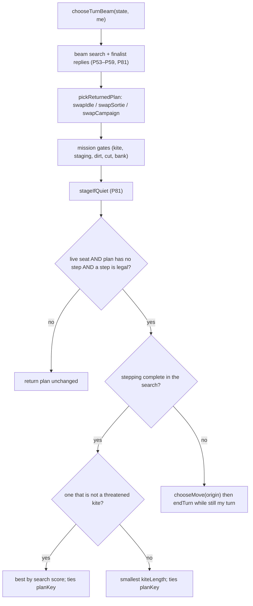

# heuristic-never-idle — the live heuristic seat never passes while a step is legal

**Packet:** [P84 — The heuristic seat never passes while a step is legal](../../design/packets/P84-heuristic-never-idle.md)
**Depends on:** P53 (beam, `IDLE_SLACK`), P59 (mission gates), P65 (quiet-home
pass), P81 (finisher, acceptance harness).
**SPEC:** none. **No game rule is added, changed, or implied.** Nothing is owed
to SPEC §11. Passing (`endTurn`) is legal whenever it is a seat's turn (P04);
this packet only decides when *this bot* chooses it.
**Layer:** `packages/web` heuristic seat only. A new pure module
`botNeverIdle.ts` plus its wiring in `botSearch.ts`. No `contracts`,
`rules-core`, `geometry-*`, `byokBot.ts`, `online-api` or `mcp` change. No port
method is added.
**Features:** [core](./heuristic-never-idle.core.feature) ·
[edge cases](./heuristic-never-idle.edge-cases.feature)

**Counts:** 15 scenarios (5 core, 10 edge; outlines count once) · 6 invariants · 0 SPEC §11 items.

## Purpose

P53 made "never pass while a step is legal" a hard rule for `chooseMove`.
The live seat plays `chooseTurnBeam`, and the beam does not keep that rule.
P81 counted 62 zero-step seat-turns with a legal step in its three mirror
games. A human playtest (2026-11-02) saw a seat pass 11 turns in a row with
3 heads and a legal step every turn. This spec brings the live beam in line
with `chooseMove`: when a step is legal, the turn takes one.

## Diagnosis (recorded before the fix)

**Method.** I added an uncommitted trace to `chooseTurnBeamWithBudget` that
records the search's `best`, `bestStepped`, the plan after each of
`swapIdle`, `pickReturnedPlan` and the five P59 gates, and the plan after
`stageIfQuiet`. Then I walked two move lists on `main` `a16f571`:
- the playtest log `docs/research/playtest-2026-11-02/match-log.json`;
- a fresh `pnpm byok-bench mirror` run (it reproduces P81's games move for
  move).

At every heuristic seat-turn that took no step while
`autoEndTurn.hasLegalStep` held, I re-ran `chooseTurnBeam` on the turn's start
state. **Every case reproduced**: the seat is stateless between turns. Each
case is classified by the first stage that turned a stepping choice into
`[endTurn]`.

| cause | what happens | mirror (per game: s1 / s2 / s3) | playtest |
|---|---|---|---|
| **kite gate** — P59 BSSN 12, "threatened kite, no staging in the beam" (edge 12) | `pickReturnedPlan` returns a stepping plan (`best` *is* stepped; gap 0). Every contest complete is a threatened kite and no staging close exists. So the gate returns "the complete with smallest `kiteLength`, then smaller `planKey`". `[endTurn]` has `kiteLength` 0 and `endTurn` sorts first, so the pass wins. The P59 spec allows this explicitly ("a stop-short / pass that is already in the beam is eligible"). | 1 / 38 / 5 = **44** | A r6–r16 (11), B r26 = **12** |
| **`IDLE_SLACK`** — P53 `swapIdle` | `best` is `[endTurn]`. `bestStepped` exists, but scores lower by 21–205 (> `IDLE_SLACK` = 16), so `swapIdle` keeps the pass. P53 EARS 11 and P65 decided this on purpose for "a lone tip walking onto trail". | 4 / 9 / 5 = **18** | A r35 (gap 147) = **1** |
| beam kept no stepping complete (`bestStepped` undefined) | — | **0** | **0** |
| P81 dominant seat with no staging walk | Not a cause of its own. Seed 3's A at r28–29 (15 and 17 heads, dominant) is the **kite gate**. `stageIfQuiet` then finds no staging walk and keeps the pass. | (inside the kite-gate count) | — |
| anything else (sortie / campaign swaps, other gates) | — | **0** | **0** |
| **total** | | **62 per game** (124 over 6 cells; both seat orders of a seed are the same game) | **13** |

**Who passes.**
- Kite-gate cases are seats with 3–33 heads, 17–39 land, 9–99 legal steps,
  no trail, and `contest` as the only mission.
- `IDLE_SLACK` cases are mostly 1-head seats (3 legal steps), plus seats
  holding a 1-arrow trail under a `cut` mission (s2 A r80–84: 9 heads,
  gap 124).

**No position was found where passing is the only sane play.** The
`IDLE_SLACK` passes are stepped plans that `evaluate` scores lower. The
kite-gate passes are the gate's own fallback, not an evaluation. Neither is a
position where every step is self-destructive. So the packet's escalation
clause does not fire.

**A throwaway prototype** of decisions 2–4 below (no tests, reverted) steps
at all 13 playtest positions. Its mirror and reach numbers are under
"Baselines".

## Terms

| Term | Means here |
|---|---|
| **live seat** | `chooseTurnBeamWithBudget` with `withReplies: true`, i.e. `chooseTurnBeam` and so `playBotTurn` |
| **nested search** | `chooseTurnBeamWithBudget` with `withReplies` false or absent: the P55 enemy-reply search, and tests that call it directly |
| **idle plan** | a returned plan with no step (in practice `[endTurn]`) |
| **step is legal** | `rules.legalMoves(state)` contains at least one `step` (the same test as `autoEndTurn.hasLegalStep`) |
| **stepping complete** | a complete plan of the live search (after P59's finalist reply scoring; carves included) that contains at least one step |
| **search score** | the order the live search already ranks completes by: `replyScore` when present, else `evaluate`, ties `planKey` ascending (`pickBetterComplete`) |
| **threatened kite** | P59's `isThreatenedKite(ctx, plan)`, unchanged |

## Decisions (BSSN, recorded here)

1. **Scope: the live seat.** The guard runs only when `withReplies` is true.
   - Nested searches keep P53 EARS 11 (`IDLE_SLACK` may return `[endTurn]`)
     and P59 edge 12 (a pass may win the least-kite fallback). The enemy
     model the reply search predicts is a different question from what our
     seat plays.
   - For the live seat this **supersedes** P53 EARS 11, the P65
     "`passIsBest` / `passWithManySteps` still return `[endTurn]`" clause,
     and P59 edge 12's "a pass that is already in the beam is eligible".
     Those specs are amended in place with a pointer here.
2. **One guard, at the return seam, last.** After `applyMissionGates` and
   `stageIfQuiet`, if the plan about to be returned has no step and a step
   is legal at the origin, it is replaced (3, 4). If the plan already steps,
   or no step is legal, it is returned unchanged.
   - Why one guard and not a fix per cause: two independent stages (the
     `swapIdle` slack and the kite gate's fallback) each produce the pass,
     and a third (no stepping complete) is possible under the apply cap. A
     per-stage fix leaves the next stage free to reintroduce `[endTurn]`.
     The guard is the only place every path passes through.
   - `swapIdle`, `IDLE_SLACK`, `SORTIE_SLACK`, the P59 gates and the P81
     finisher are left exactly as they are, so a plan that steps today is
     returned unchanged.
3. **The replacement, when a stepping complete exists.**
   - Prefer stepping completes that are **not** threatened kites; take the
     best of them by search score.
   - If every stepping complete is a threatened kite, take the one with the
     smallest `kiteLength`, then smaller `planKey`. This is P59 edge 12's own
     order, restricted to stepping plans.
   - This keeps the kite gate's intent (do not hand the enemy a long
     unanchored trail) without its pass. It also keeps `swapIdle`'s ranking
     (the best-scoring stepped plan) without its slack.
4. **The fallback, when the search kept no stepping complete.** Return
   `chooseMove(origin, me)`'s move. While it is still `me`'s turn and there
   is no winner, follow it with `endTurn`. `chooseMove` returns a step
   whenever one is legal (P53 EARS 12). This was not observed in the
   diagnosis. It is reachable when the apply cap starves the beam (P81's
   diagnosis saw one-complete searches), and the guard must cover it.
5. **Where the code lives.** A new pure module
   `packages/web/src/botNeverIdle.ts` holds the choice in 2–4. It exports
   `neverIdle` and needs no state beyond its arguments. `botSearch.ts`
   gains the call at the return seam and nothing else. `chooseMove`
   (`opponent.ts`) is reused as the fallback, not copied.
6. **Unchanged:**
   - `chooseMove`, `chooseTurnGreedy`, `bestFindingMove`;
   - `evaluate`'s terms and weights;
   - the values of `IDLE_SLACK`, `SORTIE_SLACK`, `BEAM`, `BRANCH`,
     `MAX_PLAN`, `MAX_APPLIES` and the reply budgets;
   - every P53–P59 swap and gate, and the P81 finisher;
   - `byokBot.ts`;
   - `online-api`'s `pagesHeuristic`.
7. **MCP drift.** `packages/mcp/src` keeps a parked copy of the bot. It is
   not changed and now also lacks this guard.
8. **Superseded tests.** These committed tests assert that the live seat
   passes with a step legal. Phase 2 rewrites each one to the new
   expectation (the plan contains a step) and cites P84. They are
   superseded, not deleted:
   - `bot-turn-search.core.test.ts`, "endTurn is chosen while steps remain
     when passing evaluates best";
   - `bot-turn-search.edge-cases.test.ts`, "endTurn is considered even when
     it is not among the BRANCH steps";
   - `mission-and-staging.invariants.test.ts`, "…shall still consider
     endTurn as a complete…" (its `passIsBest` assertion);
   - `mission-and-staging.invariants.test.ts`, "…a 2–3 seat board whose
     one-step terminals evaluate no better than passing shall still return
     [endTurn]…";
   - `mission-and-staging.edge-cases.test.ts`, "3-seat 1-stack
     pass-is-best still returns endTurn".

   The prototype turned exactly these five red across all of
   `packages/web/test` (1,606 others passed). P59's edge-12 least-kite test
   stays green.

   Tests that call `chooseTurnBeamWithBudget` with `withReplies: false` stay
   as they are.
9. **Diagnostics stay out of the repo.** The trace and the prototype were
   throwaways. The evidence is the table above, and the committed fixture
   reproduces the playtest positions.

## Fixture

`packages/web/test/fixtures/playtest-2026-11-02.match-log.json` is a verbatim
copy of `docs/research/playtest-2026-11-02/match-log.json`: a 3-seat config,
`spawnerSeed: 1`, seats A and B heuristic, C human, 616 moves. Replayed from
`makeMatch(config)`, these move indices are the start of the named seat's
turn:

| round | seat | move index | heads / land | legal steps | cause |
|---|---|---|---|---|---|
| 6 | A | 53 | 3 / 8 | 9 | kite gate |
| 7 | A | 60 | 3 / 8 | 9 | kite gate |
| 8 | A | 68 | 3 / 8 | 9 | kite gate |
| 9 | A | 77 | 3 / 8 | 9 | kite gate |
| 10 | A | 86 | 3 / 8 | 9 | kite gate |
| 11 | A | 95 | 3 / 8 | 9 | kite gate |
| 12 | A | 103 | 3 / 8 | 9 | kite gate |
| 13 | A | 111 | 3 / 8 | 9 | kite gate |
| 14 | A | 120 | 3 / 8 | 9 | kite gate |
| 15 | A | 129 | 3 / 8 | 9 | kite gate |
| 16 | A | 138 | 3 / 8 | 9 | kite gate |
| 26 | B | 264 | 5 / 30 | 15 | kite gate |
| 35 | A | 404 | 5 / 28 | 14 | `IDLE_SLACK` (gap 147) |

The logged moves for those 13 turns are a lone `endTurn`. Every other turn of
seats A and B in the log steps; those logged turns are the pre-P84 output for
the "unchanged when it already steps" scenario.

`packages/web/test/fixtures/mirror-s3.moves.json` holds the first 173 moves
of the baseline `mirror` run's `s3-first` cell (`main` `a16f571`, which
reproduces P81's seed-3 game), in the same shape as P81's `mirror-s1`. Moves
167 and 172 start seat A's turns in rounds 28 and 29. There A is dominant
(15 and 17 heads against 4 and 5), `stagingWalk` finds no walk, the logged
turn is a lone `endTurn`, and every stepping complete of the live search is a
threatened kite. So the guard takes decision 3's least-kite branch.

## Flow

## Baselines (measured on `main` `a16f571`, before any change)

Free tiers only. Mirror: `pnpm byok-bench mirror --concurrency 6` (400-round
safety cap). Reach: `pnpm byok-bench reach --round-cap 200 --concurrency 6`.
Both reproduce P81's published "after" numbers exactly: the same mirror
games, and reach 15/16 at 78 %. The reach run carried the inert, uncommitted
diagnostic trace (results file marked `dirty`). It records only when a global
hook is set, and the hook was never set during the run.

| reading | `a16f571` | prototype (throwaway, not the gate) |
|---|---|---|
| mirror: zero-step seat-turns with a step legal (6 cells) | **124** | **0** |
| mirror: rounds / winner (s1, s2, s3; both orders identical) | 55 / B, 95 / B, 63 / A | 56 / B, 83 / B, 44 / A |
| mirror: wall (s), longest cell's seat-turns, per-turn | 165.9 s, 191, **0.87 s** | not comparable (shared the machine with the reach run) |
| reach: cells ending ≤ 200 rounds | **15 / 16** (only `p3-R7-h5-s1` capped; wall 1,353 s) | — |
| reach: combat share of heads lost | **78 %** (1,950 / 2,510; 2 seats 73 %, 3 seats 79 %) | — |
| playtest positions stepping | 0 / 13 | 13 / 13 |

## Acceptance (from the packet; thresholds fixed before the change)

- **Never idle.** Summed over the 6 mirror cells, zero-step seat-turns with
  a legal step = **0**.
- **Playtest positions.** At all 13 fixture positions above, `playBotTurn`
  takes ≥ 1 step.
- **P81 still holds:**
  - ≥ 5/6 mirror cells end with a winner within 200 rounds;
  - ≥ 12/16 reach-grid cells end at `--round-cap 200`;
  - combat share of heads lost on the reach grid ≥ 50 %;
  - no late stasis (the seat ahead on heads takes ≥ 20 steps in every
    40-round mirror window);
  - two runs of each mirror cell give byte-identical move lists.
- **Speed.** Mirror per-turn wall time (wall ÷ the longest cell's
  seat-turns, concurrency 6) ≤ 1.5 × the baseline.

Results go in `docs/research/byok-benchmark.md` under "Mirror".

## Invariants

1. While it is the live seat's turn and a step is legal, the system shall return a plan from `chooseTurnBeam` that contains at least one step.
2. While it is the live seat's turn and no step is legal, the system shall return exactly `[endTurn]` from `chooseTurnBeam`.
3. When `chooseTurnBeam` returns, every move in the plan shall be legal in sequence from the turn's start state, and the plan shall end the seat's turn or the match.
4. The system shall return the same plan for the same `(state, me)` on every call (no clock, no randomness, no iteration-order dependence).
5. If the live search's chosen plan already contains a step, then the system shall return that plan unchanged.
6. While `withReplies` is false, the system shall return the same plan as it did before P84 (the nested search may still return `[endTurn]` with a step legal).
