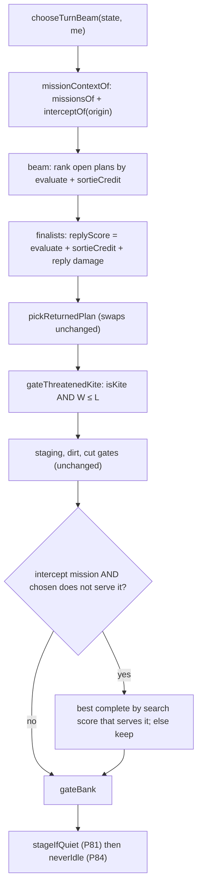
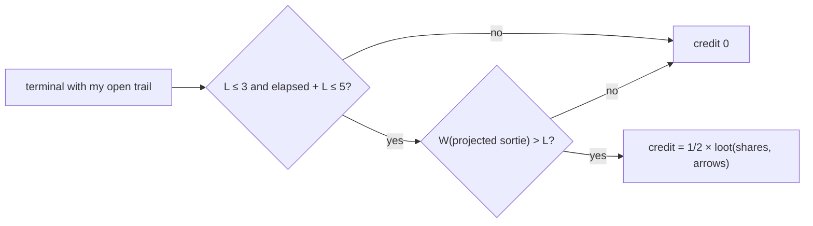

# heuristic-tempo-horizon — the heuristic seat counts the race

**Packet:** [P85 — The heuristic seat counts the race: tempo horizon](../../design/packets/P85-heuristic-tempo-horizon.md)
**Depends on:** P53 (beam), P54 (close value, `loot`), P55 (one-ply replies),
P57 (campaign), P59 (missions, threatened-kite gate), P81 (finisher,
`mirror` / `reach` acceptance), P84 (never idle).
**SPEC:** none. **No game rule is added, changed, or implied.** Nothing is owed
to SPEC §11. Speed (§3), grain movement, cuts (§6.1) and the rule that a step
onto other players' territory needs territory grade (§6.3) are read, never
changed. This packet decides only how *this bot* weighs them.
**Layer:** `packages/web` heuristic seat only. A new pure module
`botTempo.ts`, plus wiring in `botSearch.ts` and `botMission.ts`. No
`contracts`, `rules-core`, `geometry-*`, `byokBot.ts` or `mcp` change. No port
method is added. `chooseMove` is unchanged, so `online-api`'s
`pagesHeuristic` is unchanged.
**Features:** [core](./heuristic-tempo-horizon.core.feature) ·
[edge cases](./heuristic-tempo-horizon.edge-cases.feature)

**Counts:** 27 scenarios (6 core, 21 edge; outlines count once) · 10 invariants · 0 SPEC §11 items.

## Purpose

The live heuristic seat looks one turn ahead. Two playtests in a row
(2026-11-02 and 2026-11-03) were easy wins for the human. At r20 the human
held 113 land against 24 and 21. The human closed for about 13 arrows a time;
the bots closed for 2–3. The bots also ignored a long human trail they could
have cut in two turns.

This spec gives the live seat a **tempo horizon**: race arithmetic over
several turns, from grain distances and `speed(N)`. It is not a deeper
search. Every reading is a pure function of the turn's start state or of a
plan's terminal state.
- **The safe window W** sizes the seat's own sortie: it may keep a trail open
  while it can land before any enemy can reach that trail.
- **The intercept race** drives a march: when the seat can reach an enemy's
  trail no later than that enemy can close it, the seat moves toward it, even
  when no cut is legal this turn.

## Diagnosis (recorded before the fix)

**Method.** A throwaway replay script (uncommitted, under the bench) walked
three sources on `main` `c7ee34c`:
- the playtest log `docs/research/playtest-2026-11-02/match-log.json`
  (seats A and B heuristic before P84; 41 full rounds);
- the playtest log `docs/research/playtest-2026-11-03/match-log.json`
  (seats A and B heuristic after P84; 37 full rounds);
- a fresh `pnpm byok-bench mirror --concurrency 6` run. It reproduces P84's
  "after" games move for move (56 / B, 83 / B, 44 / A). Both seat orders of
  a seed are the same game, so each seed is counted once.

The positions are every heuristic seat-turn start where the seat has a legal
step. The race arithmetic is the one decisions 1 and 2 adopt (Terms), with
one difference: for W the diagnosis also blocked third-party territory on an
enemy's path. That can only make its W larger than decision 2's.

The mirror games are today's code by construction. For the playtests, I
re-ran today's `chooseTurnBeam` at all 32 playtest races of the raw count
below: it gives the logged answer (moved toward, or not) in every case. The
seat is stateless, so the 2026-11-02 log, played before P84, still shows
today's behaviour at these positions.

### List 1 — missed intercepts

A **won race** is a position where some enemy E has an open trail and my
turns to reach a bare mark of it are ≤ E's turns to close it. A **miss** is
a won race where my turn neither cut E's trail nor brought my nearest group
strictly closer to it.

| | playtest 11-02 | playtest 11-03 | mirror s1 | mirror s2 | mirror s3 | **total** |
|---|---:|---:|---:|---:|---:|---:|
| won races (position × enemy) | 5 | 8 | 12 | 15 | 5 | **45** |
| … a cut was legal that turn | 2 | 3 | 7 | 14 | 3 | 29 |
| … … and missed (different defect) | 0 | 0 | 0 | 5 | 0 | **5** |
| … no cut was legal | 3 | 5 | 5 | 1 | 2 | 16 |
| … … and missed (**this packet**) | 2 | 3 | 1 | 0 | 0 | **6** |

The six multi-turn misses (fixtures `I1`–`I6`):

| id | source | move index | seat → enemy | round | enemy turns to close | my turns to reach | my steps |
|---|---|---:|---|---:|---:|---:|---:|
| I1 | playtest 11-02 | 193 | A → C | 20 | 2 | 2 | 3 |
| I2 | playtest 11-02 | 249 | B → C | 24 | 1 | 1 | 2 |
| I3 | playtest 11-03 | 102 | B → C | 10 | 2 | 2 | 4 |
| I4 | playtest 11-03 | 134 | A → C | 13 | 5 | 5 | 10 |
| I5 | playtest 11-03 | 154 | A → C | 15 | 3 | 3 | 5 |
| I6 | mirror s1 | 153 | A → B | 24 | 2 | 2 | 2 |

**Cause.** In all six, `missionsOf` returns `contest` only: `cutAvailable`
is false, because no cut is legal at the origin. No mission, step filter or
gate refers to an enemy trail that is not cuttable this turn.

**The five cut-legal misses** are all mirror s2, seat B (P81-dominant, 34–143
heads) against A's fresh trail at rounds 33 and 77–80. `cut` is among B's
missions, but `gateCut` replaces the chosen plan only when it is sideways
dirt or idle, and B's finisher plan is neither. That is a different defect
(the packet says so) and is **out of scope** (decision 8).

**Raw grain distance overstates the list.** Counted with plain
`grainDistanceToAny` to *any* trail arrow (the tip included) and through
anyone's territory, there are 107 won races and 40 multi-turn misses. Most of
the extra rows target the enemy's own tip (stepping there is contact combat,
not a cut) or route through territory the seat may not enter (SPEC §6.3).
Decision 2 therefore races to **bare marks**, along paths that avoid other
players' territory.

### List 2 — small sorties

A **sortie** runs from the turn start where the seat's trail goes from empty
to non-empty, to the close that lands it. **W** is the safe window at the
sortie's start: the turns before the nearest enemy group can reach any arrow
of the trail the sortie actually laid (decision 2). A **small sortie** is a
close with loot ≤ 3 arrows of new land and W ≥ 4.

| | playtest 11-02 | playtest 11-03 | mirror s1 | mirror s2 | mirror s3 | **total** |
|---|---:|---:|---:|---:|---:|---:|
| heuristic closes | 26 | 25 | 34 | 66 | 30 | **181** |
| mean loot per close | 3.0 | 2.4 | 2.9 | 2.6 | 2.9 | **2.73** |
| closes with loot ≤ 3 | 19 | 22 | 28 | 56 | 23 | **148 (82 %)** |
| **small sorties** (loot ≤ 3, W ≥ 4) | 8 | 7 | 9 | 13 | 6 | **43** |
| … by a P81-dominant seat (finisher carves) | 0 | 0 | 0 | 5 | 1 | 6 |
| … **fixtures** (non-dominant) | 8 | 7 | 9 | 8 | 5 | **37** |

The human, for comparison, closed 28 times for 356 land (≈ 12.7 per close).
The opening sorties have W = 7–8 and loot 2–3.

**Cause, traced stage by stage.** An uncommitted trace recorded the live
search's plan after each stage (the top-scoring complete, `pickReturnedPlan`'s
swaps, each P59 gate, the bank gate) at the 43 sortie starts, and the largest
projected close among the search's own completes.

| reading at the 43 sortie starts | count |
|---|---:|
| the top-scoring complete takes no new land and leaves no open trail (stays home) | 32 |
| the top-scoring complete projects ≤ the logged loot | 42 |
| some complete in the search projects a **larger** close than the logged loot | 39 |
| P59's threatened-kite gate cut the picked plan back (every one at W ≥ 4) | 5 |
| the returned plan projects ≤ the logged loot | 40 |

So there are two causes, and the first is the larger:
1. **`evaluate` has a one-turn horizon.** An open trail scores `+1` per
   arrow, minus tip pressure. A closed bridge scores `+25` per arrow now.
   The larger sortie is in the search at 39 of 43 starts, and `evaluate`
   ranks it below staying home or closing small. The P53 / P56 swaps that
   pull the seat out of home pick the best-*scoring* expedition, which is the
   smallest.
2. **P59's threat test ignores tempo.** `enemyCanReach` calls a kite
   threatened when any enemy group is within 12 grain steps of the projected
   trail, whatever its speed and however many turns the close needs. At 5
   starts it cut a plan back while W was 4–6.

The P55 one-ply reply model never fired at these starts: no enemy could cut
next turn (W ≥ 4 > 1). It is not a cause (decision 6).

### The prototype

A throwaway prototype of decisions 1–7 (no tests, reverted before phase 2)
was measured before this spec was fixed. It settled three things the
diagnosis alone could not:
- **Full credit procrastinates.** Valuing an open trail at its whole
  projected loot made both seats hold their first trail for 10–20 rounds and
  never bank it (r20 land 3 for several seats). The credit grows with every
  step, so holding always beats landing. Hence decision 3's half credit and
  the whole-sortie cap.
- **A per-group forward BFS is too slow.** The first prototype searched
  forward from every enemy group for every beam state and ran about 10×
  slower mid-game. One backward search from the targets per reading
  (decision 7) brings the per-position cost back to baseline.
- **The sortie-start position is the wrong fixture.** A sortie's first turn
  is two steps out whatever the seat intends, so the difference shows at the
  turn the seat decides to land. The sortie fixtures are those close turns.

Its numbers are under "Baselines". They are evidence for the design, not the
gate.

## Terms

| Term | Means here |
|---|---|
| **live seat** | `chooseTurnBeamWithBudget` with `withReplies: true` (`chooseTurnBeam`, `playBotTurn`). As in P84 |
| **nested search** | `chooseTurnBeamWithBudget` with `withReplies` false or absent (the P55 reply search, and direct test calls) |
| **turns for a group** | `max(1, ceil(d / speed(heads)))` for a grain distance `d ≥ 0` the group must walk; ∞ when `d` is beyond the reading's depth. A group's `spent` is ignored: every count starts at that seat's next fresh turn |
| **passable** | an arrow a mover's path may step *through*. An arrow in territory owned by a player in the reading's blocked set is not passable; it may still be the target itself |
| **bare mark** (of E's trail) | an arrow of E's trail with no group of E on it. A step onto it cuts (SPEC §6.1, P40). An arrow holding E's heads is contact combat, not a cut |
| **tip** | a group of a player standing on that player's own trail |
| **turns to land, L** | of a terminal with an open trail of mine: the max over my tips of turns for that tip to reach my territory (`homewardPath` distance). Decision 7 bounds it |
| **elapsed** | of a terminal with an open trail of mine: `ceil(trail size ÷ the largest speed among my tips)`. The turns the sortie has already spent, read from the board (no memory) |
| **projected sortie** | my trail ∪ every tip's `homewardPath` path (the landing excluded). Its **arrows** are those not already my territory; its **shares** are those of its arrows that flank a spawner vertex |
| **safe window, W** | of a set of arrows S at a terminal: the min over enemy groups of turns for that group to reach any arrow of S, by a path passable for it (my territory blocked); `cap + 1` when none is within the reading's cap |
| **enemy turns to close** | of enemy E: the min over E's tips of turns for that tip to reach E's territory; `TEMPO_TURN_CAP + 1` when E has no tip or none lands within the cap |
| **intercept race** | for enemy E with at least one bare mark: **won** when my turns to reach a bare mark of E (min over my groups; my path may not pass through other players' territory) ≤ E's turns to close |

## Decisions (BSSN, recorded here)

1. **Turn order in the race.** Counts are in each seat's own turns. The live
   seat is moving now, so its k-th turn (k = 1 is this turn) always comes
   before any other seat's k-th next turn, whatever seats sit between.
   - **Intercept:** I can reach on my turn k = my turns; E closes on its
     j-th next turn, j = E's turns to close. The race is won iff
     **my turns ≤ E's turns to close**.
   - **Sortie:** at a plan's terminal my turn is over. Every enemy's j-th
     next turn comes before my j-th next turn. I land on my L-th next turn.
     The sortie is safe iff **W > L**.
   - **3 players.** The seat between me and E is not counted in the
     intercept race. If it cuts E first, that only helps. For W, *every*
     enemy group counts, the in-between seat included, by the same rule.
   - **Why:** this is exact for the rotation SPEC §4 defines, and needs no
     seat-order bookkeeping. Diagnosis rows I1–I5 are 3-player positions.
2. **Who threatens, and how fast.**
   - Every enemy group threatens a sortie, at `speed(its own heads)`. A split
     never moves faster than the stack it came from (`speed` is
     non-decreasing in heads), so the full stack is the fastest threat.
   - Paths avoid other players' territory as SPEC §6.3 does for a mover
     without territory grade: an enemy's path to my trail may not cross my
     territory, and my path to an enemy trail may not cross anyone else's
     territory. Third-party territory is *not* blocked for an enemy's path
     to my trail. That errs toward a smaller W, the safe side.
   - **Intercept targets are bare marks only.** The diagnosis showed that
     counting the enemy's tip or routes through foreign territory inflates
     the misses from 6 to 40 with races that cannot be won by a cut.
3. **How W enters the choice.** Two changes, live seat only.
   - **(a) Sortie credit.** The live search adds `sortieCredit(terminal)`
     wherever it ranks by `evaluate`: the beam's ranking of open plans, the
     finalists' unreplied score (so `replyScore = evaluate + credit +
     damage`), the score of non-finalist completes, and the finalist pick
     (`betterByEvaluate`). For a terminal with an open trail of mine and at
     least one tip:

     `credit = SORTIE_CREDIT × loot(shares, arrows)` of the projected sortie
     (P54's `loot`) **iff** L ≤ `SORTIE_TURN_CAP`, and elapsed + L ≤
     `SORTIE_TOTAL_CAP`, and W(projected sortie, cap L) > L. **Else 0.**
     With no open trail, or no tip, the credit is 0.
     - *Half, not whole:* a pending close is worth less than a banked one.
       At full value the prototype never banked (see the diagnosis).
     - *The total cap* is the stateless stopping rule. Once the sortie has
       spent its turns, the credit drops to 0, `evaluate`'s tip pressure
       takes over, and the seat lands.
     - *`evaluate` is not changed.* `chooseMove`, the nested search, the
       P55 reply probes and `pagesHeuristic` all score exactly as before.
   - **(b) P59's threat test uses the race.** For the live seat,
     `isThreatenedKite(ctx, plan)` becomes `isKite(ctx, plan)` **and**
     `isSortieThreatened`: W(P59's `projectedTrail`, cap min(L,
     `TEMPO_TURN_CAP`)) ≤ L, where L is the terminal's turns to land (1 when
     the terminal has no open trail; `TEMPO_TURN_CAP + 1` when a tip cannot
     land within the decision-7 depth, which makes every such kite
     threatened). It replaces `enemyCanReach` (any enemy group within 12
     grain steps) **in this test only**.
   - **P59 keeps:** `isKite` and `KITE_RATIO`; every gate, its order and its
     fallbacks; `isStagingClose`'s own `enemyCanReach` check;
     `servesContest`; the P84 guard's use of `isThreatenedKite` (it now sees
     the race-based answer, by the same call).
   - **Why both:** the trace found two causes. (a) answers the larger one
     (`evaluate` ranks the larger sortie below staying home at 39 of 43
     starts). (b) answers P59 cutting plans back at W 4–6.
4. **How an intercept enters the choice: a mission.**
   - `MissionKind` gains `'intercept'`. `missionsOf` adds it **after `cut`,
     only when no cut is available and the seat is not under fire** (no
     `bank`), and only when `interceptOf(origin)` finds a won race. Like
     `bank` and `cut`, its presence keeps `contest` out of the list. `deny`
     and the no-campaign rule are unchanged.
   - **The race chosen:** enemies in ascending PlayerId; among won races the
     one with the fewest my-turns; ties keep the lower PlayerId.
   - **Step filter (`onMissionStep`):** a step is on the intercept mission
     when it is a `cut` / `attack` finding, or when it lowers the min, over
     my groups, of the steps-to-target reading (decision 7's field from the
     origin).
   - **Serves (`servesMission`):** the terminal shrank E's trail, or its
     min steps-to-target is strictly below the origin's.
   - **Gate (`gateIntercept`):** after `gateCut`, before `gateBank`. If the
     chosen plan does not serve the intercept, take the best complete by
     search score that does; if none does, keep the chosen plan.
   - **No dithering without memory.** Each turn recomputes the same race
     from the board. A served turn strictly lowers my steps-to-target, so
     the next turn's race is at least as good for me unless E moved. The
     march continues while the race is won and stops by itself when E lands
     or outruns me.
5. **Shadowing (race lost): out.** The diagnosis found 16 races with no cut
   legal and only 6 misses; none was a race lost by one turn worth chasing.
   A "shrink the enemy's safe close" term would be a new evaluation idea
   with no evidence behind it. Re-open it with a fixture if a playtest shows
   the need.
6. **The reply model: unchanged.** P55's one-ply reply never fired at the 43
   sortie starts (W ≥ 4 > 1 there). It already models the W = 1 threat
   exactly, by playing the reply. `worstReplyDamage`, `exposure`, the reply
   budgets and the nested search are untouched.
7. **Caps, so a turn's cost stays bounded.**
   - `TEMPO_TURN_CAP = 8` turns. No race or window is read beyond it.
   - `SORTIE_TURN_CAP = 3`: a terminal whose L > 3 earns no credit.
   - `SORTIE_TOTAL_CAP = 5`: elapsed + L > 5 earns no credit.
   - `SORTIE_CREDIT = 1/2`.
   - Turns to land use `homewardPath` with depth `speed(tip) ×
     (SORTIE_TURN_CAP + 1)`; a tip with no landing in that depth makes
     L = `TEMPO_TURN_CAP + 1`.
   - Enemy turns to close use `homewardPath` with depth `speed(tip) ×
     TEMPO_TURN_CAP`.
   - **Each reading is one backward grain search** from its target set
     (over `inArrows` of the target's origin point), to depth `max speed of
     the movers × the turn cap of that reading` (for W: × L; for the
     intercept: × E's turns to close). Then every group reads its distance
     from that field. The prototype's per-group forward search was about
     10× slower mid-game.
   - **Memo.** A reading may be memoised within one `chooseTurnBeam` call
     (terminal states are immutable). No module-level mutable state.
   - The beam budgets (`BEAM`, `BRANCH`, `MAX_PLAN`, `MAX_APPLIES`, the
     reply budgets) are **not** raised.
8. **Out of scope, named for a follow-up.** The five cut-legal misses (a
   P81-dominant seat whose finisher plan ignores a legal cut, mirror s2
   r33 and r77–80). `gateCut` and the finisher are unchanged here.
9. **Where the code lives.**
   - `packages/web/src/botTempo.ts` (new, pure): every reading and the
     constants. Its exports are under "Module".
   - `botMission.ts`: `'intercept'` in `MissionKind`, the optional
     `intercept` field on `MissionContext`, `missionsOf`'s new optional
     argument, `isThreatenedKite`'s race test, and the intercept branches of
     `onMissionStep` / `servesMission`.
   - `botSearch.ts`: the credit at the four score sites, `gateIntercept`,
     and `missionContextOf` computing `interceptOf` once.
   - `online-api/tsconfig.json`'s `include` gains `../web/src/botTempo.ts`
     (as P84 added `botNeverIdle.ts`), so `opponent`'s graph still
     typechecks for `pagesHeuristic`. No `online-api` source changes.
10. **Unchanged:** `evaluate` and its weights; `chooseMove`,
    `chooseTurnGreedy`; the nested search's results; P53–P59 swaps and
    gates other than (3b) and (4); the P81 finisher and `stageIfQuiet`; the
    P84 guard; `byokBot.ts`; `pagesHeuristic`.
11. **MCP drift.** `packages/mcp/src`'s parked bot copy is not changed. It
    lacks P84 and now P85 too.
12. **Superseded tests.** The prototype turned exactly these 12 committed
    tests red across `packages/web/test` (1,640 others passed). Phase 2
    rewrites each one and cites P85, as P84 did; none is deleted. They fall
    in three groups:
    - **"Land now" on a board no enemy can reach** (the credit now holds a
      safe trail inside the caps). Keep the P53 / P54 mechanics they test by
      making the credit inapplicable on that board: add an enemy group that
      reaches the projected sortie within L turns, or start from a trail
      long enough that elapsed + L > `SORTIE_TOTAL_CAP`. Where the original
      board is worth keeping, add a twin that asserts the P85 behaviour on
      it.
      - `bot-turn-search.core.test.ts`: "A 2-stack strides a two-arrow
        homeward close"; "A 4-stack takes three arrows in one turn";
        "Splitting wins when two destinations beat one deeper advance";
      - `bot-turn-search.edge-cases.test.ts`: "Findings order beam
        expansion but do not short-circuit it";
      - `close-and-spawner-value.core.test.ts`: "beam-v1 takes the homeward
        close_path";
      - `mission-and-staging.core.test.ts`: "P53 stride construction still
        strides and shuttle rate still holds".
    - **The threat test's spec mirror.** The support helper
      `specIsThreatenedKite` encodes the old 12-step rule. It follows
      decision 3b instead, and a position whose premise is "threatened"
      must have W ≤ L.
      - `mission-and-staging.core.test.ts`: "Staging close beats a
        threatened kite";
      - `heuristic-never-idle.edge-cases.test.ts`: "The kite-gate cause
        where a non-kite stepping complete exists".
    - **Setups or expectations built from pre-P85 self-play.**
      - `mission-and-staging.core.test.ts` "3-seat quiet-home leftover
        after the first close still leaves" and
        `mission-and-staging.invariants.test.ts` "WHEN chosen is [endTurn],
        a contest-advancing complete exists, …": the setup
        `threeSeatQuietHomeAfterFirstClose` plays the bot to reach its
        position, and A no longer closes first the same way. Build the
        position from a recorded move list (record it from today's code)
        instead of self-play.
      - `heuristic-never-idle.core.test.ts` "Turns that stepped in the
        playtest are reproduced move for move" and
        `heuristic-never-idle.invariants.test.ts` invariant 5: they compare
        the live seat's plans with pre-P85 logs. P84's property is that the
        guard returns a stepping plan unchanged. Restate them against the
        guard itself (`neverIdle` returns a stepping `staged` plan as is),
        not against old logs.

    Tests that call `chooseTurnBeamWithBudget` with `withReplies: false`
    stay as they are.

## Module

`packages/web/src/botTempo.ts` exports, and nothing else is public:

| export | contract |
|---|---|
| `TEMPO_TURN_CAP = 8`, `SORTIE_TURN_CAP = 3`, `SORTIE_TOTAL_CAP = 5`, `SORTIE_CREDIT = 0.5` | decision 7 |
| `safeWindow(geometry, state, me, arrows, cap)` | W of `arrows` (Terms), in `1 … cap + 1` |
| `sortieOf(geometry, state, me)` | `undefined` with no open trail or no tip; else `{ turnsToLand, elapsed, projected, arrows, shares }`, `projected` sorted by arrow id |
| `sortieCredit(geometry, state, me)` | decision 3a, ≥ 0 |
| `isSortieThreatened(geometry, state, me, projected)` | decision 3b's race test |
| `enemyTurnsToClose(geometry, state, enemy)` | Terms |
| `interceptOf(geometry, state, me)` | `undefined`, or `{ enemy, targets, turns, enemyTurns, stepsTo(arrow) }`: the won race of decision 4, `targets` its bare marks sorted by id, `stepsTo` the decision-7 field (∞ off the field) |
| `interceptDistance(state, me, intercept)` | min over my groups of `intercept.stepsTo` |

The skeleton's signatures are what phase 2 compiles against. A phase-3 need
for another export is a kickback, not a free addition.

## Fixtures

Committed under `packages/web/test/fixtures/` (phase 2):
- `playtest-2026-11-02.match-log.json` (already there, P84);
- `playtest-2026-11-03.match-log.json`, a verbatim copy of
  `docs/research/playtest-2026-11-03/match-log.json`;
- `mirror-p85-s1.moves.json`, `mirror-p85-s2.moves.json`,
  `mirror-p85-s3.moves.json`: the move lists of today's baseline `mirror`
  cells `s1-first`, `s2-first`, `s3-first` (`main` `c7ee34c`), trimmed to
  the moves the scenarios need (s1 ≥ 160, s2 ≥ 140, s3 ≥ 160).

Positions are reached by replaying from `makeMatch(config)`: the playtest
logs' own `config`; mirror `{ dominationN: 5, R: 7, homeOffset: 5,
playerCount: 2, spawnerSeed: seed }`. The move index is the first move of the
named seat's turn.

**Intercept fixtures** — the six misses of list 1. The logged turn neither
cuts nor moves closer.

| id | log | index | seat → enemy | round | E turns to close | my turns | my steps |
|---|---|---:|---|---:|---:|---:|---:|
| I1 | playtest-2026-11-02 | 193 | A → C | 20 | 2 | 2 | 3 |
| I2 | playtest-2026-11-02 | 249 | B → C | 24 | 1 | 1 | 2 |
| I3 | playtest-2026-11-03 | 102 | B → C | 10 | 2 | 2 | 4 |
| I4 | playtest-2026-11-03 | 134 | A → C | 13 | 5 | 5 | 10 |
| I5 | playtest-2026-11-03 | 154 | A → C | 15 | 3 | 3 | 5 |
| I6 | mirror s1 | 153 | A → B | 24 | 2 | 2 | 2 |

**Sortie fixtures** — the 37 non-dominant small sorties of list 2, taken at
the **turn the logged seat landed** (index), with the sortie's start for
reference. *Logged loot* is the land that close took. *Baseline* and
*prototype* are the live seat's plan at that position: land gained this turn
/ projected arrows of the open trail it leaves (0 when none).

| id | log | start | index | seat | start round | W at start | logged loot | baseline | prototype |
|---|---|---:|---:|---|---:|---:|---:|---|---|
| S1 | playtest-2026-11-02 | 0 | 12 | A | 0 | 8 | 2 | 2 / 0 | 0 / 7 |
| S2 | playtest-2026-11-02 | 20 | 43 | A | 2 | 6 | 3 | 3 / 0 | 0 / 9 |
| S3 | playtest-2026-11-02 | 46 | 69 | B | 4 | 6 | 3 | 3 / 0 | 0 / 5 |
| S4 | playtest-2026-11-02 | 78 | 87 | B | 8 | 5 | 2 | 2 / 0 | 0 / 4 |
| S5 | playtest-2026-11-02 | 121 | 130 | B | 13 | 6 | 2 | 2 / 0 | 2 / 0 |
| S6 | playtest-2026-11-02 | 157 | 168 | A | 17 | 5 | 3 | 3 / 0 | 0 / 8 |
| S7 | playtest-2026-11-02 | 259 | 259 | A | 25 | 5 | 1 | 1 / 2 | 0 / 5 |
| S8 | playtest-2026-11-02 | 351 | 367 | A | 31 | 4 | 2 | 2 / 0 | 2 / 1 |
| S9 | playtest-2026-11-03 | 0 | 12 | A | 0 | 8 | 2 | 2 / 0 | 0 / 7 |
| S10 | playtest-2026-11-03 | 20 | 43 | A | 2 | 6 | 3 | 3 / 0 | 0 / 9 |
| S11 | playtest-2026-11-03 | 46 | 72 | B | 4 | 4 | 3 | 3 / 0 | 0 / 7 |
| S12 | playtest-2026-11-03 | 61 | 89 | A | 6 | 6 | 3 | 3 / 0 | 0 / 7 |
| S13 | playtest-2026-11-03 | 81 | 93 | B | 8 | 4 | 2 | 2 / 0 | 0 / 6 |
| S14 | playtest-2026-11-03 | 126 | 137 | B | 12 | 4 | 2 | 2 / 0 | 0 / 9 |
| S15 | playtest-2026-11-03 | 316 | 330 | B | 26 | 4 | 1 | 1 / 0 | 1 / 0 |
| S16 | mirror s1 | 2 | 8 | B | 0 | 7 | 3 | 3 / 0 | 0 / 9 |
| S17 | mirror s1 | 15 | 29 | B | 2 | 6 | 3 | 3 / 0 | 0 / 7 |
| S18 | mirror s1 | 25 | 33 | A | 4 | 8 | 3 | 3 / 0 | 0 / 7 |
| S19 | mirror s1 | 41 | 54 | A | 6 | 5 | 3 | 3 / 0 | 0 / 7 |
| S20 | mirror s1 | 37 | 57 | B | 5 | 5 | 3 | 3 / 0 | 0 / 7 |
| S21 | mirror s1 | 64 | 64 | B | 9 | 6 | 1 | 1 / 3 | 1 / 3 |
| S22 | mirror s1 | 60 | 68 | A | 9 | 6 | 2 | 2 / 3 | 0 / 5 |
| S23 | mirror s1 | 68 | 75 | A | 10 | 4 | 1 | 1 / 3 | 1 / 3 |
| S24 | mirror s1 | 91 | 91 | B | 13 | 5 | 1 | 1 / 0 | 1 / 0 |
| S25 | mirror s2 | 3 | 10 | B | 0 | 7 | 2 | 2 / 0 | 0 / 8 |
| S26 | mirror s2 | 21 | 28 | A | 3 | 6 | 3 | 3 / 0 | 0 / 8 |
| S27 | mirror s2 | 17 | 32 | B | 2 | 6 | 3 | 3 / 0 | 0 / 8 |
| S28 | mirror s2 | 39 | 46 | B | 5 | 5 | 3 | 3 / 2 | 0 / 6 |
| S29 | mirror s2 | 35 | 50 | A | 5 | 5 | 2 | 2 / 0 | 0 / 6 |
| S30 | mirror s2 | 102 | 109 | A | 15 | 4 | 2 | 2 / 0 | 2 / 3 |
| S31 | mirror s2 | 114 | 120 | A | 17 | 6 | 2 | 2 / 0 | 2 / 0 |
| S32 | mirror s2 | 127 | 135 | A | 19 | 5 | 2 | 2 / 0 | 0 / 6 |
| S33 | mirror s3 | 21 | 27 | A | 4 | 16 | 3 | 3 / 0 | 0 / 7 |
| S34 | mirror s3 | 31 | 43 | B | 5 | 6 | 3 | 3 / 0 | 0 / 6 |
| S35 | mirror s3 | 105 | 105 | A | 18 | 4 | 1 | 1 / 0 | 0 / 5 |
| S36 | mirror s3 | 126 | 134 | B | 20 | 4 | 1 | 1 / 0 | 1 / 0 |
| S37 | mirror s3 | 152 | 158 | B | 24 | 4 | 1 | 1 / 0 | 0 / 3 |

**"Reaches for a larger close"** at a sortie fixture means: the land the live
plan gains this turn is greater than the logged loot, **or** the plan's
terminal holds an open trail whose projected sortie has more arrows than the
logged loot (`sortieOf(...).arrows`). Baseline 4 / 37 (S7, S21, S22, S23);
prototype 31 / 37.

## Flow

## Baselines (measured on `main` `c7ee34c`, before any change)

Free tiers only, concurrency 6. The mirror run reproduces P84's "after"
games move for move.

| reading | `c7ee34c` | prototype (throwaway, not the gate) |
|---|---|---|
| mirror: mean land per seat at r20, 6 cells | **24.33** (s1 24 / 24, s2 25 / 26, s3 28 / 19) | 43.00 (1.77×; s1 53 / 44, s2 38 / 44, s3 40 / 39) |
| mirror: mean income per seat at r20 (heads per round), 6 cells | **3.194** (s1 1.58 / 3.94, s2 2.19 / 4.64, s3 5.14 / 1.67) | 3.935 (1.23×; s1 3.72 / 3.33, s2 5.33 / 2.97, s3 4.94 / 3.31) |
| mirror: zero-step seat-turns with a step legal | **0** | 0 |
| mirror: rounds / winner (s1, s2, s3; both orders identical) | 56 / B, 83 / B, 44 / A | 85 / B, 67 / A, 100 / B |
| mirror: wall, longest cell's seat-turns, per-turn | 99.0 s ÷ 167 = **0.59 s** | 302.2 s ÷ 200 = 1.51 s |
| mirror: leader's steps per full 40-round window | ≥ 76 | ≥ 73 |
| mirror: two runs byte-identical | holds (two runs, 6 / 6 cells) | — |
| reach (`--round-cap 200`): cells ending | 15 / 16 (`p3-R7-h5-s2` capped) | — |
| reach: combat share of heads lost | 79 % (2,075 / 2,621) | — |
| intercept fixtures passing | **0 / 6** | 6 / 6 |
| sortie fixtures reaching for a larger close | **4 / 37** | 31 / 37 |
| mean loot per heuristic close (5 games) | 2.73 | — |

**What the prototype says about the gates.** It met the land gate (1.77×
in the full run; 1.75–1.83× across nearby settings in a 20-round probe), the
fixture gates, never-idle, ending, stasis and determinism (its two runs gave
identical games). **It missed two gates:**
- **Income: 1.23×** (1.13–1.23× in every setting tried), against 1.5×. In a
  mirror both seats grow, and they contest the same spawners near their
  homes, so income does not scale with land.
- **Speed: 1.51 s per turn** against ≤ 0.89 s. The readings are not the
  cost: on the prototype's own s2 positions the pre-P85 code takes the same
  time (96–100 s for 134 turns). The games are longer (67–100 rounds) and
  their positions heavier: more groups, more completes, more reply probes.

The packet fixes both gates and says not to lower any, so they stand. If
phase 4 measures either one short, P85 is parked as the packet says.

## Acceptance (predeclared 2026-11-03, before any code change)

Thresholds from the packet, with the baselines above. None is lowered; the
fixture floors are expressed in fixtures.

| gate | baseline | required after P85 |
|---|---|---|
| **Intercepts:** the six intercept fixtures, the live seat's turn cuts or moves strictly closer | 0 / 6 | **≥ 5 / 6** (80 % floor) |
| **Sorties:** the 37 sortie fixtures, the live seat reaches for a larger close | 4 / 37 | **≥ 30 / 37** (80 % floor) |
| **Opening land:** mean land per seat at r20, 6 mirror cells | 24.33 | **≥ 36.50** (1.5×) |
| **Opening income:** mean income per seat at r20, 6 mirror cells | 3.194 | **≥ 4.791** (1.5×) |
| never idle (P84): zero-step seat-turns with a legal step, 6 mirror cells | 0 | **0** |
| mirror cells that end with a winner within 200 rounds (P81) | 6 / 6 | **≥ 5 / 6** |
| reach grid (`--round-cap 200`) cells that end (P81) | 15 / 16 (`p3-R7-h5-s2` capped) | **≥ 12 / 16** |
| combat share of heads lost, reach grid (P81) | 79 % (2,075 / 2,621) | **≥ 50 %** |
| no late stasis: the seat ahead on heads takes ≥ 20 steps in every full 40-round mirror window | holds (≥ 76) | **holds** |
| determinism: two runs of each mirror cell give byte-identical move lists | holds (two runs, 6 / 6 cells) | **holds** |
| speed: mirror per-turn wall (wall ÷ the longest cell's seat-turns, concurrency 6, quiet machine) | 0.59 s | **≤ 0.89 s** (1.5×) |

Land and income at r20 are read by replaying each cell's move list from
`makeMatch` to the end of round 20: land is owned arrows, income is
`incomeRate` (Σ force × shares held). Results go in
`docs/research/byok-benchmark.md` under "Mirror".

## Invariants

1. The system shall return the same plan from `chooseTurnBeam` for the same `(state, me)` on every call (no clock, no randomness, no iteration-order dependence, no state kept between calls).
2. The system shall return from every `botTempo` reading a value that depends only on its arguments.
3. When `sortieCredit` reads a terminal with no open trail of `me`, no tip, turns to land > `SORTIE_TURN_CAP`, elapsed + turns to land > `SORTIE_TOTAL_CAP`, or W ≤ turns to land, the system shall return 0.
4. Otherwise `sortieCredit` shall return exactly `SORTIE_CREDIT × loot(shares, arrows)` of the projected sortie, which is ≥ 0.
5. The system shall return from `safeWindow` a value no larger when an enemy group is added, and no smaller when one is removed.
6. While a cut against some enemy is legal at the origin, or `bank` is among the missions, the system shall not include `intercept` in the live seat's missions.
7. When `interceptOf` returns a race, the system shall have `turns ≤ enemyTurns ≤ TEMPO_TURN_CAP`, and every target shall be an arrow of that enemy's trail holding no group of that enemy.
8. While `withReplies` is false, the system shall return the same plan from `chooseTurnBeamWithBudget` as it did before P85; and `chooseMove` and `evaluate` shall return what they did before P85.
9. While it is the live seat's turn and a step is legal, the system shall return a plan that contains at least one step (P84, unchanged).
10. When `chooseTurnBeam` returns, every move in the plan shall be legal in sequence from the turn's start state, and the plan shall end the seat's turn or the match.
