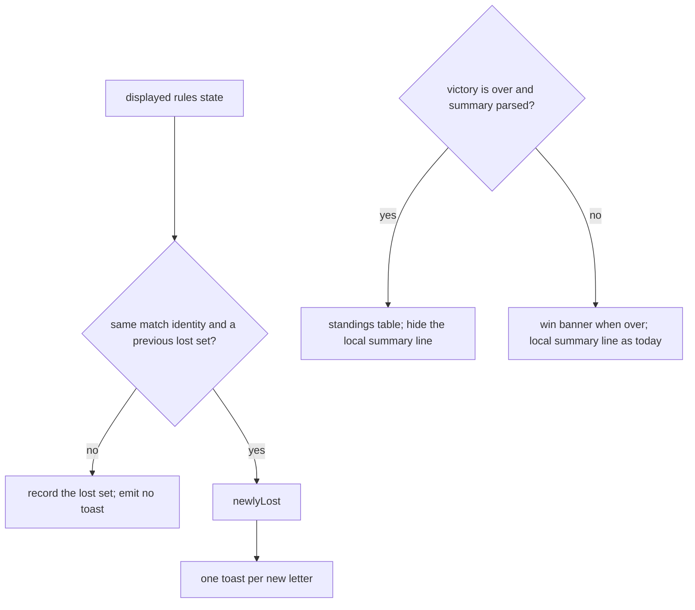

# lost-seat-standings — a lost seat is marked once, and a finished online game shows the server's standings

**Packet:** [P102](../../design/packets/P102-lost-seat-standings.md). Issue
[#120](https://github.com/hochgi/conquarrow/issues/120), items 3 and 4 only.
**SPEC:** not edited. No game rule is added, changed, or implied. Loss stays
the rules predicate (`isLost`, SPEC §9). Nothing is owed to SPEC §11.
**Amends:** the HUD seat line (`Seats: …` in `Hud.tsx`), the game-over panel
when an online `summary` is present, and a one-time elimination toast. Does
not amend the turn banner, the victory banner copy, `matchSummaryLine`, the
lobby, or the server.
**Layer:** `packages/web` (`lostSeat.ts`, `seatLabel.ts`, `seatLine.ts`,
`standings.ts`, `online-parse.ts`, `EliminationToasts.tsx`, `Hud.tsx`,
`App.tsx`, `styles.css`) and one optional field on `OnlineGameBoard` in
`packages/contracts`. No `online-api` change. `GET` game already sends
`summary` when `winner` is set (`handleGetGame`). The client was dropping it.
That is not a new exchange, so there is no `SCENARIOS.md` and no new
`@hochgi/test-kit` test.
**Features:** [core](./lost-seat-standings.core.feature) ·
[edge cases](./lost-seat-standings.edge-cases.feature)

8 core scenarios, 28 edge scenarios, 8 invariants. No diagram paths (no new
protocol).

## Purpose

A player must see that a seat is gone, the moment it becomes gone, and must
see the server's standings when an online game ends. The words and the flags
live in pure functions. React only paints them.

## Terms

| Term | Means |
|---|---|
| **lost set** | the letters of `state.players` for which `isLost` holds, in `players` order. Not a server field. Not `summary.standings[].lost` |
| **first snapshot** | `prevLost` is absent (`undefined`). The seats already lost are recorded and not toasted |
| **newly lost** | in the next lost set, and not in the previous one |
| **seat label** | the short name P101 already decides: `you`, `your agent`, `AI`, an owner name, or the letter. Not `Player A`, not a banner suffix |
| **accessible name** | `C — eliminated` (letter, space, U+2014, space, `eliminated`). Only on a lost seat-line item |
| **summary** | `GameSummary` already on `GET` of a finished game. `winner`, `turns`, `standings` |
| **fallback** | no table. The win banner stays. The local summary line stays |

`you` here is the seat label and the standings mark. It is not the turn-banner
suffix ` · you`. A test that rejects any string containing the letters `you`
is wrong.

## What the HUD lists

The only in-game list of every seat is the `Seats:` line in `Hud.tsx`. It is a
string today (`A=Player · B=AI · C=Agent`). There are no seat chips in the HUD.
`turnBanner.ts` names the active chair only. The starvation note names seats
on the clock; a lost seat's streak is already dropped, and this packet does
not restyle that note. Lobby chips are not the HUD.

The seat line keeps every roster seat, lost or not. "The shell skips a lost
seat" means the line never marks one. It does not mean the letter is removed.

## Decisions (adapter BSSN)

### D1 — the lost set is the rules predicate, in players order

`lostSeatIds` (`packages/web/src/lostSeat.ts`) is pure.

```
lostSeatIds(players, isLostAt) → readonly string[]
```

`players` is the displayed `state.players` as strings, in that order.
`isLostAt(letter)` is the only loss fact. The result is the letters for which
it returns true, in `players` order, each once. It does not read `GameSummary`,
a library `lostPlayers` list, or the DOM.

App passes `(letter) => isLost(state, player, geometry)` for the matching
`PlayerId`. That call is wiring. The function does not import `isLost`, so a
test can stub the predicate. Geometry stays in App.

The seat line and the toast both consume this set. The standings table does
not. A finished game's `summary.standings[].lost` can disagree with `isLost`
only if the payload is stale or hand-edited; the line follows `isLost`, the
table follows the payload. Neither side is "fixed" to match the other.

### D2 — `newlyLost` is the diff, and the first snapshot is silent

```
newlyLost(prevLost: readonly string[] | undefined, nextLost: readonly string[])
  → readonly string[]
```

| prevLost | nextLost | result |
|---|---|---|
| `undefined` | any, including a non-empty set | `[]` |
| `[]` (a real snapshot where nobody was lost) | `['B', 'C']` | `['B', 'C']` |
| `['A']` | `['A', 'C']` | `['C']` |
| `['A', 'C']` | `['A', 'C']` | `[]` |
| `['C']` | `['A']` | `['A']` — C left the set and is not a toast; A just appeared and is |
| `['A']` | `['C', 'A', 'C']` | `['C']` — once, at the first new occurrence |

Order is `nextLost` order. No sort. No `Set` iteration. Duplicates in
`nextLost` emit once. Membership is string equality.

`[]` is not the first snapshot. Only `undefined` is. A reload is a new mount,
so the first observation passes `undefined` and does not toast seats that
were already lost.

### D3 — match identity resets the memory

`observeLosses` is the function App calls. It is pure. No clock, no DOM.

```
observeLosses(memory, identity, nextLost)
  → { memory, newly }
```

`memory` is `{ identity: string; prevLost: readonly string[] } | undefined`.

- Memory absent, or `memory.identity !== identity`: `newly` is `[]`, and the
  returned memory is `{ identity, prevLost: nextLost }`. This is the first
  snapshot of that match. It does not call through to a toast even when
  `nextLost` is non-empty.
- Same identity: `newly` is `newlyLost(memory.prevLost, nextLost)`, and the
  returned memory stores `nextLost` under that identity.

`matchIdentity(online, hash, startedAt)` is pure, in `lostSeat.ts`. It is
not suppressed.

| When | identity |
|---|---|
| `online` is true and `parsePagesHash(hash)` is a game route | `${groupHash}/${gameNumber}` |
| anything else — lobby, invite, a game route while `online` is false | `local:` plus `startedAt` |

A version jump in the same mount keeps the identity, so a loss that arrives
in the caller's move, a replayed batch, or a resume catch-up all toast. A
different game, or a new local match, does not toast seats that are already
lost in the new snapshot.

App observes when the displayed rules state or the log changes. It does not
observe because the hash changed. The identity is read from the hash on that
render. A hash change that has not yet installed the new rules state must not
write loss memory: writing the new identity against the previous game's lost
set makes the next snapshot toast seats that were already lost. It does not
diff a server snapshot the replay has not installed, and it does not diff an
animation frame that is not a rules state. Each installed state is one
observation. Appending toasts does not reset the timers of toasts already
showing.

### D4 — the toast sentence uses the P101 label, with one grammar fix

`eliminationSentence(label)`:

| label | sentence |
|---|---|
| exactly `you` | `You were eliminated` |
| anything else | `${label} was eliminated` |

No trailing period. `your agent was eliminated` keeps `was`. An owner whose
display name is the string `you` takes the `you` sentence. That collision is
accepted. Do not search for the substring `you`.

`eliminationToasts(newly, labelOf)` returns `{ id, text }[]` in `newly` order.
`id` is the letter. `text` is `eliminationSentence(labelOf(letter))`. One
entry per letter. App appends them. Dismissing removes that id only. The lost
set is not consulted again on dismiss.

`ELIMINATION_TOAST_MS` is `4000`. The component receives it as `dismissMs`.
The number does not appear in JSX. Each toast's timer starts when that toast
is mounted and is cleared on dismiss and on unmount. Tap dismisses that toast.
The control is a `button`. The container is `aria-live="polite"` and
`aria-atomic="false"`. No second label on the button.

There is no toast component today. Add a presentational one. It holds no
loss rule. Place it `position: fixed`, bottom centre, above the route dock
and the safe area, `z-index: 7` (under the tutorial overlay). A short enter
animation is allowed. Under `prefers-reduced-motion: reduce` that animation
is `none`. The toast still appears, and it still auto-dismisses. Centring
must not depend on an animated `transform`.

### D5 — seat labels are P101's words, not a new scheme

`seatLabel` (`packages/web/src/seatLabel.ts`) is pure. First match wins.

| # | When | label |
|---|---|---|
| 1 | `sayYou` and relation `caller-human` and kind `human` | `you` |
| 2 | relation `caller-agent` and kind `agent` | `your agent` |
| 3 | kind `heuristic` or `byok` | `AI` |
| 4 | kind `agent` and `ownerName` trims to a non-empty string | that trimmed name |
| 5 | otherwise | the letter |

Row 2 beats row 4: the caller's own agent is `your agent`, not their profile
name. Row 4 is the owner name P101 already parses (`Agent (Ada)` → `Ada`),
not `Ada's agent`. An unnamed agent is the letter, not `B's agent`. Do not
call `displaySeatKind` and do not call `styleFor().label`.

`sayYouForRoster({ venue, humanSeats })` is true when `venue` is `online`, or
when `venue` is `local` and `humanSeats === 1`. A local hot-seat has more than
one human, so nobody is `you`. A local versus-bot match with one human is
`you` for that human. Online always passes `sayYou: true`; relation still
refuses `you` unless the chair is proved to be the caller's human seat.

`labelForOnlineSeat({ seats, userHash, players, letter })` calls
`onlineTurnSeat` with `active` set to `letter`, then `seatLabel` with
`sayYou: true`. Missing seats, a missing hash, or an unbound chair stay
`other` — P101's rule, not a new one. The toast uses this, because the roster
is aligned with `players`.

`labelForLocalSeat({ configKind, logSeats, letter })` calls `localTurnSeat`
for that letter. `humanSeats` is the count of `logSeats` whose kind is
`human`. `configKind` wins for the letter's kind, as `localTurnSeat` already
specifies. No `ownerName` locally.

`labelForChair({ letter, chair, kindHint, userHash })` is what the standings
table uses. `chair` is `seats[standing.seat]`, not `players.indexOf(letter)`,
so a duplicate letter still reads its own chair. When `chair` is present, kind,
relation, and owner name are that chair's, by the same rules `onlineTurnSeat`
uses. When `chair` is absent, kind is `kindHint` if that is `human`, `agent`,
or `heuristic`; otherwise relation is `other` and the label is the letter.
An absent chair has no owner name and is never `you`. `sayYou` is true.
The owner-name parse is P101's (`Agent (Ada)` → `Ada`). Export that parse
from `turnBanner.ts` (one export; the body stays). Do not write a second
parser.

The seat line does not use these labels for its visible text. The toast and
the standings table do. Renaming the roster is #119.

### D6 — the seat line marks a lost seat and does not drop it

`seatLineView(seats, lost)` is pure.

```
seats: { letter, kindLabel }[]
lost: readonly string[]
→ { letter, text, lost, struck, greyed, accessibleLabel? }[]
```

`text` is `${letter}=${kindLabel}`. `kindLabel` is whatever App already got
from `displaySeatKind` (`Player`, `AI`, `BYOK`, `Agent`). This function does
not rename it.

A row is lost when `letter` is in `lost` (string equality). Then `lost`,
`struck`, and `greyed` are all true, and `accessibleLabel` is
`${letter} — eliminated` with U+2014. Otherwise all three flags are false and
`accessibleLabel` is absent, not `''` (`exactOptionalPropertyTypes`).

Order is `seats` order. A letter in `lost` that is not in `seats` adds no row.
A repeated letter is a repeated row, each marked on its own. The separator
between rows, when Hud paints them, is ` · ` (space, U+00B7, space), the same
dot the line uses today.

Hud replaces the `seatSummary` string with these items. A lost item gets
`class="seat-lost"` and `aria-label` of the accessible name. `.seat-lost` is
`color: var(--muted)` and `text-decoration: line-through`. Colour is not the
only signal. The static HUD harness passes items, not the old string.

The turn banner, the starvation note, and the victory banner are not this
line. Do not grey them here.

### D7 — standings are a view model of the server summary

`SeatStanding` is already `{ player, seat, kind, territory, shares, heads, lost }`.
`GameSummary` is `{ winner, turns, standings }`. No field is added. The table
shows seat label, territory, shares, heads, and a lost/winner marker, plus
`Won on turn N`. Those are all present. No backlog gap, no server change.

`standingsView(summary, seats, callerUserHash)`:

- `summary` undefined → `{ kind: 'fallback' }`. Seats and the caller are
  ignored. No rows are invented from the rules state.
- otherwise `{ kind: 'table', wonOnTurn, rows }`.

`wonOnTurn` is `Won on turn ${turns}`, including `Won on turn 0`.

Each row, built before sorting, from `summary.standings` in server order:

| field | source |
|---|---|
| `letter` | `standing.player` |
| `territory`, `shares`, `heads`, `lost` | the standing, unchanged |
| `winner` | `standing.player === summary.winner` |
| `label` | `labelForChair`, from `seats[standing.seat]` |
| `you` | `label === 'you'` |
| `marker` | `winner, lost` if both, else `winner`, else `lost`, else `''` |

Label lookup uses `standing.seat` as the index into `seats`, not the row index
after sorting, and not `players.indexOf`. A missing chair follows
`labelForChair`'s absent-chair row. A missing `callerUserHash` marks nobody
`you`.

Sort: every `winner` row first, then the rest. Each group keeps server order.
A winner string that matches no row leaves the server order unchanged and
still shows `wonOnTurn`. Two rows with the same player both move if both match.
Do not synthesise a winner row.

`standingsForHud(displayedOver, summary, seats, callerUserHash)` returns
`standingsView(...)` only when `displayedOver` is true. Otherwise
`{ kind: 'fallback' }`, even if `summary` is present. `displayedOver` is
`victory.kind === 'over'`, the same bit `matchSummaryLine` already uses, so
the table appears with the win banner and not during the celebration wait.

`showMatchSummaryLine(view)` is false only when `view.kind === 'table'`.
Local games pass no summary, so the line stays. Online with a table hides the
local telemetry line (it is the browser session, not the server result).
Online over without a summary is the fallback: the win banner stays, and the
local line stays. The win banner copy is not changed.

Hud paints a table only for `kind: 'table'`. Columns, in order: `Seat`,
`Territory`, `Shares`, `Heads`, `Result`. Seat cell text is `label`. Result
cell text is `marker` (empty when `''`). Numbers are the integers, no suffix.
`wonOnTurn` is the caption. A lost row reuses `.seat-lost` on the seat cell.
The winner row is not given a second colour. Rendering is dumb: it does not
sort, label, or decide fallback.

### D8 — parsing the summary must not drop the board

`parseGameSummary(raw)` in `online-parse.ts` returns `GameSummary` or
`undefined`. `parseBoard` attaches `summary` only when this returns a value.
An absent field, or an invalid one, leaves the board without the key. An
invalid summary does not fail `parseBoard`.

Invalid, and the whole summary is dropped (no partial table):

- not an object
- `winner` not a non-empty string
- `turns` not an integer ≥ 0
- `standings` not an array
- any standing missing a non-empty `player`, an integer `seat` ≥ 0, integer
  `territory` / `shares` / `heads` ≥ 0, or a boolean `lost`

`kind` may be absent. `human`, `agent`, and `heuristic` are kept. Any other
kind is stored as absent, and the standing is kept. Extra keys are ignored.
Standings order is kept. An empty `standings` array is valid.

`OnlineGameBoard` gains `summary?: GameSummary`. Additive. No server edit.



## Invariants

1. When the previous lost set is absent, the system shall emit no elimination
   toast, whatever the next set contains.
2. When a letter is in both the previous and the next lost set, the system
   shall not toast that letter.
3. When several letters are newly lost in one snapshot, the system shall emit
   one toast per letter, in next-lost order, with no duplicates.
4. When a seat-line letter is in the lost set, that item shall be struck,
   greyed, and accessibly named with the letter and `eliminated`; a letter
   that is not lost shall have none of those.
5. When `summary` is absent, or the displayed match is not yet showing
   game-over, the standings view shall be the fallback and shall invent no row.
6. When a table is shown, every winner row shall precede every non-winner row,
   and each of those groups shall keep server order.
7. When the caller is not proved to own a human chair, no standings row shall
   be marked `you`.
8. The seat line's lost flags shall come from the injected rules predicate,
   not from `GameSummary`.

## Mutation

`pnpm test:mutation:changed` on this packet's lines. The decisions live in
`lostSeatIds`, `newlyLost`, `observeLosses`, `eliminationSentence`,
`eliminationToasts`, `seatLabel`, `sayYouForRoster`, `labelForOnlineSeat`,
`labelForLocalSeat`, `labelForChair`, `seatLineView`, `standingsView`,
`standingsForHud`,
`showMatchSummaryLine`, and `parseGameSummary`. Those have no suppression.
`Hud.tsx`, `EliminationToasts.tsx`, and `App.tsx` only wire the result; a
changed line there that Stryker mutates is suppressed with `no DOM harness`
and a pointer at the pure function. Do not suppress a branch in the pure
modules. CSS is not mutated. `ELIMINATION_TOAST_MS` is asserted, not suppressed.

## Out of scope

Lobby chips and the lobby roster. The turn banner, the starvation note, and
the victory-banner sentence. Raw `tiling:` ids. The `passing…` delay. Camera
lock and retargeting `activeIsAi`. Seat names everywhere (#119). Animation
pacing. A local standings table. Any server or rules change.

The rules edges (a cut one arrow from a closure, a fork, a land bridge, an
accumulator, a stranded head) are not this packet. It does not read a move.
It reads `isLost` and a summary that already exists.

## Phone check

Web has no DOM tests. On a phone, in a 3-seat online game, eliminate one seat
mid-game: the seat line shows that letter struck and greyed, the accessible
name is `C — eliminated`, and one toast appears (`C was eliminated`, or
`You were eliminated` / `your agent was eliminated` / `AI was eliminated` for
that chair). A second snapshot does not repeat it. Reload: the seat stays
greyed, and the toast does not come back. Finish the game: the standings
table shows seat, territory, shares, heads, the lost and winner marks, and
`Won on turn N`, with the winner first. Reduced motion shows the toast with
no enter animation, and it still dismisses on its own or on tap.
