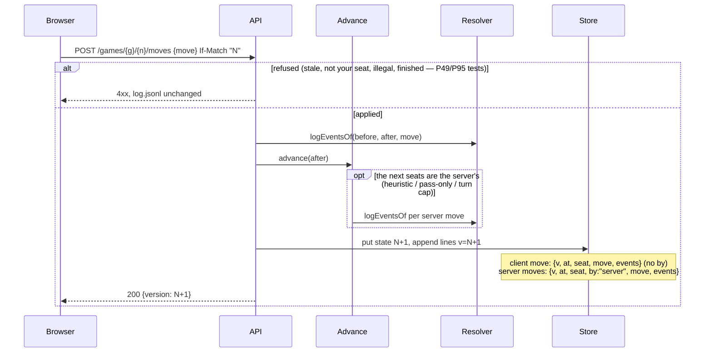
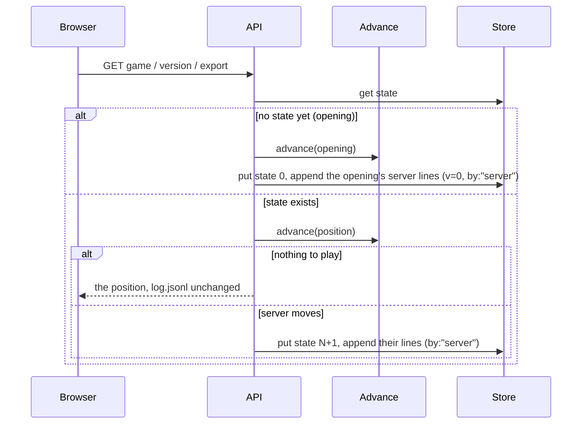
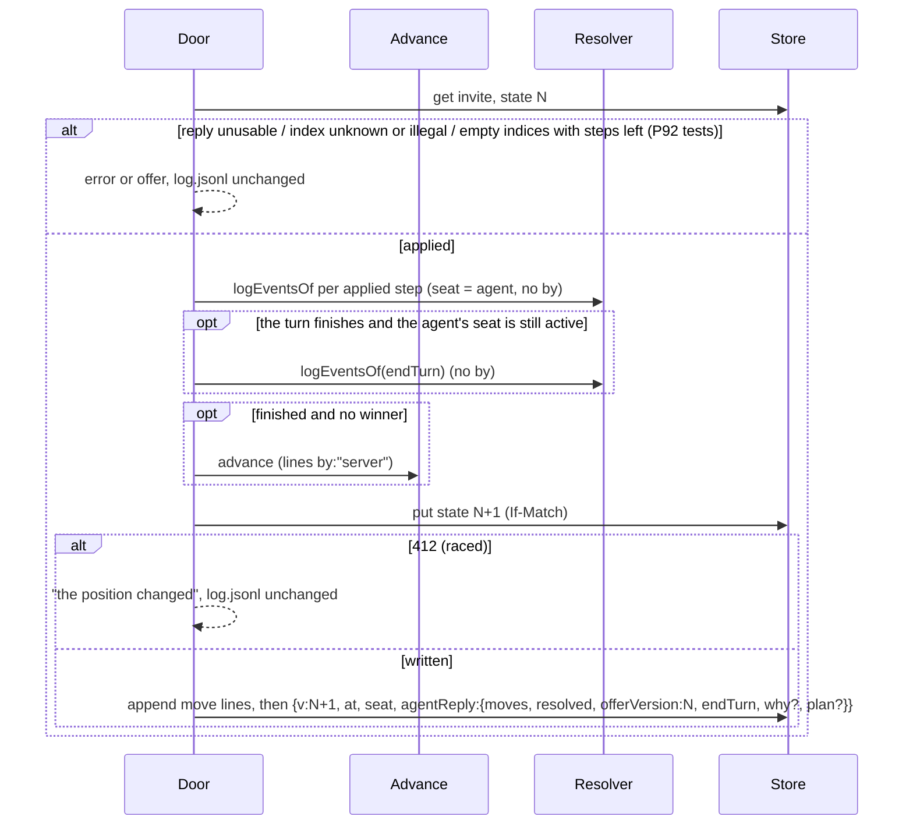
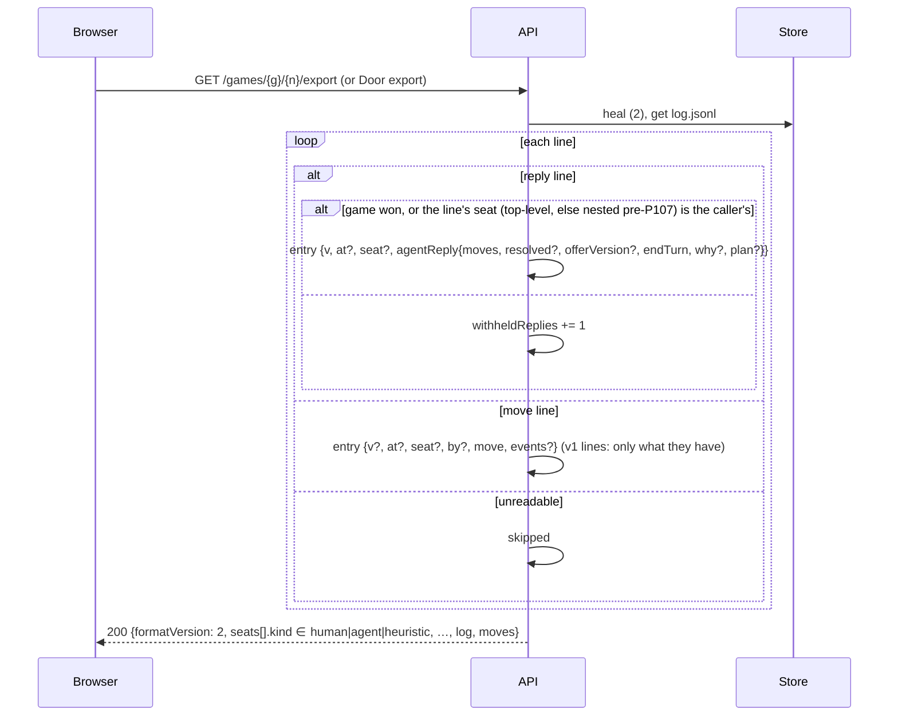
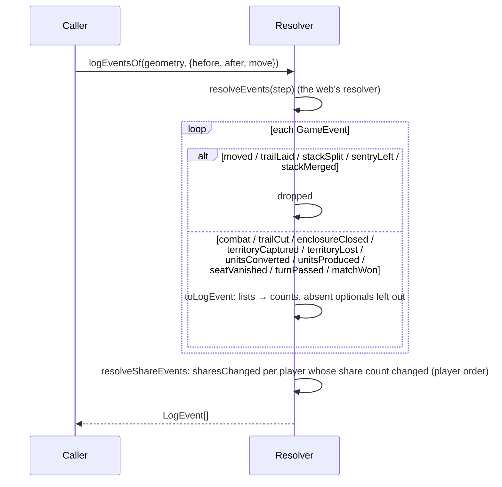

# match-log-v2 — sequence diagrams

Participants are the seams the tests probe:

- **Browser**: a signed-in member's HTTP request (`createOnlineApi`).
- **API**: the handlers (`handlePostMove`, the P95 heal `ensurePosition`, `handleGetExport`).
- **Door**: the MCP door (`tools/call` `move` / `export`).
- **Advance**: `advance` (`game-advance.ts`), the server's own moves.
- **Resolver**: `logEventsOf` (`@conquarrow/rules-core` `events.ts`).
- **Store**: the object store (`state.json`, `log.jsonl`).

[Overview](./match-log-v2.md). Every `alt` and `opt` below has a test; the test
name starts with the diagram number. Server paths:
`packages/online-api/test/match-log-v2.scenarios.test.ts`. Resolver and
projection: `packages/rules-core/test/match-log-v2.events.test.ts`.

## 1. A browser move is logged

## 2. The heal logs server moves

## 3. An agent move is logged with what it resolved to

## 4. The export serves v2

## 5. One move's log events

