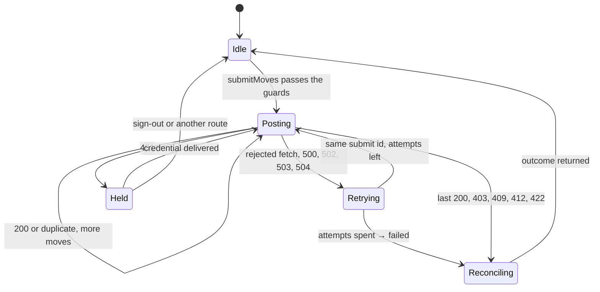
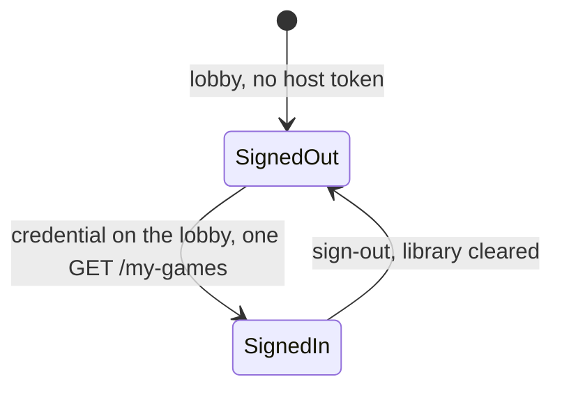

# online-reliability — the server is the source of truth

**Packet:** [P95 — Online reliability](../../design/packets/P95-online-reliability.md)
**SPEC:** §9 is read, not changed ("a lost seat keeps its place in turn order and
is offered only the pass; that pass is a move in the log"). No game rule is added.
**Builds on:** [P18 online-moves-ws](../online-moves-ws/online-moves-ws.md),
[P49 online-move-log-replay](../online-move-log-replay/online-move-log-replay.md),
[P94 online-turn-flow](../online-turn-flow/online-turn-flow.md),
[P92 remote-agent-mcp](../remote-agent-mcp/remote-agent-mcp.md).
**ADR:** [0011 — the server is the source of truth](../../adr/0011-server-is-source-of-truth.md).
**Layer:** `packages/online-api` (handlers, notify, the advance, the summary, the
version route, the WS `$default` route, the payload log), `packages/contracts`
(the pages socket, submit outcome, pages deps), `packages/web` (`online-pages.ts`,
`online-host.ts`, `online-window.ts`, `online-runtime.ts`, `online-gis.ts`,
`online-submit.ts`), `infra/template.yaml` (two routes).
**Features:** [server core](./online-reliability.server.core.feature) ·
[server edge cases](./online-reliability.server.edge-cases.feature) ·
[web core](./online-reliability.web.core.feature) ·
[web edge cases](./online-reliability.web.edge-cases.feature) ·
[sign-in core](./online-reliability.signin.core.feature) ·
[sign-in edges](./online-reliability.signin.edge-cases.feature) ·
[sequence diagrams](./SCENARIOS.md)

## Purpose

The P95 playtest stalled four ways, each a client waiting for something that
would never come: an End turn that unlocked without an answer, a wake that never
arrived, a resumed tab that showed an old board, and a lost seat that nobody
passed. This packet makes the server the one place that decides and the clients
able to always catch up with it.

## Terms

| Term | Means |
|---|---|
| **submit id** | a client-chosen id on one `POST /moves`, 1–64 of `[A-Za-z0-9_-]` |
| **last submit** | `{id, userHash, version}` the envelope keeps for the last applied POST |
| **duplicate** | a POST whose submit id and caller equal the envelope's last submit |
| **pass-only seat** | the active seat when `legalMoves` holds no `step` (lost, headless, or boxed in) |
| **advance** | the server playing every pass-only seat and every heuristic seat in turn order, until a seat with a step that a human or agent must choose, or a winner |
| **budget** | the advance's wall-clock limit per request, `ADVANCE_BUDGET_MS` |
| **heal** | an advance run on a *read* of the game, persisted as a new version |
| **summary** | `{winner, turns, standings}` of a finished game |
| **poll** | the client's `GET …/version` fallback while it is in a game |
| **held submit** | the moves a 401 stopped, kept to send after the next credential |
| **signed in** | the host's session store holds an ID token; `OnlineHostPort.signedIn()` |
| **chooser slot** | the element `id="conquarrow-gis-chooser"` the shell mounts while signed out |
| **library due** | signed in, the hash route is the lobby, and My games not yet loaded |

## Decisions (online/web BSSN, recorded here)

### D1 — idempotent submit

`POST /games/{g}/{n}/moves` takes `{"move": …, "submitId": "…"}`. `submitId` is
optional on the wire (absent → no idempotency, as before); present, it must be
1–64 characters of `[A-Za-z0-9_-]`, else 422.

The persisted envelope gains `lastSubmit: {id, userHash, version}`, written with
every applied POST that carried an id. Every other write (an advance, a heal, an
agent move) carries the current `lastSubmit` forward unchanged.

A POST from a member whose `submitId` equals `lastSubmit.id` **and** whose user
hash equals `lastSubmit.userHash` is a duplicate: 200
`{version: lastSubmit.version, groupHash, gameNumber, duplicate: true}`, nothing
applied, nothing woken. The duplicate check runs before `If-Match`, the finished
check and the turn check, so a retry after the game moved on still learns that
its move landed.

When the conditional write loses a race, the handler re-reads the envelope; if
its `lastSubmit` is this submit, the answer is the duplicate 200, else 412 as
before.

### D2 — the advance

`advance(game, seats, heuristic, clock)` loops while there is no winner:

1. the active seat's `legalMoves` holds no `step` → apply `endTurn` for it,
   **whatever its kind** (human, heuristic, agent). This is §9's pass, played by
   the server;
2. the active seat is heuristic → play its turn as the burst did (up to
   `MAX_MOVES_PER_TURN` choices, then a forced `endTurn`);
3. otherwise stop.

Before each move it reads the clock; once `ADVANCE_BUDGET_MS` (20 000 ms) has
passed since the advance began, it stops with what it has. A heuristic turn may
stop mid-turn; the position is a legal one and the next advance carries on.
`ADVANCE_MAX_MOVES` (4 096) bounds one call against a position that passes
forever. These are transport limits, not balance values.

The advance runs:

- after every applied browser POST and agent `move` (replacing `runBurst`),
- when the opening is materialised (replacing the opening burst),
- **on every read** — `GET /games/{g}/{n}`, `GET …/version`, `POST /moves`
  before its checks, and the agent door's `observe`/`move` load — as a heal.

A heal that plays at least one move persists `version + 1` (state, log lines
stamped with that version, library summary, `lastSubmit` carried forward) and
wakes every bound human (D6). A heal that loses the conditional write re-reads
the envelope and serves that. A read that needs no advance writes nothing.

The client auto-pass (P26) stays: the server has usually passed already, and a
client auto-pass on a seat that is no longer active is refused by its guards.

### D3 — seat-kind ownership

The browser door moves only a **human** seat bound to the caller. When the
active seat is an agent seat bound to the caller, the POST answers 403
`{error: "forbidden", reason: "agent-seat"}`; any other seat that is not the
caller's answers 403 `{error: "forbidden"}` as before. The agent door moves only
an agent seat bound to the caller (unchanged, P92).

### D4 — the game-over summary

For a game with a winner, `GET /games/{g}/{n}` adds

```json
"summary": {
  "winner": "<player id>",
  "turns": 123,
  "standings": [
    { "player": "<id>", "seat": 0, "kind": "human", "territory": 40, "shares": 6, "heads": 9, "lost": false }
  ]
}
```

`turns` is the number of `endTurn` moves in the log (stamped or not). `standings`
follow `state.players` order; `territory`, `shares`, `heads` and `lost` are read
with rules-core's `territoryCountOf`, `shareCountOf`, `headsOf` and `isLost` —
nothing is restated. `kind` is the invite seat's kind.

The agent door's `observe` and `move` on a finished game answer
`{stop: true, reason: "game-over", summary}`; a `move` whose own moves end the
game answers `{applied: true, version, stop: true, summary}`.

### D5 — the version read

`GET /games/{g}/{n}/version` → 200 `{version, activePlayer, winner?}`, member
only (P18 rules: 401, 403, 404), after the heal. It is the poll's endpoint: a
small answer whatever the board's size.

### D6 — every device wakes

Every wake goes to every connection of every bound human, **the caller's
included**: a user's phone and laptop are two connections of one user hash.
This supersedes P18's "not to the caller". The payload stays
`{type: "stateChanged", version, groupHash, gameNumber}` — version-stamped and
constant-size. A client already showing that version does nothing (P49 D4).

### D7 — payload sizes are logged

`OnlineApiDeps` gains an optional `log(line)`. Every HTTP response writes one
JSON line `{"http": "<METHOD> <route>", "status": s, "bytes": n}` (the route
name, never the path, so no hash is logged) and every wake post writes
`{"ws": "stateChanged", "bytes": n, "status": s}`. The HTTP Lambda wires
`console.log`.

### D8 — the heartbeat route

The WebSocket API gets a `$default` route on the connect Lambda; `$default`
answers 200 and does nothing else. A client sends `{"action":"ping"}`.

### D9 — the client submit (supersedes P94 D2's single attempt)

Every POST of a submit carries `submitId = deps.newId()` (browser:
`crypto.randomUUID()`). A rejected fetch or a 500, 502, 503 or 504 answer is
retried with the **same** body and `If-Match`, up to `SUBMIT_ATTEMPTS` (3)
attempts, waiting `deps.wait(SUBMIT_RETRY_MS × attempt)` (1 000 ms) between.
Any other answer is final. A duplicate 200 counts as a 200 with that version.
A submit whose attempts are spent ends `failed`, as before.

`deps.newId` and `deps.wait` are optional on `OnlinePagesDeps`; absent, the
adapter uses `crypto.randomUUID` and an immediate wait. The browser runtime
passes a real timer.

### D10 — a 401 holds the submit

A 401 on a submit's POST ends the submit `unauthorized`, keeps the unsent moves
(that one included, with its submit id) and the version to send them at as the
**held submit**, and asks GIS for a credential (`prompt`). While a submit is
held, `submitPending()` is true, so the controls stay locked.
`deliverGoogleCredential` sends the held submit (D9 rules, same submit ids) and
then reconciles (P94 D3). A held submit is dropped by sign-out and by opening
another game (or by a credential that arrives on another route). If the game
moved on meanwhile, the resend is answered 409/412 and ends `stale`, like any
stale submit, with its reconcile.

`submitNote`: `unauthorized` → "Your sign-in expired. Sign in again and your
move will be sent."; `forbidden` (a new outcome, 403) → "That seat is not yours
to move."; `failed` and `stale` as P94.

### D11 — never miss a wake

`OnlinePagesOpenSocket` becomes `(url, events: {onClose}) => socket`, and the
socket gains `send(text)`. When the current socket closes, the adapter forgets
it.

The host gains `handlePoll()` and `handleHeartbeat()`; the browser runtime calls
them every `POLL_MS` (15 000 ms) and `HEARTBEAT_MS` (300 000 ms, under API
Gateway's 10-minute idle) while the page is visible.

- **heartbeat**: an open socket is sent `{"action":"ping"}`.
- **poll**: when signed in and online-ready, reopen the socket if none is open;
  then, on a game route, unless a submit is in flight or held, GET `…/version`;
  a version above the replay baseline (P49) takes the wake path (`planWake`).

A wake that arrives while a submit is in flight is ignored: the submit's
reconcile reads the same server (P94 D3).

### D12 — resume and the token

The runtime binds `visibilitychange` (visible), `focus`, `online` and
`pageshow` to `handleVisibility(true)`. `becomeVisible` reopens a closed socket,
refreshes a stale token (below), re-reads the game (P25), and refreshes the
lobby.

The ID token is cached in `localStorage` under the same key. It is a cache: the
server verifies it on every request, and no board, log or seat is ever read from
browser storage for an online game. When the token's `exp` claim (read without
verification) is less than `REAUTH_LEAD_MS` (300 000 ms) away or past, by
`deps.now()`, the adapter calls `gis.prompt()` — once per token. GIS is
initialised with `auto_select: true`, so a returning user gets a new credential
with no tap. A token whose `exp` cannot be read is left to the server's 401.

Who the lobby says is signed in, and where the Google button sits, is D13.

### D13 — the lobby shows who is signed in (P97)

Packet: [P97](../../design/packets/P97-signin-lobby.md). No game rule. No
`online-api` change. No production read or write.

#### Diagnosis, recorded before the fix

P95 cached the ID token in `localStorage` (`browserSession`). The shell still
decided "signed in" by reading `sessionStorage` for the same key. The two stores
diverge, and both live symptoms are that split:

- A phone that signs in after P95 holds the token only in `localStorage`. The
  shell reads `sessionStorage` (empty), so it keeps "Sign in with Google", hides
  My games, and never calls `refreshLibrary`. Create invite still works: the
  host reads the store that holds the token. Google's own button stays because
  `renderChooser` appends an iframe under the first `.lobby-online-row` — a
  node React owns, and a class the Learn card also uses — and a One Tap failure
  or a 401 renders it again. The button swaps, sometimes doubles, and sits
  beside Sign out.
- A laptop tab that still has the pre-P95 token in `sessionStorage` shows My
  games and then an empty list. The shell thinks it is signed in, so the button
  is offered. `refreshLibrary` sends the host's token. When `localStorage` is
  empty the read returns before the GET. An unset library is painted as no
  games (`library === undefined` has no sections). A 401 is swallowed the same
  way; that path is not this packet.

The seat-A game created from an invite while the lobby looked signed out is not
missing from the index. Create and accept bind `userHashFromSub` of the bearer
`requireUserHash` verified. Start's `finishStart` writes a membership pointer
for every bound human and agent hash before it returns the game ids. `/my-games`
resolves the caller with the same function. A missing library stamp does not
omit a row: listing follows the pointer, hydrates an unstamped meta from
`state.json`, and still lists a row whose summary is missing (`waiting`). No
backfill. A well-formed P96 body parses; the empty list is an unset library,
not a dropped row.

A leftover `sessionStorage` token is not copied across. Reading that key is
forbidden below, so the laptop shows Sign in until the player signs in again,
into the host store. The indexed game then appears. Do not touch production.

#### Decisions

1. **`signedIn()` is the only sign-in bit.** `OnlineHostPort.signedIn()` is true
   while the host session store holds an ID token. The shell uses
   `host.signedIn()`. No file under `packages/web/src` reads
   `GOOGLE_ID_TOKEN_SESSION_KEY` from `sessionStorage`.

2. **One library read per new credential on the lobby.** `deliverGoogleCredential`
   on the lobby route (not an invite route, not a game route) sends exactly one
   `GET /my-games` and sets the library to that body. An invite route still
   accepts. A game route still loads the game. Neither also lists. Sign-out
   clears the library and reports signed out. My games is offered only by
   `libraryOffered` — online and signed in.

3. **The shell re-reads only when a read is due, and only on the lobby
   route.** `lobbyLibraryDue(signedIn, onLobby, libraryLoaded)` is true only
   when signed in, the hash route is the lobby, and the library is not loaded.
   `onLobby` is `parsePagesHash(hash).kind === 'lobby'`. It is not "React has
   no match yet": an invite route never sets that state, and a game credential
   fills the host board before React flushes `setState`. Passing that flag
   starts `GET /my-games` after an invite accept or a game read, which decision
   2 and sequence diagram 6 forbid. `App`'s effect calls `refreshLibrary` only
   when `lobbyLibraryDue` is true, and it passes the hash route, not
   `state !== undefined`. After the credential handler has loaded the library,
   that effect does not send a second GET. A reload with a stored token
   (library unset, lobby route) sends one GET from the effect. A reload on an
   invite or game route does not. `becomeVisible` / `refreshLobby` may read
   again on resume; that is a later read, not this sign-in.

4. **The Google button mounts once, in a React-owned slot, and never while
   signed in.** `chooserSlotOffered(signedIn)` is `!signedIn`. The online row
   renders an empty `<div id="conquarrow-gis-chooser">` only while that is true.
   `renderChooser` does not create, move, or remove nodes, and does not query
   `.lobby-online-row`. When `document` exists it calls `renderButton` only if
   that element exists and has no element child. When `document` is absent it
   still calls `renderButton` with `{ id: "conquarrow-gis-chooser" }`, so the
   existing no-DOM GIS tests keep their meaning. The credential callback does
   not remove the slot. The shell unmounts it when `signedIn()` becomes true.
   The web package does not gain jsdom. Before this is called fixed on a phone:
   one Google button, no swap between "Sign in with Google" and "Sign in as …",
   not beside Sign out, and the Sign in button back after sign-out.

#### Out of scope

A `GET /my-games` answered 401 still leaves the library unset, which looks
empty (P95 D10). Not this packet. The seat list labelling an agent seat "you"
(P93-a) and the MCP OAuth token-endpoint items are not this packet.

## Flow



Lobby sign-in (D13). The Google slot exists only in Signed out.



## Invariants (EARS)

1. *Ubiquitous*: The server shall apply a submit id from one user at most once per game.
2. *Event-driven*: When a POST repeats the last applied submit id of the same user, the server shall answer 200 with the version that submit produced and shall write nothing.
3. *Unwanted*: If the active seat has no legal step and there is no winner, then the server shall not leave the game waiting on that seat after any write or read it serves.
4. *Ubiquitous*: Every pass the server plays shall be the engine's `endTurn`, logged with the version that persisted it.
5. *Unwanted*: If the browser door is asked to move a seat that is not a human seat bound to the caller, then the server shall answer 403 and write nothing.
6. *State-driven*: While a game has a winner, its `GET` and the agent door's game-over answers shall carry the summary.
7. *Ubiquitous*: A wake shall carry only the type, version, group hash and game number, and shall reach every connection of every bound human.
8. *Ubiquitous*: One advance shall stop within its budget and its move cap.
9. *Unwanted*: If a submit's POST is not answered, then the client shall resend it with the same submit id before reporting failure.
10. *Unwanted*: If a submit is answered 401, then the client shall keep it pending until it is sent after a new credential or dropped by sign-out or a route change.
11. *State-driven*: While the client is in a game and visible, it shall reopen a closed socket and poll the version, and a newer version shall take the wake path.
12. *Ubiquitous*: The client shall read no online board, log or seat from browser storage.
13. *Event-driven*: When a credential is delivered on the lobby route, the client shall report signed in from the host and shall send exactly one GET /my-games, and the library shall be that body.
14. *Event-driven*: When the player signs out, the host shall report signed out, the library shall be cleared, and My games shall not be offered.
15. *Ubiquitous*: The shell shall read signed-in only from the host, and no web source shall read the ID token key from sessionStorage.
16. *State-driven*: While the player is signed out, the hash route is not the lobby, or the library is already loaded, the shell shall not start a GET /my-games.
17. *Unwanted*: If the chooser slot is absent or already holds a button, the client shall not call renderButton, and it shall not create the slot.
18. *Ubiquitous*: The Google chooser shall render only into the shell's chooser slot, and shall not query or append under a lobby-online-row.
19. *Unwanted*: If a credential is delivered on an invite route or a game route, the client shall not replace that route's accept or game read with a library read.

## Counts

19 invariants · 6 feature files · 6 sequence diagrams. P97 adds invariants
13–19, 14 scenarios (1 core, 13 edge, including 2 outlines), two feature files,
and sequence diagram 6. No server change. No backfill.
