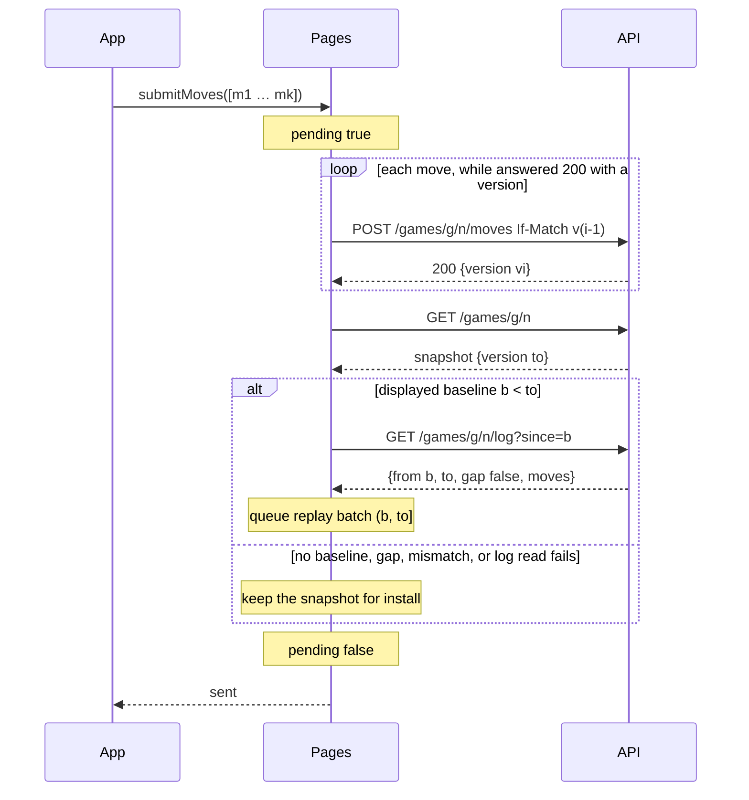
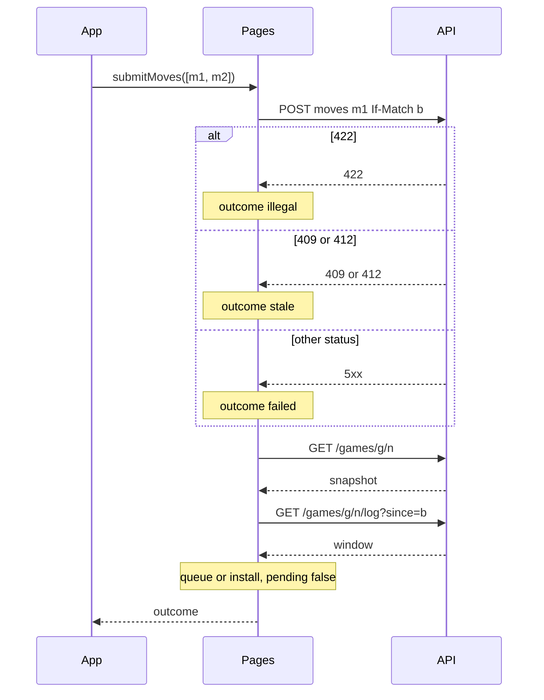
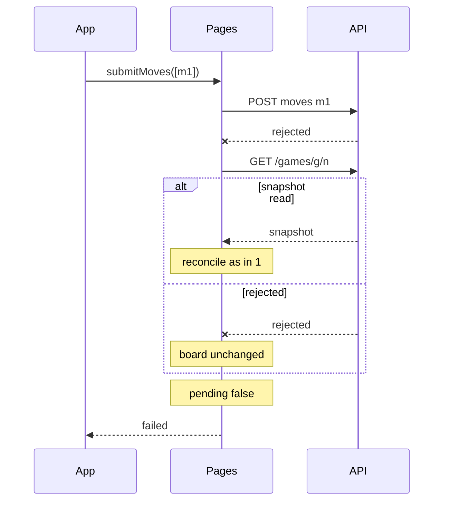
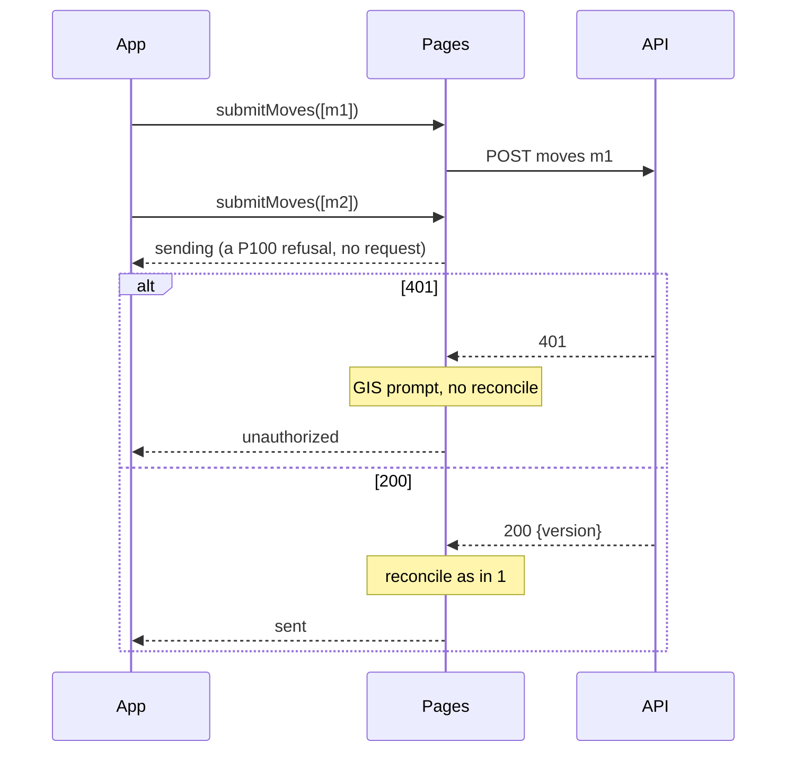

# online-turn-flow — sequence diagrams

Participants are the seams the tests probe: **App** (the caller of the port),
**Pages** (`createOnlinePages` behind `OnlinePagesPort`), and **API** (the
injected `fetch`, faked in tests). Gherkin in the feature files is the
assertable contract; these say the message order.
[Overview](./online-turn-flow.md).

## 1. A submit that lands replays from the displayed baseline

## 2. A refused or stale move stops the rest, then reconciles

## 3. A network failure settles as failed

## 4. Unauthorised, and a submit while one is in flight

