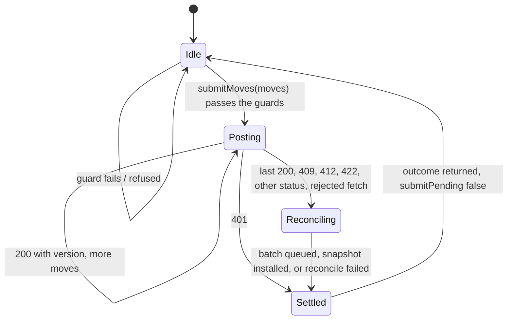

# online-turn-flow — every seat plays out, and a tap answers at once

**Packet:** [P94 — Online turn flow](../../design/packets/P94-online-turn-flow.md)
**SPEC:** none. **No game rule is touched, read, or implied.** Transport plus presentation.
**Builds on:** [P49 online-move-log-replay](../online-move-log-replay/online-move-log-replay.md) (the wake path, D4 and D7).
**ADR:** [0002 — cheap async online](../../adr/0002-cheap-async-online.md). No route changes.
**Layer:** `packages/contracts` (the two online ports), `packages/web`
(`online-pages.ts`, `online-host.ts`, a new pure `online-submit.ts`,
`botPause.ts`, `Hud.tsx`, `App.tsx`, `autoEndTurn.ts`, `styles.css`).
**Features:** [core](./online-turn-flow.core.feature) · [edge cases](./online-turn-flow.edge-cases.feature) · [sequence diagrams](./SCENARIOS.md)

## Purpose

Two playtest findings (P93) with one cause: the client's own move does not go
through the path a wake takes.

- After its own `POST /moves`, the client installs the snapshot. The server ran
  the heuristic burst inside that POST, so the seats after the human jump to
  their end state while the seats after a remote mover animate.
- Nothing shows that the POST is in flight, and the End-turn POST waits for the
  whole burst. On a phone the human taps again.

## Terms

| Term | Means |
|---|---|
| **submit** | one `submitMoves(moves)` call: the moves one commit names (a drafted route, or End turn) |
| **in flight** | from the call until the submit settles; `submitPending()` reads it |
| **settle** | the submit returns an outcome; nothing it started is still pending |
| **reconcile** | the P49 wake path run after the POSTs: re-read the snapshot, then queue the replay window from the displayed baseline, or install |
| **displayed baseline** | P49: the version this client is showing |
| **outcome** | `sent`, `refused`, `illegal`, `stale`, `failed` or `unauthorized`. P100 replaced `refused` with one reason per guard |
| **burst** | the heuristic seats' moves the server persists in the same version as the human's move (P49 "batch") |

## Decisions (online/web BSSN, recorded here)

### D1 — one submit per commit

`OnlinePagesPort.submitMoves(moves: readonly Move[]): Promise<SubmitOutcome>`
replaces `submitMove(move)`; `OnlineHostPort` the same. Both gain
`submitPending(): boolean`. App calls it once per committed draft and once per
auto-pass. Breaking; there are no other clients.

### D2 — the POSTs

The moves are POSTed in order to `POST /games/{g}/{n}/moves`. The first carries
`If-Match` the snapshot version the client holds; each later one carries the
`version` the previous 200 reported. The first response that is not a 200, a
200 whose body has no integer `version`, or a rejected fetch stops the loop: no
later move of that submit is POSTed.

### D3 — reconcile replaces the install

After the loop, unless the loop ended on 401 or nothing was POSTed, the client
runs the P49 wake path: `GET /games/{g}/{n}`, then from the displayed baseline
either queue `(baseline, to]` from `GET …/log?since=baseline` as a replay batch
or install the snapshot (no baseline, a gap, a window that is not the one asked
for, a failed log read). The client's own moves are therefore replayed with
the burst, through the commit path (effects, camera, match log). App no longer
pushes effects or log entries for its own online moves itself, so nothing is
recorded twice.

A reconcile that fails (a rejected fetch, a non-200) leaves the board as it
was. The next wake or visibility change catches up.

This supersedes P25's "a 422 does not GET again": a 422 now reconciles too,
so the board catches up to any seat that moved meanwhile. The four P25 tests
that counted exactly one GET after a 422 now count two, and still assert the
board is the last good one (kickback recorded in the P94 packet).

### D4 — the in-flight guard

While a submit is in flight `submitPending()` is true, and a second
`submitMoves` returns `refused` without a request. The existing P18/P49 guards
also return `refused` without a request: not online-ready, not a game route,
no board, a finished game, not the caller's turn, a replay in flight, and an
empty move list. **Amended by [P100](../send-refusal/send-refusal.md) D1:** each guard now returns its own reason instead of `refused`.

### D5 — outcomes, and every outcome unlocks

The outcome is decided by what stopped the loop:

| stopped by | outcome |
|---|---|
| every move answered 200 (or a 200 with no version) | `sent` |
| 422 | `illegal` (the host still reports `illegal()`, as today) |
| 409 or 412 | `stale` |
| 401 | `unauthorized` (GIS prompt, as today; no reconcile) |
| any other status, or a rejected fetch | `failed` |

`submitMoves` never rejects. `submitPending()` is false once it has settled,
whatever happened, including a rejected reconcile.

The host's `illegal()` note survives the reconcile's own reads of the game
(`GET /games/{g}/{n}` and `…/log`); any other 2xx clears it, as before.

### D6 — what the human sees

- From the tap (synchronously, before the first request) until the submit
  settles, App's `submitting` flag is true. While it is true, or while a replay
  plays, the turn controls (Next stack, End turn) and board input are locked.
- While `submitting`, End turn reads **Sending…**, carries `aria-busy`, and
  shows a CSS spinner.
- `submitNote(outcome)` gives the one line shown under the buttons: for
  `failed`, "The server did not answer, so your last move may not have been
  sent. Try again."; for `stale`, "The game moved on before your move arrived.
  The board has caught up."; nothing for the other outcomes (`illegal` keeps the
  host's existing note, `unauthorized` the sign-in prompt). **Amended by
  [P100](../send-refusal/send-refusal.md) D2:** every outcome but `sent` has a
  note, `illegal` included, and a refusal keeps the drawn route (D3).
- The note clears on the next submit.

### D7 — no server change

The server keeps running the burst inside the End-turn POST; the spinner
covers that wait. No route, log line or balance value changes.

## Flow

## Invariants (EARS)

1. *Ubiquitous*: The client shall POST a submit's moves in the order given, the first with `If-Match` the held snapshot version and each later one with the version the previous POST reported.
2. *Unwanted*: If a POST of a submit is not answered 200 with a version, then the client shall POST none of that submit's remaining moves.
3. *State-driven*: While a submit is in flight, the client shall send no other `POST /moves`.
4. *Event-driven*: When a submit settles, the client shall report it as no longer pending, whatever its outcome.
5. *Event-driven*: When a submit that POSTed at least one move settles with any outcome but `unauthorized`, the client shall have re-read the snapshot, and either queued the replay window from its displayed baseline or installed the snapshot.
6. *Ubiquitous*: The replay window a submit queues shall start at the displayed baseline, so no seat's move between the baseline and the snapshot is skipped.
7. *State-driven*: While a submit is in flight or a replay is playing, the turn controls shall be locked.
8. *Unwanted*: If a submit's request is rejected by the network, then `submitMoves` shall resolve with `failed` and shall not reject.

## Counts

8 invariants · 6 core scenarios · 15 edge-case scenarios · 4 sequence diagrams.
