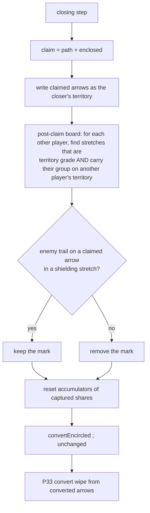

# raider-survives-claim — a territory-grade raider is not captured by a claim

**Packet:** [P87 — A territory-grade raider survives a claim](../../design/packets/P87-raider-survives-claim.md)
**SPEC:** §6.3 (encirclement), §7 (what a closure grants and clears), §6.1 (anchor grades)
**Features:** [core](./raider-survives-claim.core.feature) · [edge cases](./raider-survives-claim.edge-cases.feature)
**Upstream:** [closure](../closure/closure.md) claims and commits;
[encirclement](../encirclement/encirclement.md) judges grade and converts;
[encircled-path](../encircled-path/encircled-path.md) wipes the victim's trail on convert (P33)

## Purpose

§6.3: *you cannot capture a trail-connected raider by claim alone.* The engine
did, in one shape. `closure.commit` (P13) removed every trail mark on the
arrows a closure took, and `convertEncircled` (P07) judged grade after that.
A raider standing on a **newly claimed** arrow had lost its mark by then,
read as gradeless, and converted. The same raider on the closer's
**existing** land kept its mark and survived. Playtest 2026-11-04 shows both:
move #345 (converted) and #329 (survived, then converted by the cut at #331).

The human decided (2026-11-04) that §6.3 wins. This packet makes the claim
leave a territory-grade raider's trail in place, so the grade check sees it.

## Scope

In:
- which enemy trail marks a closure removes from the arrows it claims;
- the two playtest cases as replay tests;
- SPEC.md §6.3 and §7 agreeing on it.

Out:
- who converts: the §6.3 predicate and `convertEncircled` are unchanged;
- the convert wipe (P33), the claim walk and fill (P05b, P42), accrual (P08);
- the anchor grade computation itself (§6.1, P05 D7).

## Terms

| Term | Means |
|---|---|
| **claimed arrows** | the closure's path plus what the claimed ground rings (`Claim.path ∪ Claim.enclosed`) |
| **post-claim board** | the state with the claimed arrows written as the closer's territory and **every trail still in place** |
| **stretch** | one connected component of a player's trail: arrows sharing a point, either direction (§6.1, the same connectivity `anchorGrade` floods) |
| **shielding stretch** | a stretch of player P (not the closer) that, on the post-claim board, is territory grade and carries a group of P standing on another player's territory |
| **bare trail** | enemy trail on a claimed arrow that is not in a shielding stretch |

## The rule

> **Enemy trail on a claimed arrow is removed, unless it belongs to a
> shielding stretch.**

Every claimed arrow becomes the closer's territory either way. Heads are not
touched by the claim. `convertEncircled` then runs as before; a group on a
shielding stretch is territory grade, so it does not convert.

## Decisions (BSSN, recorded here)

1. **The seam is the strip in `closure.commit`.** The strip is what removed
   the grade, so the strip is what changes. `convertEncircled` and the order
   in `movement.ts` `applyStep` (combat → cut → closure → convert) stay. The
   alternative, judging grade on the pre-strip state inside conversion, would
   leave the raider unconverted but with no trail under it. The next apply's
   state-based check would then convert it with no cut, which is the same
   bug one move later.
2. **The whole shielding stretch stays, not only the arrow under the
   raider.** A stretch can run through claimed arrows that hold no head
   (the raider's road home through the pocket). Removing those arrows
   would demote the raider and convert it by claim alone, which §6.3
   forbids. "Bare enemy trail is still stripped" (the human's ruling)
   therefore means trail that shields no one.
3. **Grade is judged on the post-claim board.** Conversion is a state
   predicate (§6.3, "state, not event"). A closure that carves out the
   raider's own anchoring territory has taken the anchor itself, so the
   stretch is not territory grade, is stripped, and the raider converts.
   That is not capture "by claim alone" of a trail-connected raider: after
   the claim the trail no longer reaches its owner's territory.
4. **Only stretches that keep a group from conversion are shielded.** A
   group of P on neutral ground, or on its own territory, is not at risk of
   conversion, so a stretch carrying only such groups is stripped as before
   (P13 unchanged there). A stretch is shielding when at least one of its
   groups stands on another player's territory on the post-claim board.
5. **Order inside `commit`:** write territory, find the shielding stretches
   on the post-claim board, then strip. Players and stretches are visited in
   sorted order, and the kept trail is rebuilt with `canonical` as today.
   The result is a set, so the order cannot be observed, but sorted order
   keeps the code free of iteration-order luck.
6. **No port change.** `Claim`, `closureOf` and `enclosedBy` are unchanged.
   `ClosureRules.commit` is internal to rules-core. If `commit` needs the
   stretch and the grade, inject them into `makeClosureRules` from the
   trail rules (a narrow helper, not a `RulesPort` method).

## What a surviving raider means downstream

Each of these is an existing rule applied to a position that already arises
when a raider walks onto enemy land along a territory-grade trail (#329's B).
None needs a new rule, so nothing goes to §11.

- **Fill.** Only the closer's ground walls a fill (§7). Enemy trail on the
  closer's land does not enter it. Unchanged.
- **The raider's own later closure.** The raider's trail is now on the
  closer's land. Landing home claims it back by the ordinary claim walk
  ("territory is contestable", §7).
- **Accrual.** An enemy head on a share halts that share (§11 item 15). The
  claimed share still changes owner and resets (§7). A surviving raider on a
  claimed share arrow therefore blockades it (§7, "Blockading is real").
- **Later cuts.** The surviving stretch is ordinary trail on enemy land:
  cuttable (§6.1), with a territory-root cut at its feeder. When a cut drops
  its grade, the raider converts on that apply and P33's wipe runs. That is
  #331.

## How a claim commits

## Invariants

1. When a closure commits, the system shall make every claimed arrow the
   closer's territory, whether or not enemy trail stays on it.
2. When a closure commits, the system shall keep a player's trail on every
   arrow of a shielding stretch.
3. When a closure commits, the system shall remove from every claimed arrow
   each enemy trail mark that is not in a shielding stretch.
4. The system shall not change any enemy trail mark on an arrow the closure
   did not claim, other than through the convert wipe (P33).
5. When a closure commits, the system shall convert an enemy group standing
   on a claimed arrow if and only if that arrow is in no territory-grade
   stretch of the group's owner on the post-claim board.
6. The system shall give the same conversion outcome for a territory-grade
   raider whether its arrow was the closer's territory before the closure or
   was claimed by it.
7. When a closure commits with no combat in the step, the system shall
   conserve total heads on the board.
8. The system shall not mutate the input state, and shall return equal
   outputs for equal inputs.

## Counts

Core: 7 scenarios. Edge cases: 9 scenarios. Invariants: 8.
No §11 item opened; the decisions above are BSSN or follow from §6.3.
