# remote-agent-mcp — message flows

**Spec:** [overview](./remote-agent-mcp.md) · [core](./remote-agent-mcp.core.feature) · [edge cases](./remote-agent-mcp.edge-cases.feature)

One sequence diagram per protocol flow. An `alt` is another outcome of that
same exchange, not a second flow. Gherkin states what is assertable. These
diagrams state the message order. A path with no diagram will not be built.

Participants are doors and leaf seams, not internal functions. The component
under test is the handler. Tests probe the leaves, not the SDK and not a
service that already owns the rule.

| Leaf the test may probe | Why this seam |
|---|---|
| `ObjectStore` | handlers already take it. Probing `S3Client` is too thin |
| `PostToConnection`, wrapped as a Promise method | the ping is the behaviour. The API Gateway client is too thin |
| `GoogleVerifier`, `GoogleCodeExchange` | injected. Tests do not call Google |
| client-id metadata `fetch` | injected. A non-https `client_id` must not reach it |
| clock, signer, `log` | injected. Not I/O probes |

Do not probe a fatter type that owns join, the burst, or the offer check.
Those stay inside the handler. Phase 2 writes the leaf interfaces and no
implementation. Phase 3 implements behind them.

## 1. Unauthenticated discovery

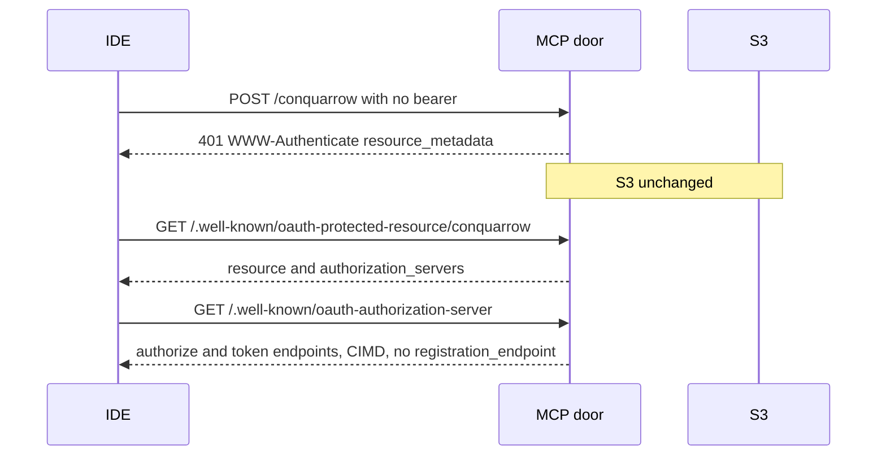

A bearer that is missing, badly signed, the wrong audience, expired, or a
Google ID token takes the same 401. The body does not echo the bearer.

## 2. Authorization code

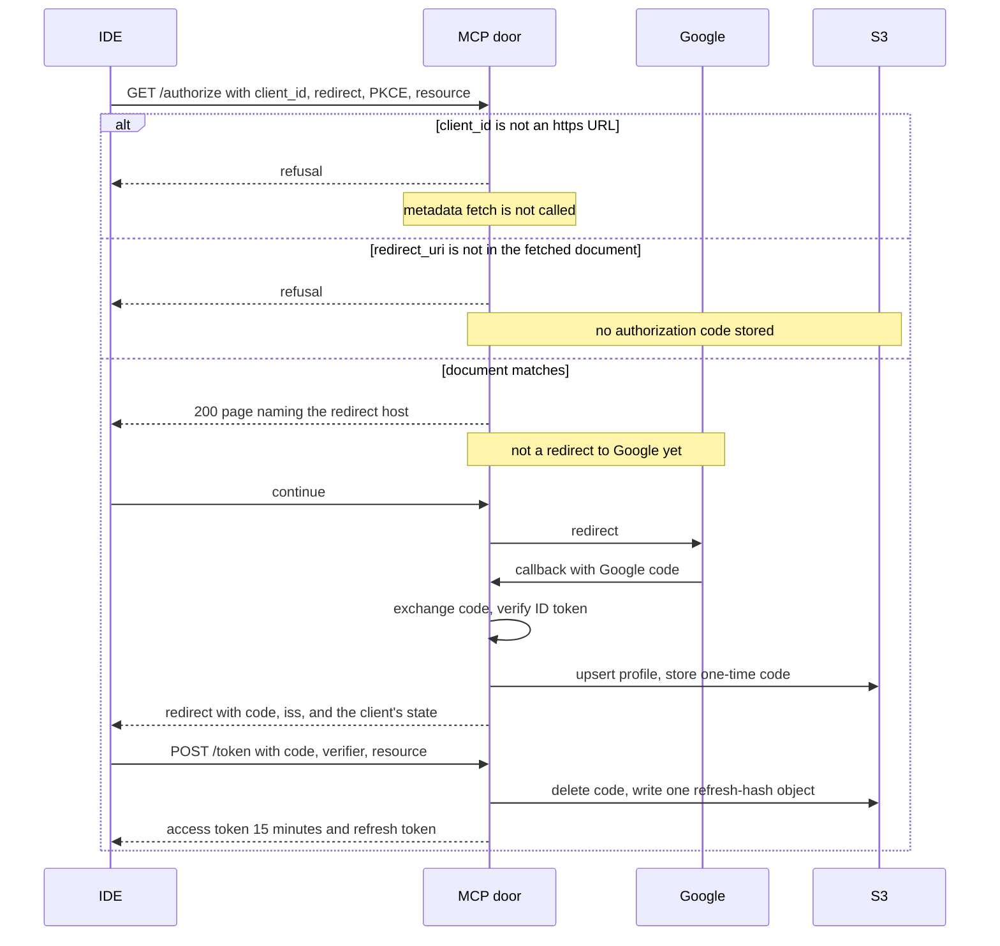

`resource` must be exactly `https://mcp.games.hochgi.com/conquarrow`. PKCE is
S256. Our code lives 60 seconds by the injected clock and dies on use.

## 3. Refresh rotation

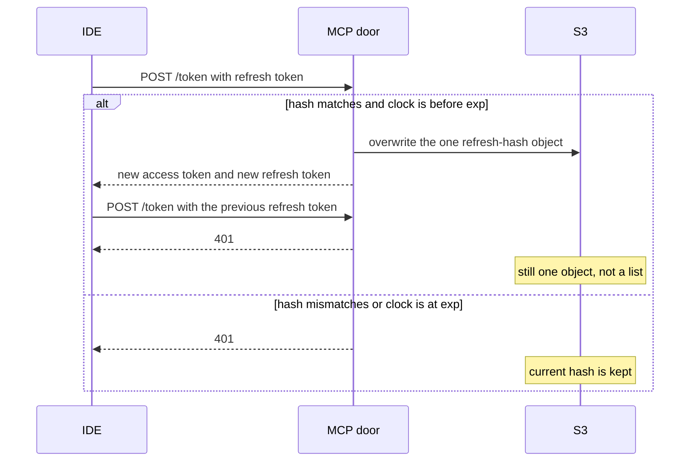

There is no revocation list. A stolen access token is 401 once the clock
passes `exp`, and it is not stored.

## 4. Create

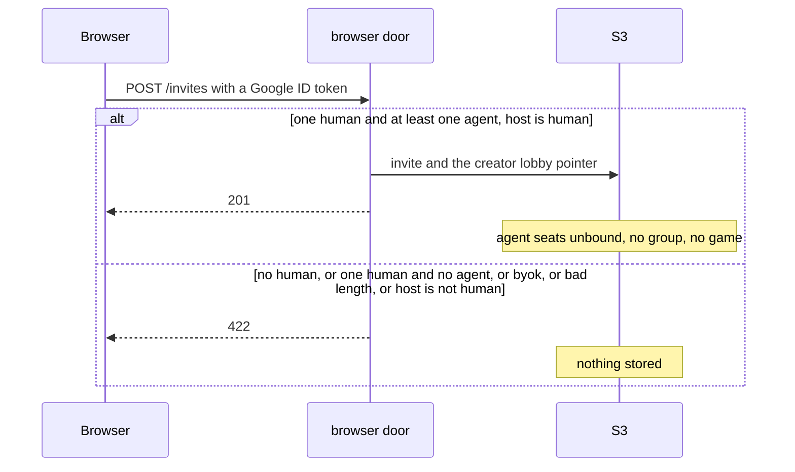

## 5. Browser accept

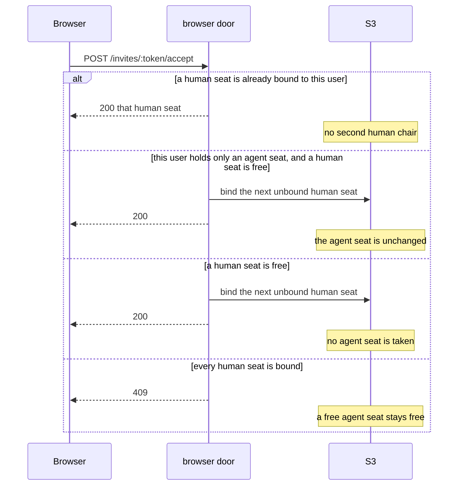

## 6. MCP join

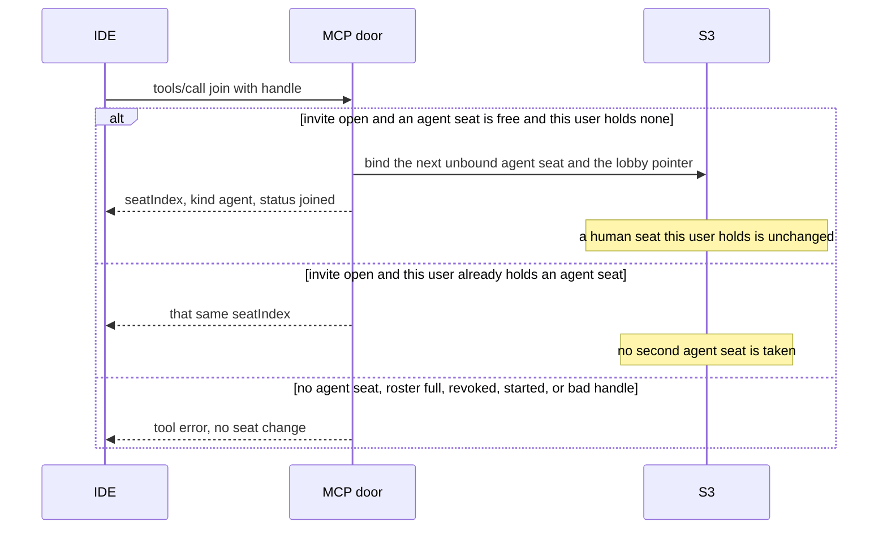

Join does not Start. Two different Google users may each take an agent seat,
in seat-index order.

## 7. Start

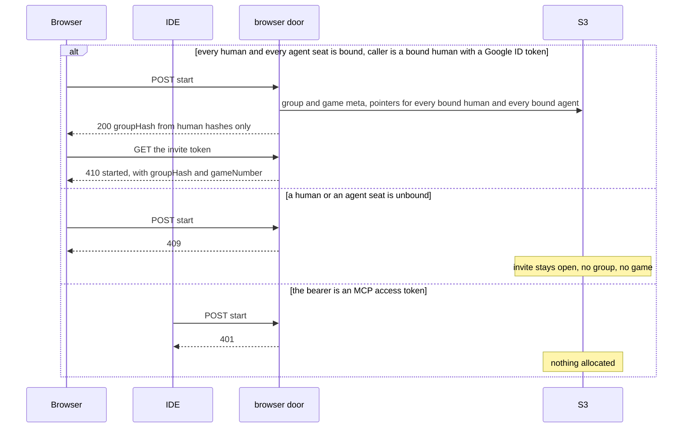

The browser door does not verify MCP access tokens. After Start, MCP `join`
is the started refusal in diagram 6, not a 410 on the MCP door.

## 8. Handshake, and no stream

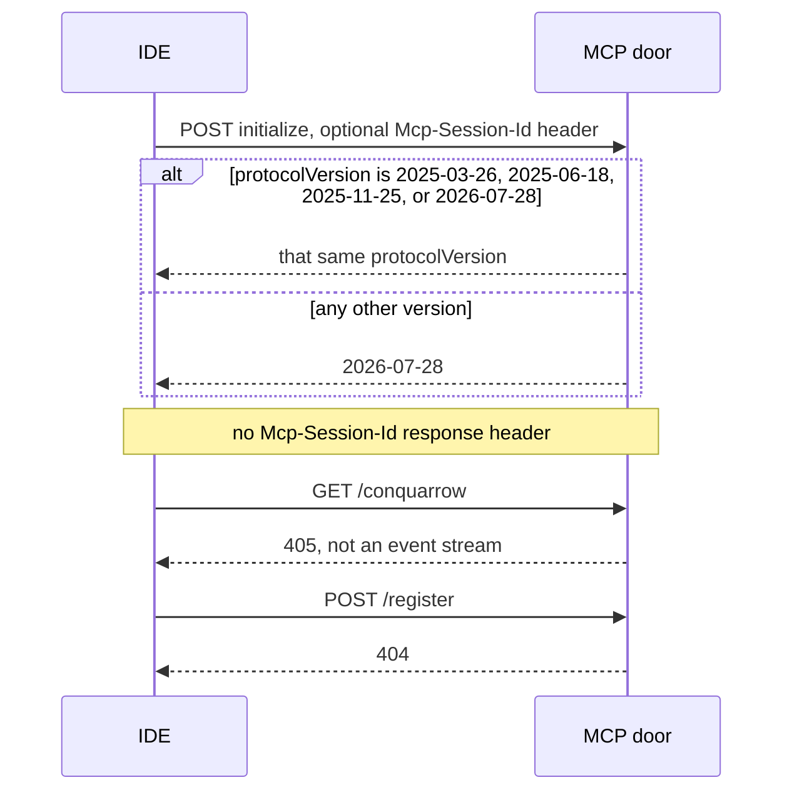

A `tools/call` does not need a prior `initialize` in this process. Each POST
is one invocation.

## 9. observe

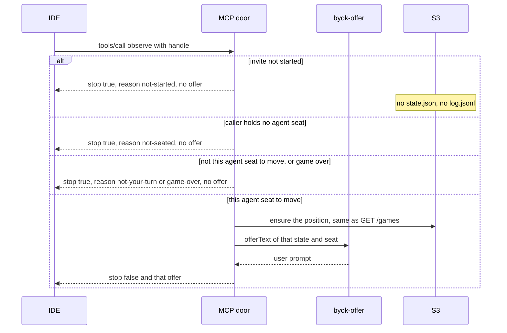

The offer is the package text: numbered rows and the reply instruction. Fresh
locks, no plan echo. The web prompt with those cleared is the same string.

## 10. move

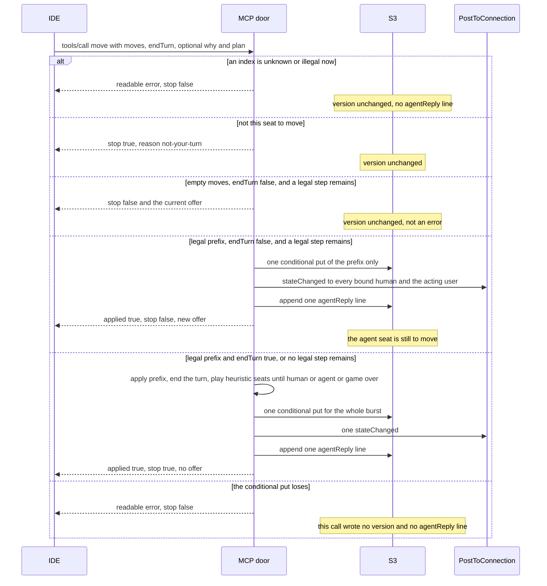

The reply is all or nothing. The server rebuilds the offer from S3. It does
not apply a legal prefix and then keep an illegal tail. It does not call
`POST /moves` and it does not invoke the WebSocket Lambda.

## 11. Who gets the ping

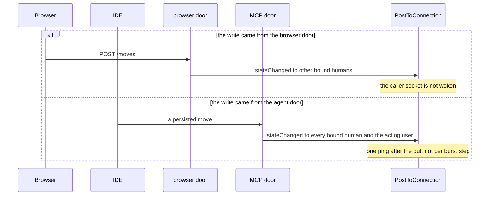

A missing socket is not an error. The payload is the existing `stateChanged`.

## 12. The record is not a move

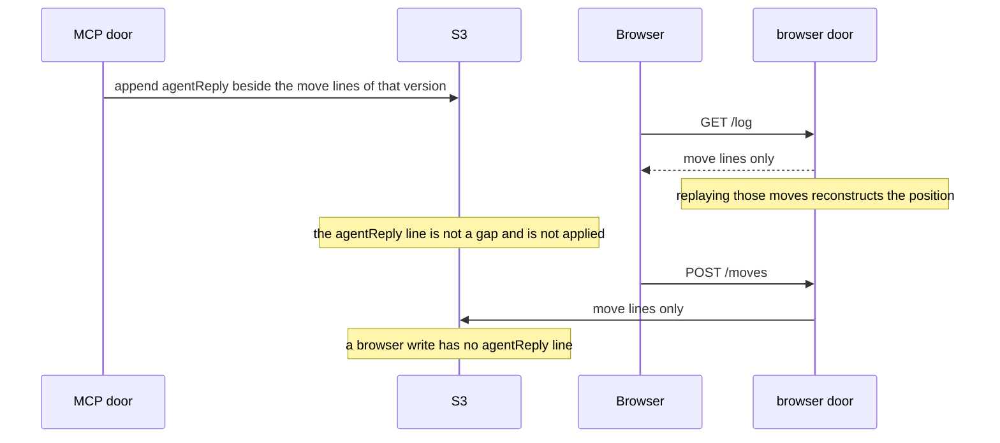

`why` or `plan` that contains the invite token or the bearer is stored with
that substring replaced by `[redacted]`. The injected log never receives the
handle, the token, or the bearer.

## Path index

| Diagram path | Gherkin |
|---|---|
| 1 unauthenticated 401 | edge: unauthenticated POST |
| 1 metadata document | edge: protected-resource metadata |
| 1 no registration endpoint | edge: no registration endpoint |
| 1 wrong bearer | edge outline: token that is not this door's access token |
| 2 consent page, then Google | edge: consent page |
| 2 non-https client_id | edge: non-https client_id |
| 2 redirect not in the document | edge: redirect not in the metadata document |
| 2 loopback ephemeral port | edge: loopback redirect may use an ephemeral port |
| 2 form-encoded token | edge: form-encoded token request redeems the code |
| 3 rotation | edge: rotated refresh token |
| 4 create stored | core: create stores a lobby |
| 4 create refused | edge outline: create refuses |
| 5 accept next human | core: browser accept |
| 5 accept while holding the agent seat | edge: accept by a user who already holds the agent seat |
| 5 humans full | edge: accept is 409 |
| 6 join binds agent, same user holds both | core: MCP join |
| 6 second join | core: a second join |
| 6 two users | edge: two different Google users |
| 6 join refusal | edge outline: join refuses |
| 7 start, humans-only groupHash | core: start allocates a game |
| 7 start too early | edge: start before the agent has joined |
| 7 MCP JWT on start | edge: start with an MCP access token |
| 8 initialize, no session | core: initialize is answered |
| 8 older protocol version | edge: older known initialize version |
| 8 GET 405 | edge: GET /conquarrow does not open a stream |
| 9 observe on turn, same offer text | core: observe on the agent's turn |
| 9 before start | edge: observe before Start |
| 9 not this turn | edge outline: observe when it is not this agent's turn |
| 9 not seated | edge: observe by a user who has not joined |
| 10 bad index, and legal-then-illegal | edge: bad index, legal then illegal |
| 10 not this turn | edge: a move when it is not the agent's turn |
| 10 empty prefix | edge: empty moves and endTurn false |
| 10 no legal step remains | edge: no legal step remains |
| 10 endTurn false | core: legal prefix with endTurn false |
| 10 endTurn true and burst | core: endTurn true |
| 10 lost put | edge: lost conditional put |
| 10 burst stops at the next agent | edge: burst stops at the next agent |
| 11 browser ping skips the caller | edge: a browser move still does not ping the caller |
| 11 agent ping includes the acting user | core: legal prefix with endTurn false |
| 12 record ignored by replay | edge: the log line has the reply fields |
| 12 redaction and log probe | edge: a token echoed into why |
| 12 browser write has no record | edge: a browser move does not append an agentReply line |

Lobby, library, and deletion scenarios are not message flows. They stay in
the feature files only.
