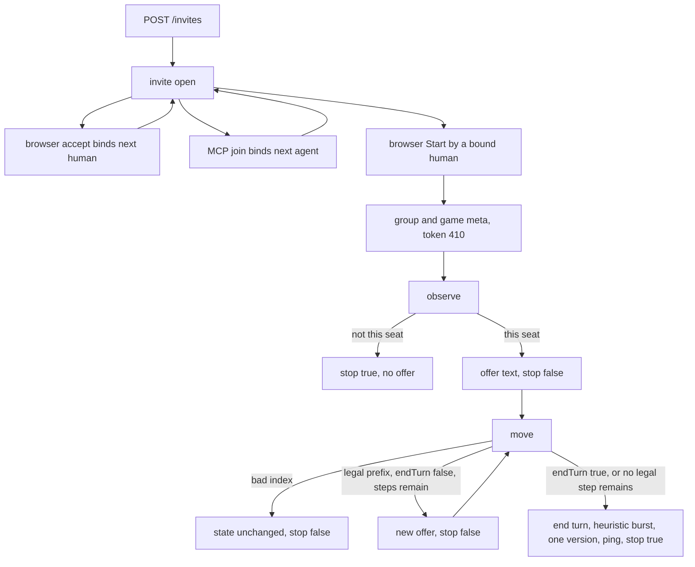
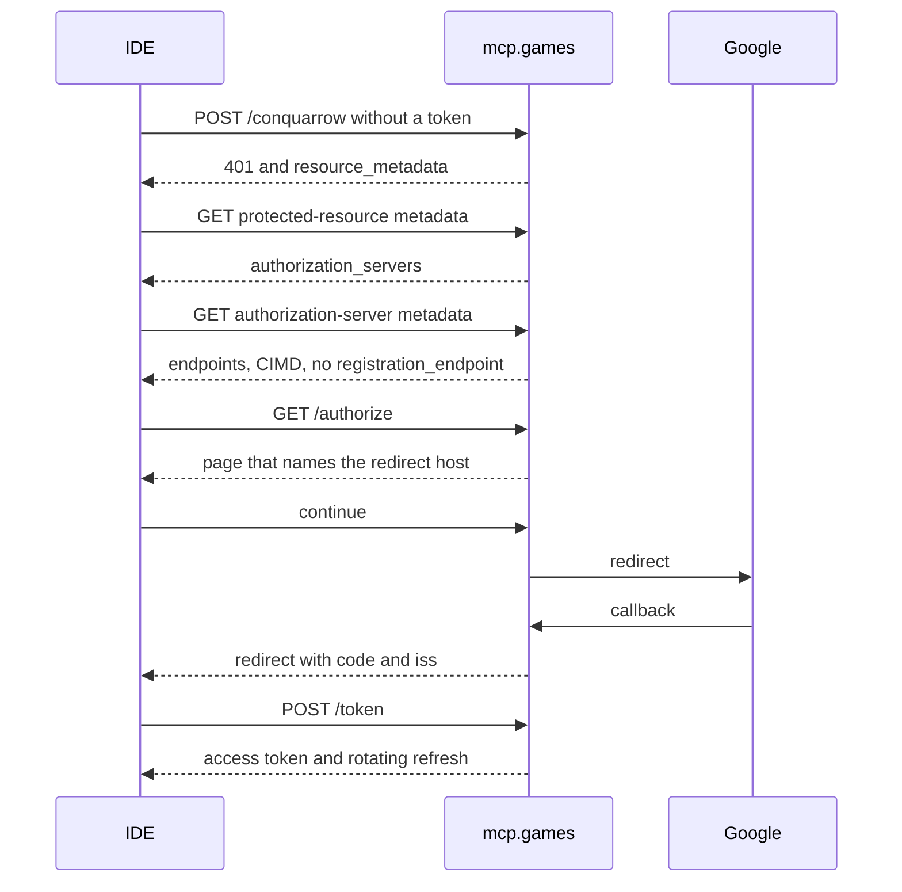

# remote-agent-mcp — an agent seat on the online match

**Packet:** [P92 — Remote agent MCP seat](../../design/packets/P92-remote-agent-mcp.md)
**ADR:** [0009](../../adr/0009-remote-agent-mcp-seat.md) amends [0002](../../adr/0002-cheap-async-online.md).
Cost ceiling: [0007](../../adr/0007-invite-only-byok-relay.md). Door settlement: the packet.
**SPEC:** none. No game rule. Nothing is owed to SPEC §11. The one SPEC edit is the
online pointer in the delivery-shape paragraph, so it no longer says every AWS
write needs two humans.
**Features:** [core](./remote-agent-mcp.core.feature) · [edge cases](./remote-agent-mcp.edge-cases.feature) · [message flows](./SCENARIOS.md)

A person plays in the browser. The same person, or another, plays an `agent`
seat from Claude Code, Cursor, or OpenCode. The IDE's model decides when to
call a tool. The tool runs in one Lambda and dies. This server does not call a
model, and it does not poll while a human is away.

## Terms

| Term | Means |
|---|---|
| **agent seat** | a chair kind beside `human` and `heuristic`. Bound iff `userHash` is set. Never a host chair. Never driven by the heuristic chooser or by the web BYOK loop |
| **handle** | the invite link the human pasted, or the bare token. A 64-hex token, or the first `/invite/` plus that token in the string (`#/invite/<token>` and `https://games.hochgi.com/#/invite/<token>` both count) |
| **MCP door** | `POST https://mcp.games.hochgi.com/conquarrow`. One JSON-RPC body, one invocation, then gone |
| **browser door** | the existing HTTP API. Google ID tokens only. It does not accept an MCP access token |
| **access token** | a JWT this door issues. `iss` is `https://mcp.games.hochgi.com`. `aud` is exactly `https://mcp.games.hochgi.com/conquarrow`. Lifetime 15 minutes from the injected clock |
| **offer text** | the user prompt from `@conquarrow/byok-offer` for that state and seat: numbered rows and the reply instruction. Not a second copy |
| **reply** | `moves` (integer indices), `endTurn` (boolean), optional `why` and `plan` |
| **playtest record** | one log line the replay skips. Not a move |
| **stop** | the model ends the chat turn. We cannot. `stop: true` means do not call another tool |

`userHash` stays `truncate16(SHA-256(sub))`. The same Google user is the same
hash on both doors. Google `sub` is never returned to a client and never written
to a log line.

## Where the code lives (BSSN)

- **`@conquarrow/byok-offer`** — the pure prompt builder and the reply parser,
  moved out of `packages/web/src/byokBot.ts`. No React, no `fetch`, no clock,
  no `Math.random`. Web re-exports the moved functions and does not keep a
  second builder. The web seat's HTTP call to a model stays in web.
- **MCP handler** — a second Lambda entry in `packages/online-api`
  (`mcp-http.ts`), not a new package. It reads and writes the same S3 keys,
  calls the same `apply`, and uses the same `PostToConnection` leaf. It does
  not HTTP-call `POST /moves` and it does not invoke the WebSocket Lambda.
- **Shared persist-and-burst** — one function, used by `POST /moves`, by the
  opening ensure, and by the MCP `move`. Heuristic seats play until the active
  seat is human or agent or the game is over. An agent seat is never given the
  heuristic chooser. One conditional put for the caller's moves plus the burst.
- **`packages/mcp` is deleted** in this packet. No stdio bin, no
  `@conquarrow/mcp`, no SVG board tool on the remote door. Historical specs
  that mention a parked bot copy are not rewritten, except
  [conquarrow-mcp](../conquarrow-mcp/conquarrow-mcp.md), which this packet
  supersedes. Live instruction files that name `packages/mcp` as a current
  package (`AGENTS.md`, the adapter-leaf rule, the component-testing skill,
  `tsconfig.json`) drop that name. `eslint.config.js` purity guard covers
  `@conquarrow/byok-offer`.

## Seat and lobby

Online plans may name `human`, `heuristic`, and `agent`. `byok` stays refused
online (422, nothing stored). Length stays 3 or 6.

Create stores an invite when the plan has at least one human, and either at
least two humans or at least one agent. One human and the rest heuristic is
still refused. Zero humans is refused. The host chair is a human seat
(default: the first human). An agent chair cannot be the host: that create is
422 and stores nothing.

The local lobby does not grow an agent chair. `byok` stays a local kind.
Switching Local to Online still forces seats 0 and 1 to human **only when the
plan has no agent chair**. A plan that already has an agent chair keeps that
chair and does not gain a forced second human. Leftover `byok` still becomes
`heuristic`. Seat 0's kind control, in the online picker, does not offer
`agent`. Dropping a human is allowed only when the plan would still have one
human and (an agent chair or two humans). The last human cannot be dropped.

Browser accept binds the next unbound **human** seat. It does not take an
agent chair. Its "already seated" check looks at human seats only: a user who
holds only the agent seat is not returned that seat; accept binds the next
human. If every human seat is bound, accept is 409 even when an agent seat is
free.

MCP `join` binds the next unbound **agent** seat. It does not take a human
chair. Its "already seated" check looks at agent seats only. The same
`userHash` may hold one human seat and one agent seat. A second agent seat for
that hash is not taken; joining again, while the invite is open, returns the
agent seat already held and writes that user's lobby pointer if it is missing.
Two different Google users may each hold an agent seat. Join does not Start.

Start is a browser action by a bound human, and only once every human seat and
every agent seat is bound. Otherwise 409, the invite stays open, and no group
or game object is written. An MCP access token on the browser door is not a
Google ID token: Start with it is 401 and writes nothing. The browser door
does not grow an MCP-JWT verifier. After Start the invite token is 410
`started`, with `groupHash` and `gameNumber`, as today. Join after Start is
refused, including for the user who already holds the seat.

`groupHash` is `truncate16(SHA-256(sorted human userHashes joined by newline))`.
Agent hashes are not in the preimage. One human's preimage is that hash alone,
no newline. Start writes a group pointer for every bound human **and** every
bound agent, all pointing at that humans-only `groupHash`, so an agent-only
user is listed in My games.

## Labels and status

Library rows and the in-game roster show `Agent (given_name)` when the profile
has a sanitised name, else `Agent`. The name is the existing profile object,
upserted when the MCP login verifies the Google ID token, same sanitiser as
the browser. It is not stored on the seat. Stored seats are
`{ kind: "agent", userHash? }` only.

`GET /my-games` returns `kind: "agent"`, that label, and `you: true` when the
bound hash is the caller's. `GET /games` adds `label` on agent seats only.
Human and heuristic seat objects on that response stay as they are today. The
in-game summary uses the agent label, not `Player`. An agent seat is not
recorded as a human in the match log, and the web does not auto-play it.

`your-turn` / `waiting` / `won` / `lost` stay about the caller's **human**
seat. An agent chair is never `your-turn`. If the caller has a human seat,
status is that seat's status even when the caller also holds the agent seat
and the agent is to move. If the caller has only an agent seat, status is
`waiting` (never `your-turn`, `won`, or `lost`), and `seatIndex` is the agent
seat. A caller with a human seat keeps that seat as `seatIndex`.

Membership of a started game is a bound human **or** a bound agent. An
agent-only user may GET state and the log. `POST /moves` still requires the
active seat to be a human bound to the caller. An agent chair is 403 on that
route. The WebSocket still takes a Google ID token; an MCP access token on
connect is 401.

## Door



Stateless Streamable HTTP. No `wait_for_turn`. No server push to the IDE. No
`Mcp-Session-Id` minted, required, or honoured: a session header is ignored.
No GET stream: `GET` and `DELETE` on `/conquarrow` are 405. Responses are
`application/json`, never SSE. Each POST is one invocation. A `tools/call`
does not need a prior `initialize` in this process.

`initialize` is answered. If the client's `protocolVersion` is `2025-03-26`,
`2025-06-18`, `2025-11-25`, or `2026-07-28`, the result echoes it. Any other
value, including a missing one, is answered with `2026-07-28`. Capabilities
are `{ tools: {} }`. Server name is `conquarrow`. `notifications/initialized`
is 202 with an empty body. Unknown methods are a JSON-RPC error and write
nothing. Malformed JSON is HTTP 400 and writes nothing.

Tools are `join`, `observe`, and `move`. Their descriptions say: when the
result has `stop: true`, do not call another tool; tell the person to send a
message when the human seat has moved. On a correctable error, correct once,
then stop. The server does not count attempts. The throttle is the backstop.

Tool arguments and result text (the JSON inside the text content):

| Tool | Arguments | Success text | Refusal |
|---|---|---|---|
| `join` | `{ handle }` | `{ seatIndex, kind: "agent", status: "joined" }` | `isError`, `{ error }` one of `bad-handle`, `no-agent-seat`, `full`, `revoked`, `started`. No seat change |
| `observe` | `{ handle }` | `{ stop: false, offer }` on this seat's turn | `{ stop: true, reason }` and no `offer` key. `reason` is `not-started`, `not-seated`, `not-your-turn`, or `game-over`. Not `isError` |
| `move` | `{ handle, moves, endTurn, why?, plan? }` | see below | bad reply: `isError`, text includes `stop: false` and a readable `error`. Not this seat: `{ stop: true, reason }`, not `isError` |

`move` success:

- Legal prefix, `endTurn: false`, and a legal step remains: `{ applied: true, version, stop: false, offer }` with the new offer text.
- Legal prefix and `endTurn: true`, or no legal step remains after that prefix: `{ applied: true, version, stop: true }` and no `offer` key.
- Empty `moves` and `endTurn: false` while a legal step remains: not an error. State unchanged, no version bump, the current offer, `stop: false`.

A reply is all or nothing. The server rebuilds the offer from S3 and does not
trust indices against text the model saw earlier. Bad JSON, a non-integer
index, an unknown index, or a step that is illegal at the moment it would be
applied: write nothing, even if an earlier index in the same reply was legal.
This is not the web loop. The web may apply a legal prefix and then fall back
to greedy; the server must not. The shared package is the text and the parser,
not `playLlmBotTurn`.

The client does not send `If-Match`. The server conditional-puts the raw it
just read. A lost race is not retried inside the tool: readable error,
`stop: false`, this call wrote nothing.

`observe` before Start does not read or write a game object. After Start,
`observe` and `move` call the same ensure as `GET /games`, so the first read
may persist the opening and a leading heuristic burst, and the offer is for
that state. A later `observe` that is not this seat's turn does not write.

Ping: the browser door still skips the caller's sockets. The agent door wakes
every bound human's sockets **and** the acting user's, including when that
hash matches. One `stateChanged` after the put, not per burst step. A missing
socket is not an error. The payload is the existing one.

## Offer

`offerText(state, seat)` in `@conquarrow/byok-offer` is a pure function of
state and seat: fresh target locks, no plan echo. `observe`'s `offer` is that
string. The web's user prompt, with target locks and the plan echo cleared, is
the same string. The MCP door does not read the web session maps, and it does
not persist locks. A carried lock is not part of the remote offer.

The string includes the numbered rows and
`Reply with only JSON: {"moves":[i,...],"endTurn":true|false,"why":"short","plan":"short"}`.

## Auth

The MCP Lambda is the authorization server. Google is the identity provider.
Cognito stays out. Dynamic registration stays out: there is no `/register`
(404). Clients identify with a client-id metadata document.



Unauthenticated `POST /conquarrow` is 401. The `WWW-Authenticate` header is
`Bearer error="invalid_token", resource_metadata="https://mcp.games.hochgi.com/.well-known/oauth-protected-resource/conquarrow"`.
The same 401 is a missing token, a bad signature, a wrong `aud`, a wrong
`iss`, an expired access token, and a Google ID token presented to this door.
The body does not echo the token.

Protected-resource metadata (`GET /.well-known/oauth-protected-resource/conquarrow`,
no auth) has `resource` equal to that exact URL and `authorization_servers`
of `https://mcp.games.hochgi.com`. Authorization-server metadata
(`GET /.well-known/oauth-authorization-server`) has issuer
`https://mcp.games.hochgi.com`, authorization and token endpoints on that
host, `code_challenge_methods_supported` of `S256`,
`client_id_metadata_document_supported: true`, and no `registration_endpoint`.

`GET /authorize` is 200 HTML that names the client's redirect hostname and
does not redirect to Google until the browser follows continue. Continue
redirects to Google. The callback exchanges the Google code through an
injected leaf, verifies the ID token with the existing injected
`GoogleVerifier`, upserts the profile name, and redirects to the client's
`redirect_uri` with our code and `iss=https://mcp.games.hochgi.com`.
`resource` on authorize and on token must be the exact audience URL. PKCE is
S256. Our codes are one-time, 60 seconds by the injected clock, stored in the
existing bucket, and deleted on use.

`client_id` must be an `https` URL with a path. Anything else is refused
before fetch. Loopback, private, and link-local metadata hosts are refused.
The fetched document's `client_id` must equal the URL, and the requested
`redirect_uri` must be one of its `redirect_uris`. A loopback redirect
(`127.0.0.1`, `localhost`, or `::1`) matches a listed one when the scheme,
host, and path are equal; the port may differ, because an IDE binds an
ephemeral port. A different path is still refused. The consent page shows
that hostname.
Tests inject the metadata fetch and the Google code exchange. They do not
call Google.

Access tokens are HS256, secret from the environment (`MCP_JWT_SECRET`, a SAM
parameter, not committed). Tests inject the signer and the clock. Claims are
`iss`, `aud`, `sub`, `iat`, `exp`. No email, no invite token, no refresh id.
They are not stored. A stolen access token dies at `exp`. There is no
revocation list.

Refresh tokens are opaque 32-byte hex values, not JWTs. Lifetime 30 days.
The current token's hash is one object,
`conquarrow/users/<userHash>/mcp-refresh.json`, in the existing bucket. That
is not a new datastore. On refresh the presented hash must match and the
clock must be before `exp`; the object is overwritten with the new hash and
a new pair is issued. The previous refresh token is then 401. A mismatch is
401 and does not wipe the current hash (no family cascade, no list).

The handler takes an injected `log`. It must not pass the handle, the invite
token, or the bearer to it. A probed test holds a known token and bearer and
asserts neither appears.

## Playtest record

On a persisted `move` only, append one line to the same `log.jsonl`:

```json
{"v":N,"agentReply":{"moves":[1],"endTurn":false,"why":"short","plan":"short"}}
```

`v` is the version that put wrote. `why` and `plan` are omitted when absent
or blank, and each is truncated to 512 characters. If either contains the
invite token or the bearer, that substring is replaced with `[redacted]`
before the append. The line has no `move` key, no offer text, no JWT, no
`sub`. One line per persisted tool call, not per heuristic move in the burst.
A browser `POST /moves` does not write one.

The move parser skips a line that has `agentReply` and no `move`. `GET /log`
does not return it as a move. It is not a gap. Replaying the log's move lines
still reconstructs the position. Pre-P49 bare move lines still parse.

## Cost and the wizard

Reserved concurrency of the MCP function is 5. The MCP stage throttle is 5
requests per second, burst 10. No new bucket, no DynamoDB, no Cognito, no new
budget resource. The ADR 0007 alert already covers this function; the wizard
reminds the human, it does not create a budget.

Operator wizard (not a Gherkin scenario; tests do not need the accounts): a
script the human runs for a Google authorization-code client whose redirect
is `https://mcp.games.hochgi.com/oauth/callback` (the GIS ID-token client is
not that client), a Namecheap CNAME `mcp.games` to the new API Gateway, and a
check that the existing budget alert includes this function. No new Route53
zone. The custom-domain parameter stays empty-by-default, same as the other
APIs.

## Out of scope

Cuts, chords, pincers, land bridges, accumulator capture, spawning onto a
contested arrow, and cells far from the origin are not this packet. Neither
are: a poll or a push to the IDE, the agent creating an invite or pressing
Start or joining after Start, a second agent seat for one Google user, calling
a model, a benchmark harness, a revocation list, per-user quotas beyond the
throttle, Cognito, dynamic registration, a change to a game rule or to local
play, MCP Apps, and a rendered button.

## Invariants

1. When create has no human seat, or one human and no agent, or a `byok` seat, or a length other than 3 or 6, or a host chair that is not human, the system shall respond 422 and shall write no invite.
2. When create has one human and at least one agent, or at least two humans, and the host chair is human, the system shall store the invite and shall bind the creator only to that human chair.
3. While an invite is open, the system shall bind browser accept to the next unbound human seat only, and MCP `join` to the next unbound agent seat only.
4. When a user already holds an agent seat, the system shall return that seat on `join` and shall not bind a second agent seat for that `userHash`.
5. When a human seat or an agent seat is unbound, the system shall reject Start with 409 and shall write no group or game object.
6. When Start succeeds, the system shall compute `groupHash` from human hashes only and shall write a group pointer for every bound human and every bound agent.
7. If the caller is not a bound human presenting a Google ID token, then the system shall reject Start and shall write nothing.
8. When `observe` runs before Start, the system shall return `stop: true`, no offer, and shall not write a game object.
9. While it is not the caller's agent seat to move, or the game is over, the system shall return `stop: true` and no offer, and a `move` shall leave state and version unchanged.
10. When a `move` reply has an index that is unknown or illegal now, the system shall leave state and version unchanged.
11. When a `move` reply is a legal prefix and `endTurn` is false and a legal step remains, the system shall persist that prefix only, shall not end the turn, and shall return the new offer with `stop: false`.
12. When a persisted agent `move` ends the seat's turn, the system shall play following heuristic seats in that same call until the next seat is human or agent or the game is over, shall write one version, and shall not play another agent.
13. When the agent door persists, the system shall wake every bound human's sockets and the acting user's, and when the browser door persists, the system shall not wake the caller's sockets.
14. The system shall append a playtest record only on a persisted agent `move`, and the move parser shall not treat that record as a move.
15. The system shall not write an invite token, a bearer, or a Google `sub` into a playtest record or a log call.
16. When `POST /conquarrow` has no access token whose `aud` is exactly `https://mcp.games.hochgi.com/conquarrow` and whose `exp` is after the clock, the system shall respond 401 and shall name the protected-resource metadata URL.
17. The system shall not expose a dynamic-registration endpoint, shall not mint `Mcp-Session-Id`, and shall not hold a GET stream.
18. When a refresh token is rotated, the system shall reject the previous refresh token.
19. The system shall produce one offer text per state and seat, and `observe` and the web prompt with no carried lock and no plan echo shall be that text.
20. The system shall not list an agent chair as `your-turn`.
21. The system shall not auto-play an agent seat from the browser.
22. The system shall contain no `packages/mcp` directory and no stdio bin.
23. The MCP function shall reserve concurrency 5, and its stage throttle shall be 5 requests per second with a burst of 10.

## Counts

Core: 9 scenarios. Edge cases: 40 scenarios (4 outlines, 17 example rows).
Invariants: 23. Deferred: 0.
SPEC §11 items: 0. Supersedes the stdio scenarios in
[conquarrow-mcp](../conquarrow-mcp/conquarrow-mcp.md).
