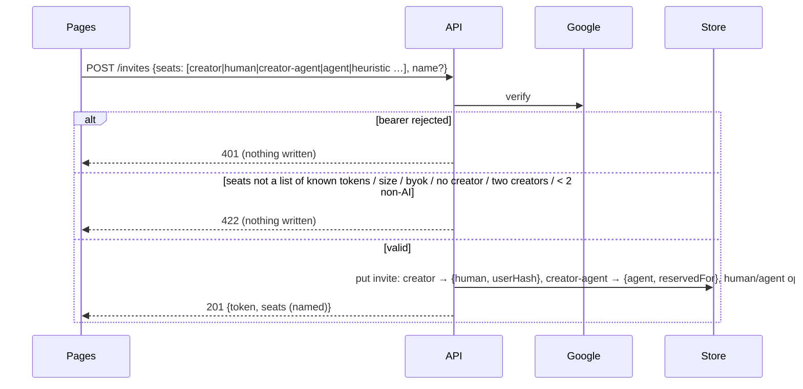
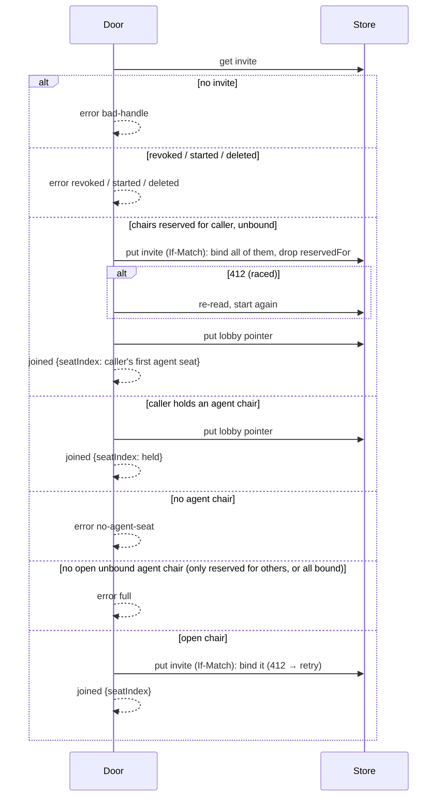
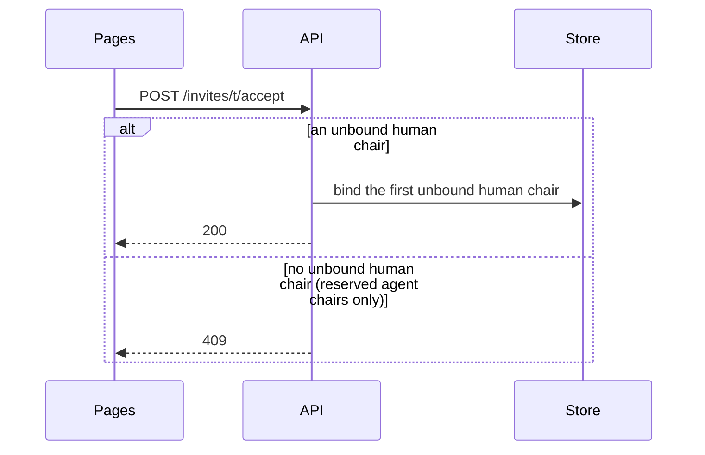
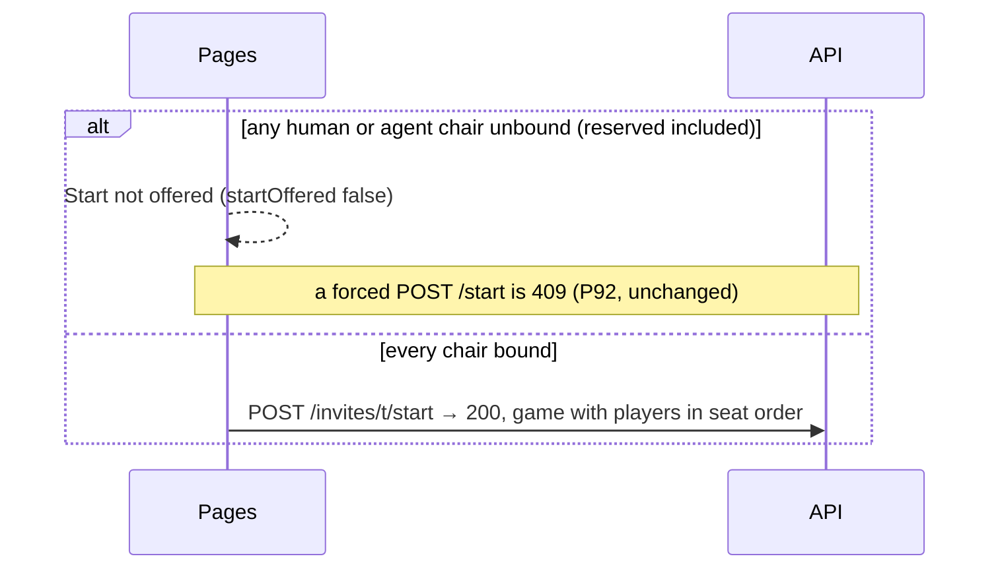
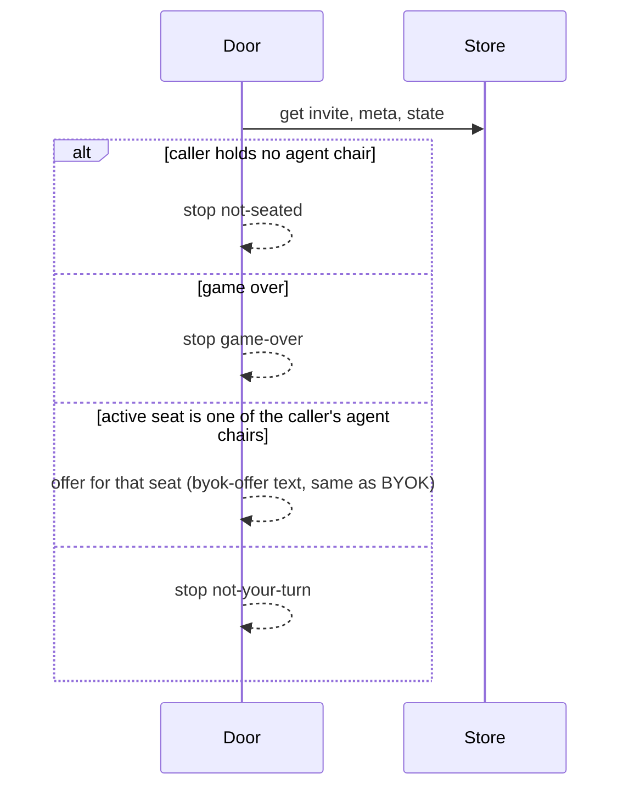
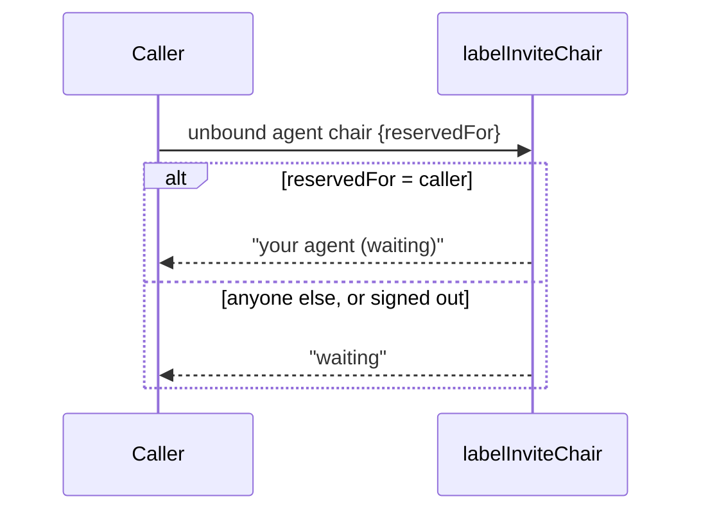

# seat-choice — sequence diagrams

Participants are the seams the tests probe:

- **Lobby**: `pickOnlineSeat`, `lobbyKindOptions`, `planProblem`, `createPlanNote`
  (pure web helpers the `<select>` and the Create button call).
- **Pages**: `createOnlinePages` / `createOnlineHost` with the probed `fetch`.
- **API**: `createOnlineApi` (handlers).
- **Door**: the MCP door (`tools/call`).
- **Google**: the verifier.
- **Store**: the object store.

[Overview](./seat-choice.md). Every `alt` branch below has a test; the test
file names the diagram number.

## 1. Lobby: pick a seat

```mermaid
sequenceDiagram
  participant User
  participant Lobby
  User->>Lobby: pick choice c on seat i (online)
  alt c = creator
    Lobby->>Lobby: seat that held creator → human; seat i → creator
  else any other choice
    Lobby->>Lobby: seat i → c (no pick is refused)
  end
  Lobby->>Lobby: planProblem(plan)
  alt pick-your-seat (no creator)
    Lobby-->>User: Create disabled + "Pick your seat: choose Player (you) on one seat."
  else needs-another (< 2 chairs that are not AI)
    Lobby-->>User: Create disabled + "Create needs you and at least one more Player or Agent."
  else valid
    Lobby-->>User: Create enabled, no note
  end
```

Mode switches: Local → Online never adds `creator`; Online → Local maps
`creator` → `human` and `agent` / `creator-agent` → `heuristic`.

## 2. Create



## 3. MCP join (after the P92 handle / status checks)



## 4. Accept never takes a reserved chair



## 5. Start



## 6. MCP observe / move with several agent chairs



## 7. Labels for a reserved chair



## 8. Creator in any seat (end to end)

```mermaid
sequenceDiagram
  participant Creator
  participant API
  participant Door
  Creator->>API: create [agent, human, creator] (seat C is the creator)
  Door->>API: join (Bob's agent) → seat A
  Creator-->>API: Bob accepts → seat B
  Creator->>API: start → players in seat order; seat A (the agent) moves first
  Door->>API: observe → offer for seat A
  Creator->>API: my-games → status waiting, labels A=Bob's agent, B=Bob, C=you
```
