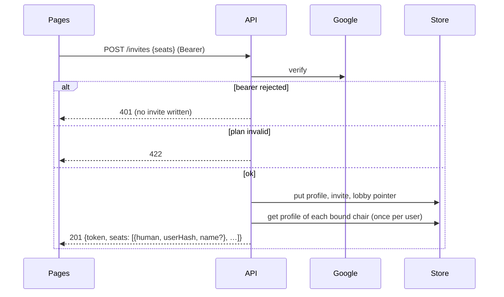
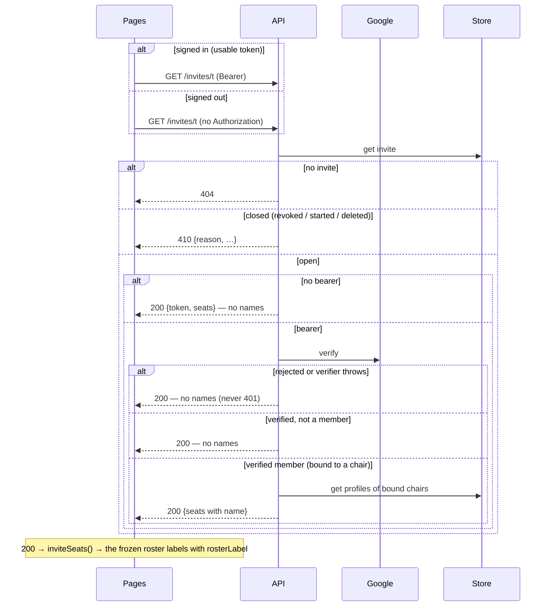

# seat-labels — sequence diagrams

Participants are the seams the tests probe:

- **Lobby/App**: the web callers of the port.
- **Pages**: `createOnlinePages`.
- **API**: `createOnlineApi`, or the probed `fetch` in web tests.
- **Google**: the verifier.
- **Store**: the object store.

[Overview](./seat-labels.md).

## 1. Create: the creator's own name comes back



## 2. Peek: names only for a member



The client side of the peek (`peekHeldInvite`, `auth: 'optional'`):

```mermaid
sequenceDiagram
  participant Lobby
  participant Pages
  participant API
  Pages->>API: GET /invites/t (Bearer when there is a token)
  alt network failure (fetch rejects)
    API--xPages: throws
    Pages--xLobby: boot() rejects as before; inviteSeats() stays unset
  else 401 (an old server; P105 never sends it)
    API-->>Pages: 401
    Note over Pages: ignored — no session end, no prompt, no seats
  else 410
    API-->>Pages: 410 {reason}
    Pages->>Lobby: inviteGoneReason() = reason; no seats
  else any other non-200 (404, 500)
    API-->>Pages: status
    Note over Pages: ignored, as before
  else 200
    API-->>Pages: {token, seats (name?)}
    Pages->>Lobby: inviteSeats() → rosterLabel: you · Bob · waiting · AI
  end
```

## 3. Accept: the joiner sees names

```mermaid
sequenceDiagram
  participant Pages
  participant API
  participant Google
  participant Store
  Pages->>API: POST /invites/t/accept (Bearer)
  API->>Google: verify
  alt rejected
    API-->>Pages: 401 (the P98 door)
  else
    API->>Store: get invite
    alt no invite
      API-->>Pages: 404
    else closed
      API-->>Pages: 410
    else already bound
      API->>Store: get profiles
      API-->>Pages: 200 {seats with name}
    else no free human chair
      API-->>Pages: 409 (lobbyIsFull)
    else
      API->>Store: put invite (If-Match), lobby pointer
      API->>Store: get profiles
      API-->>Pages: 200 {seats with name}
    end
  end
  alt client: 200
    Note over Pages: applyInviteBody → inviteSeats() with names (the joiner reads the host's name)
  else client: 409
    Note over Pages: lobbyFull() true; the board is cleared; inviteSeats() keep the peeked chairs (unchanged by P105)
  else client: 401 / 410 / 404
    Note over Pages: the P98 door / gone / ignored — unchanged by P105
  end
```

## 4. Game: names on every bound chair

```mermaid
sequenceDiagram
  participant Pages
  participant API
  participant Store
  Pages->>API: GET /games/g/n (Bearer)
  alt bearer rejected
    API-->>Pages: 401 (the P98 door, unchanged)
  else not a member / unknown or deleted game
    API-->>Pages: 403 / 404 (unchanged; the client's no-game path, P104)
  else
    API->>Store: get meta, state, profiles of bound chairs
    alt profile missing or unreadable JSON
      Note over API: that chair has no name
    end
    API-->>Pages: 200 {…, seats: [{human, userHash, name?}, {agent, userHash?, name?}, {heuristic}]}
  end
  Note over Pages: board().seats → seatLineLabel → "A=you · B=Ada's agent · C=AI"
```

## 5. My games: labels from the same table

```mermaid
sequenceDiagram
  participant Pages
  participant API
  participant Store
  Pages->>API: GET /my-games (Bearer)
  alt rejected
    API-->>Pages: 401
  else
    API->>Store: list pointers, metas, profiles (once per user)
    API-->>Pages: 200 rows; seat.label = labelInviteChair(…): you · your agent · Bob · Ada's agent · Player B · Agent · AI
  end
  Note over API: a started game's chairs are all bound (Start answers 409 otherwise), so a row never reads waiting
```

Store failures (a `get` that throws) answer 500 on every route above, as
they did before P105; P105 adds no catch around the profile reads.
