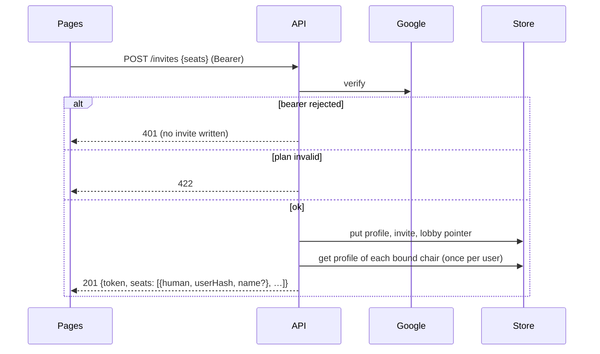
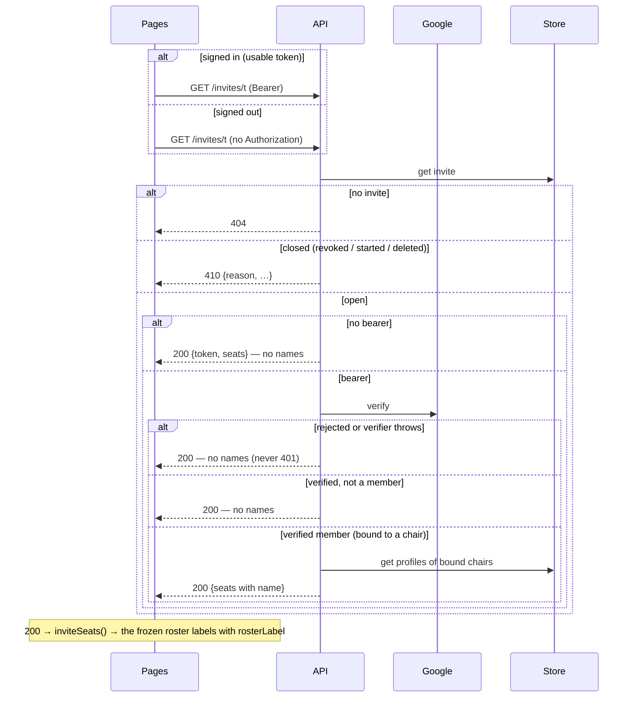
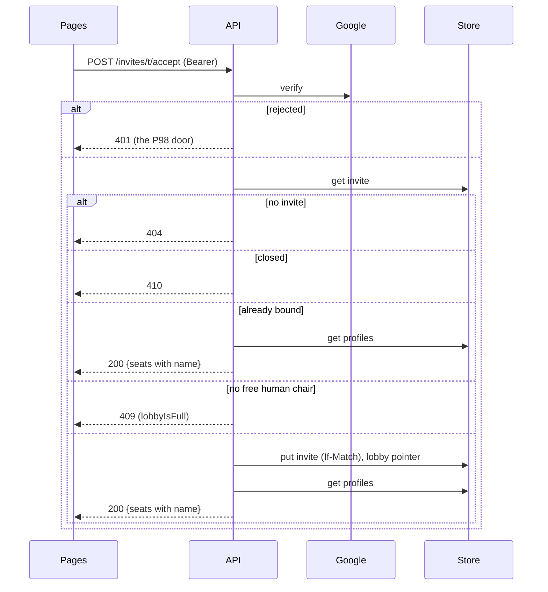
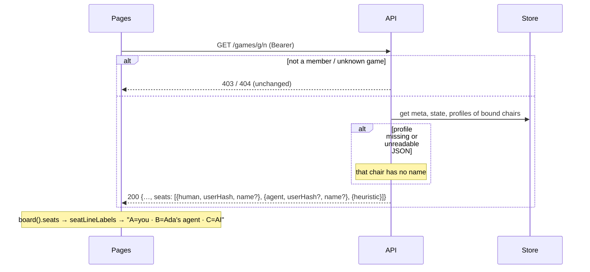

# seat-labels — sequence diagrams

Participants are the seams the tests probe:

- **Lobby/App**: the web callers of the port.
- **Pages**: `createOnlinePages`.
- **API**: `createOnlineApi`, or the probed `fetch` in web tests.
- **Google**: the verifier.
- **Store**: the object store.

[Overview](./seat-labels.md).

## 1. Create: the creator's own name comes back



## 2. Peek: names only for a member



## 3. Accept: the joiner sees names



## 4. Game: names on every bound chair



## 5. My games: labels from the same table

```mermaid
sequenceDiagram
  participant Pages
  participant API
  participant Store
  Pages->>API: GET /my-games (Bearer)
  alt rejected
    API-->>Pages: 401
  else
    API->>Store: list pointers, metas, profiles (once per user)
    API-->>Pages: 200 rows; seat.label = seatLabel(…): you · your agent · name · Player B · Agent · waiting · AI
  end
```

Store failures (a `get` that throws) answer 500 on every route above, as
they did before P105; P105 adds no catch around the profile reads.
