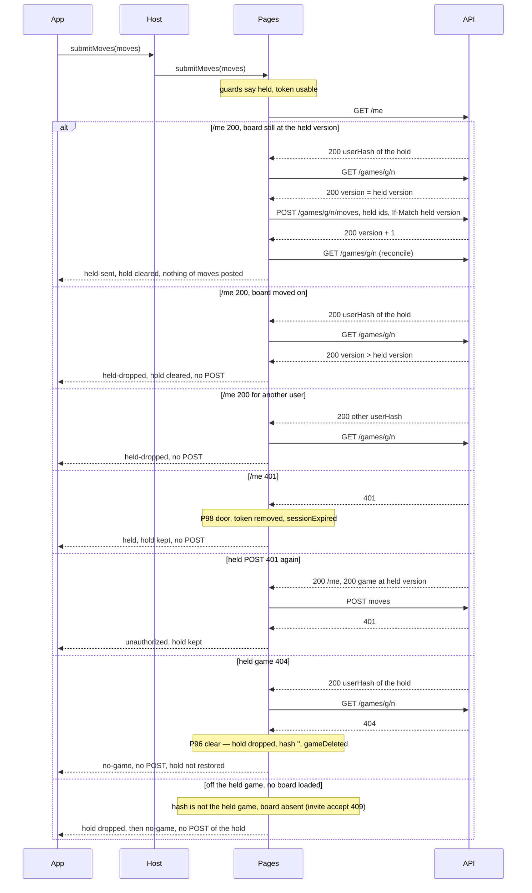
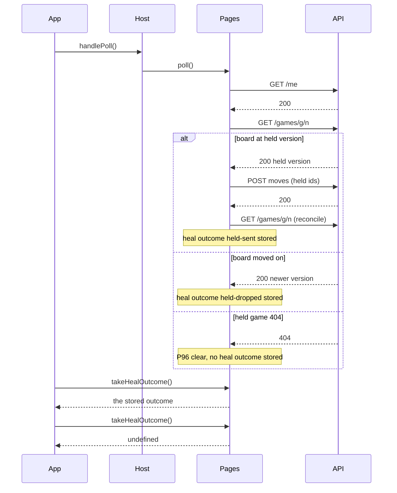
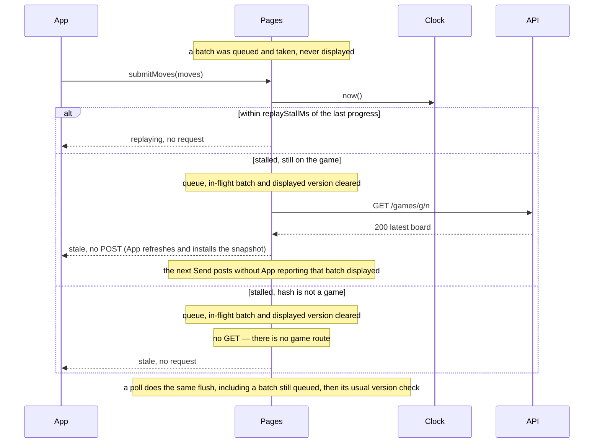
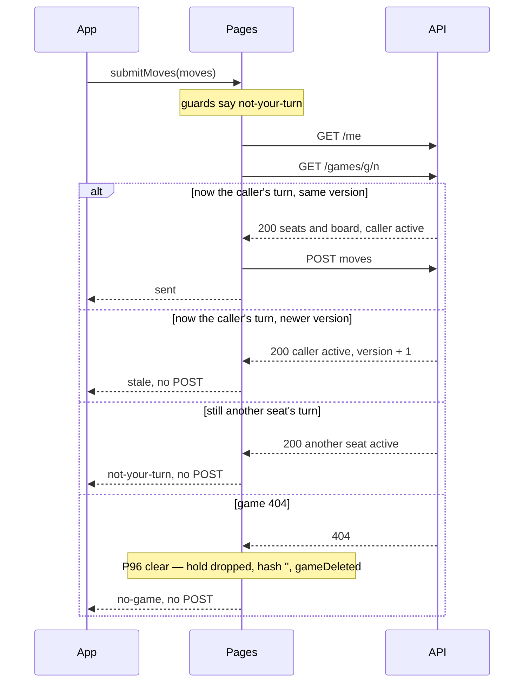

# send-self-heal — sequence diagrams

Participants are the seams a test probes: **App** (the shell), **Host**
(`OnlineHostPort`), **Pages** (`createOnlinePages`), **Clock** (the injected
`now`), **API** (the injected `fetch`). [Overview](./send-self-heal.md).

Each diagram, including every `alt`, is a `@hochgi/test-kit` component test in
`packages/web/test/send-self-heal.scenarios.test.ts`. The component is the
host. The probed leaf is the HTTP door (`PagesApi.send`). The clock is a
counted fake (synchronous, so the kit cannot probe it).

A hold is made the P95 way in every diagram: `POST …/moves` answers 401 and
the token is then replaced in the session store without a GIS credential (the
stuck case — no `deliverGoogleCredential`, so no `sendHeld`).

## 1. A Send heals a hold

## 2. A poll heals a hold, and App hears it once

## 3. The replay watchdog

A flush installs the latest snapshot (the issue's "flushed to the latest
server snapshot"), it does not replay again: App may already have applied part
of the stuck batch, and a second replay of it would diverge.

## 4. One re-check before not-your-turn

