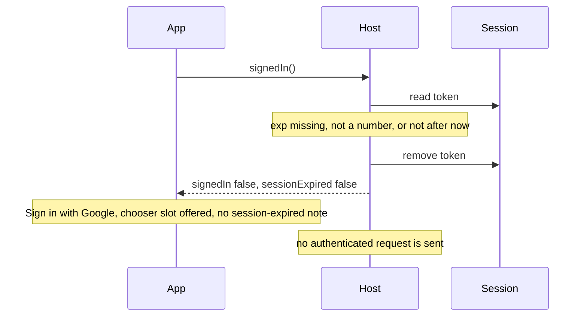
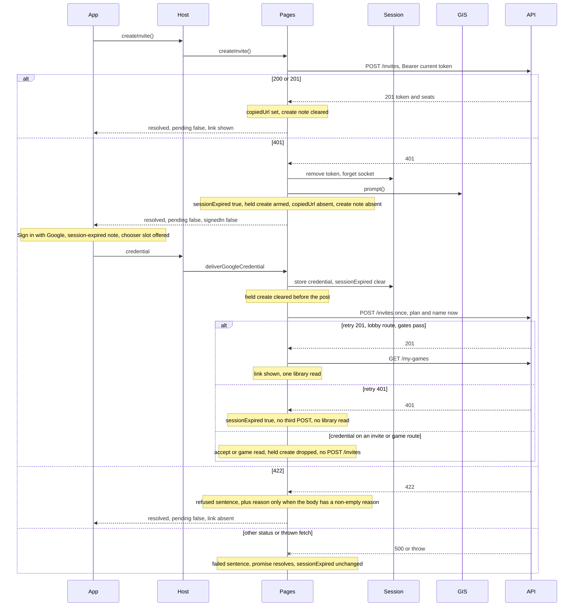
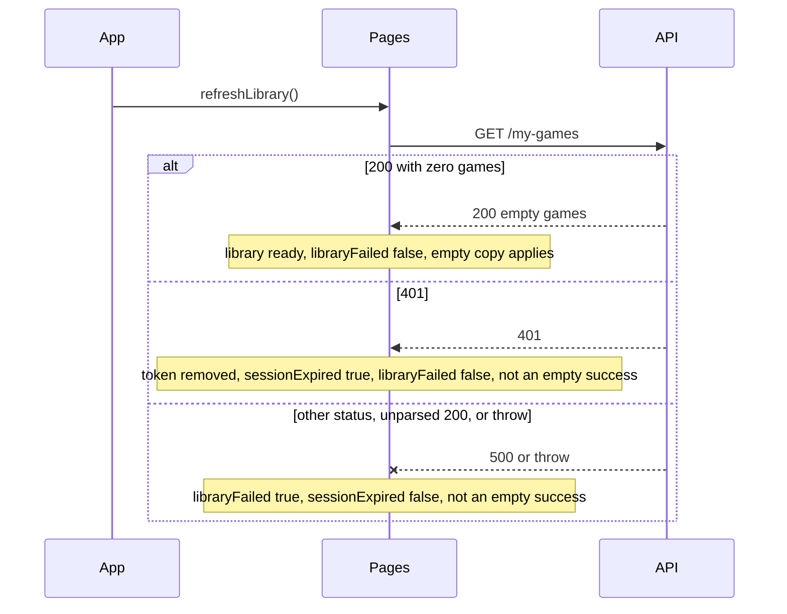
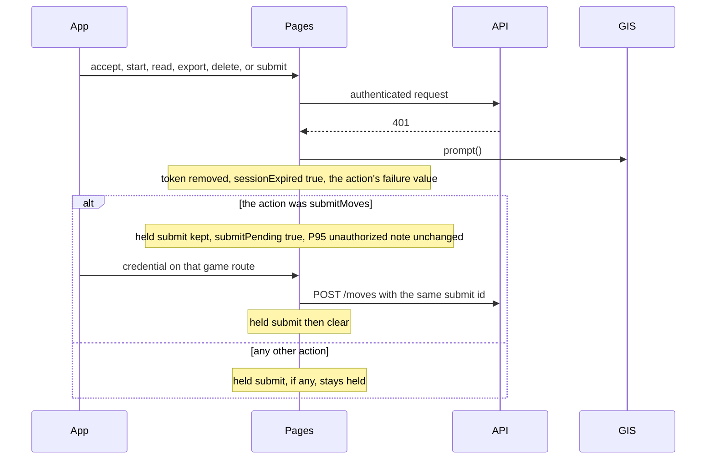
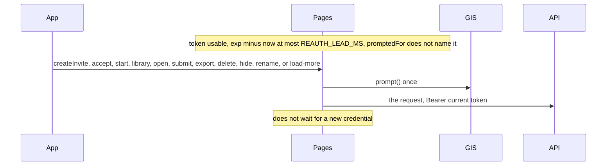
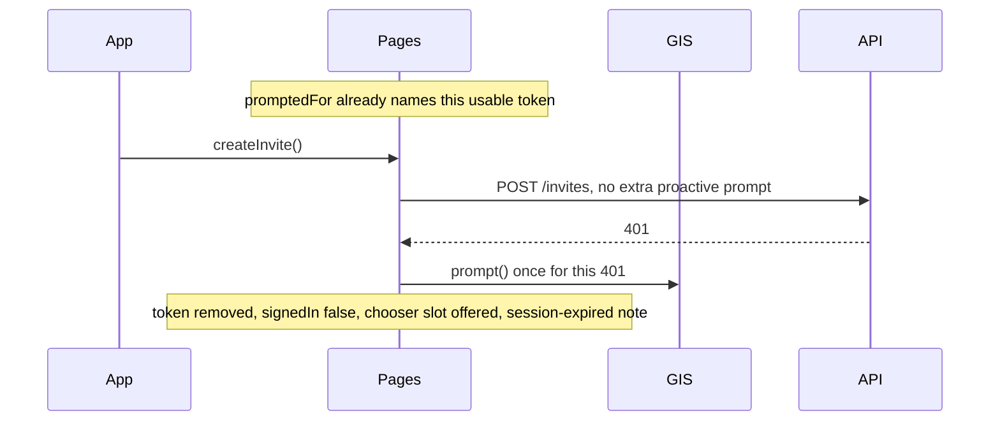

# session-expired — sequence diagrams

Participants are the seams a test probes: **App** (the shell), **Host**
(`OnlineHostPort`), **Pages** (`createOnlinePages`), **Session** (the host
session store), **GIS** (`OnlinePagesGis`), **API** (the injected `fetch`).
[Overview](./session-expired.md).

## 1. An expired token is signed out, with no request

## 2. Create invite

One exchange. The 401 retry is the recovery of that same create, not a new
feature. `gis.prompt` on the 401 is once, because this token is an hour from
expiry, so the lead window does not also prompt.

## 3. My games

## 4. Any other authenticated 401

The invite peek with `auth: false` is not this exchange. A held submit is not
dropped. Hide, rename, load-more, version poll, and `GET /me` are the same door
as the alts drawn here.

## 5. A user action inside the lead window

## 6. promptedFor does not block a 401

