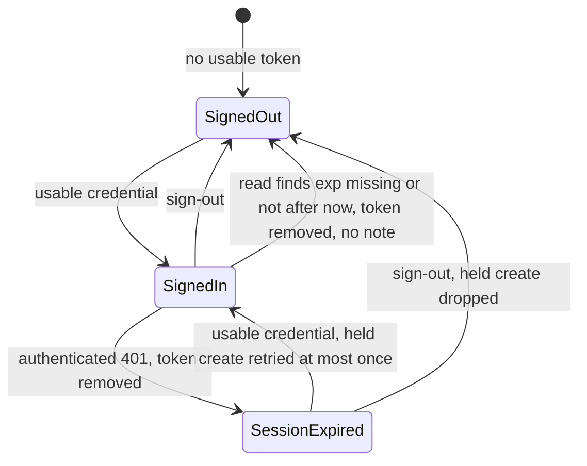

# session-expired — an expired sign-in looks signed out

**Packet:** [P98](../../design/packets/P98-session-expired.md). Issue
[#118](https://github.com/hochgi/conquarrow/issues/118).
**SPEC:** not edited. Online is [ADR 0002](../../adr/0002-cheap-async-online.md),
amended by [ADR 0011](../../adr/0011-server-is-source-of-truth.md). No game rule
is added, changed, or implied. Nothing is owed to SPEC §11.
**Amends:** [online-reliability D12 and D13](../online-reliability/online-reliability.md)
(who `signedIn()` is, and the swallowed `GET /my-games` 401 that P97 left open).
**Layer:** `packages/web` (`online-session.ts`, `online-pages.ts`, `online-host.ts`,
`online-shell-ui.ts`, `Lobby.tsx`, `App.tsx`) and `packages/contracts` (port
comments and three host/pages readers). No `online-api` change.
**Features:** [core](./session-expired.core.feature) ·
[edge cases](./session-expired.edge-cases.feature) ·
[sequence diagrams](./SCENARIOS.md)

## Purpose

A Google ID token lives about an hour, and P95 keeps it in `localStorage`. The
lobby treated "a token string is stored" as signed in, swallowed every 401, and
mounted the Google button only while that bit was false. An expired session
showed **Sign out**, a create that the server refused showed nothing, and My
games showed **No games yet** for a library that had never loaded.

## Terms

| Term | Means |
|---|---|
| **usable token** | a stored ID token whose `exp`, read by `tokenExpiryMs` without verification, is a finite number of epoch milliseconds strictly after `deps.now()` |
| **signed in** | `OnlineHostPort.signedIn()`. True only while the host store holds a usable token. The shell reads sign-in only here (P97) |
| **signed out** | `signedIn()` is false. Local expiry and an unreadable token are this, with no session-expired note |
| **session expired** | `sessionExpired()` is true. An authenticated 401 set it. The lobby shows Sign in with Google and the session-expired note. Cleared by a usable credential and by sign-out |
| **held create** | the interrupted `POST /invites`. Internal. Armed only by a 401 on that POST. One retry, then gone |
| **held submit** | P95 D10. Unchanged: a 401 on `POST /moves` keeps the moves and their submit ids |
| **library ready** | the last `GET /my-games` was 200 and parsed. Zero rows is ready and empty |
| **library failed** | `libraryFailed()` is true. The last library read was not 200 and not 401, or the 200 body did not parse, or the fetch threw |
| **chooser slot** | `#conquarrow-gis-chooser`. Still offered only by `chooserSlotOffered(signedIn)`, which stays `!signedIn`. Expiry and a 401 make that true by clearing the token. The function does not grow a parameter |
| **create note** | `createInviteNote()`. The visible sentence after a create that settled and did not succeed and was not a 401. Absent otherwise |
| **seat-plan note** | the sentence when the online plan is not creatable. Not the invalid-name warning |

`deps.now` is the clock already on `OnlinePagesDeps`. Absent, the adapter's
existing `Date.now()` fallback stays. Do not add a second clock. Do not change
`REAUTH_LEAD_MS` (300 000 ms).

## Decisions (online BSSN)

### D1 — clear an unusable token

`signedIn()` and every authenticated request read the store through one helper.
If the stored value is missing or empty, the result is no token. If it is
present and not usable — no `exp`, `exp` not a finite number, or
`tokenExpiryMs(token) <= now()` — the helper removes it and returns no token.
A second read stays signed out and does not throw.

That read does **not** set `sessionExpired()`. Reloading with an expired token
shows Sign in with Google and no "your sign-in expired" note. The phone check
is that path.

An unreadable token is not left for the server. This supersedes the last
sentence of online-reliability D12 for the sign-in bit. A token that is usable
locally and that the server still answers 401 is D2.

Do not `POST`, `GET`, or open a socket with a bearer that failed this check.
A direct `createInvite()` with no usable token resolves, sends nothing, sets no
create note, and does not set session expired.

### D2 — one door for an authenticated 401

Every authenticated response with status 401 goes through one door. The invite
peek that sends `auth: false` does not. The door:

1. removes the token and forgets the socket (a following `heartbeat` sends
   nothing; a following request sends no `Authorization`);
2. sets `sessionExpired()`;
3. calls `gis.prompt()` once for this 401, **even when `promptedFor` already
   names that token**. `promptedFor` must not block this prompt, and must not
   block the Sign in button. Clearing the token makes `signedIn()` false, so
   the shell shows **Sign in with Google** and mounts the chooser slot. If One
   Tap's `renderChooser` runs before the slot exists, the Sign in button is
   still the fallback (`promptSignIn` → `offerChooser`);
4. leaves the call's failure value in place (no link, library not replaced
   with an empty success, export `undefined`, delete/hide/rename `false`,
   accept does not bind, start does not change the hash, a game read does not
   replace the board, a version poll does not wake, load-more does not append);
5. does not reject the caller's promise.

It does not drop a held submit. A 401 on `POST /moves` still ends
`unauthorized`, keeps the held submit, and keeps `submitPending()` true. The
P95 sentence from `submitNote('unauthorized')` stays. Session expired is
additional, not a replacement.

`promptedFor` is cleared with the token, so the next token can be asked once.

### D3 — retry the interrupted create once

Chosen over re-offering the button. The player already asked for the invite.
Same shape as the held submit, one shot, not a loop.

A `POST /invites` answered 401 arms a held create, leaves `copiedInviteUrl()`
undefined, leaves `createInviteNote()` undefined (the session-expired note is
the visible outcome), and resolves with `createInvitePending()` false.

`deliverGoogleCredential`:

1. stores the credential and, when it is usable, clears `sessionExpired()`;
2. sends a held submit when D10 says so;
3. an invite route still accepts and does not list (P97). A game route still
   reads the game and does not list. Either route drops the held create and
   does not post `/invites`;
4. on the lobby, if a create is held and the create gates still pass (online,
   plan creatable, name valid), the held create is cleared **before** the post,
   then `POST /invites` goes out **once** with the plan and name **at credential
   time**, not the body frozen at the 401;
5. if that post is 200 or 201, the link is set as today, the create note is
   cleared, and exactly one `GET /my-games` follows (P97's lobby read);
6. if that post is 401, D2 runs again and **no** third `POST /invites` and **no**
   library read are sent;
7. if that post is anything else, the create-note rules of D4 apply, and one
   `GET /my-games` still follows when the token is still usable;
8. if the gates fail at credential time, no `POST /invites`, the held create
   stays dropped, and the lobby library read still happens.

No held create: a lobby credential is P97 unchanged (exactly one
`GET /my-games`). Sign-out drops the held create.

### D4 — create always ends in something the player can see

`createInvite()` on the pages adapter and on the host **resolves**. It never
rejects. `createInvitePending()` is false once the returned promise settles,
including a fetch that throws.

| Result | `copiedInviteUrl` | `createInviteNote` | `sessionExpired` |
|---|---|---|---|
| 200 or 201 with a token | the link, as today | absent | unchanged (a usable token was accepted) |
| 401 | absent | absent | set (D2), held create armed |
| 422 | absent | refused sentence, plus `: ` and the body's `reason` when that field is a non-empty string | unchanged |
| any other status, or a thrown fetch | absent | failed sentence | unchanged |

A 422 whose body is `{ "error": "unprocessable" }` has no `reason`. The note is
the refused sentence alone. Do not append `error`. A body that is not JSON is
the refused sentence alone. The server is not changed to grow a `reason`.

The refused sentence is `The server refused this seat plan`. The failed
sentence is `Couldn't create the invite — try again`. Both are the constants
below. The adapter does not retype them.

A create note is cleared when the next create attempt starts, when a 200 or
201 sets the link, and on sign-out.

A create note and a held create are not both set. A 401 arms the hold and
leaves the note absent. A 422, any other non-success, or a throw sets the note
and does not arm the hold. Sign-out clears whichever of the two is set.

### D5 — empty is only a 200

`libraryFailed()` is a pages reader, delegated on the host.

| `GET /my-games` | `libraryFailed` | library body | session |
|---|---|---|---|
| 200, parsed, zero rows | false | that body | unchanged |
| 200, parsed, some rows | false | that body | unchanged |
| 200, does not parse | true | not replaced with an empty success | unchanged |
| 401 | false | not replaced with an empty success. Unset stays unset | D2 |
| any other status, or a throw | true | not replaced with an empty success | unchanged |

`NO_GAMES_COPY` is shown only when the notice helper says `empty`. An unset
library is not empty. A failed library shows `LIBRARY_FAILED_COPY` as a control
that calls `refreshLibrary` again. A 401 does not show that sentence; it shows
the session-expired note, and My games is not offered because `signedIn()` is
false.

### D6 — ask before a user request, still send it

`refreshTokenIfStale` still runs on poll and on `becomeVisible`. It also runs
at the start of every user-initiated authenticated call, before the request:
`createInvite`, `acceptInvite`, `startOnlineMatch`, `refreshLibrary`,
`openMyGame`, `submitMoves`, `exportGame`, `deleteGame`, `hideGame`,
`renameGame`, `loadMoreGames`.

When the stored token is usable and `exp - now <= REAUTH_LEAD_MS` and
`promptedFor` is not that token, it sets `promptedFor` and calls `gis.prompt()`
once. It does not wait for a credential. The request still sends the current
bearer. A token that is already unusable is not prompted here. D1 removes it
and the request is not sent. `submitMoves` returns `refused`, the outcome it
already uses when it sends nothing (`signed-out` since
[P100](../send-refusal/send-refusal.md) D1). It does not set session expired.
`promptedFor` still suppresses a second proactive prompt for the same token.
It does not suppress D2.

### D7 — the seat-plan sentence matches the rule

The plan is creatable when it has at least two `human` seats, or at least one
`human` and one `agent`. That is the existing `onlinePlanCreatable` predicate.
Export it. Do not copy it.

The seat-plan note is `Create needs two Players, or a Player and an Agent.`
The lobby shows it only when online, signed in, seat edits are offered, a
create is not pending, **and** the plan is not creatable. An invalid name keeps
its own warning and does not show this sentence. The old sentence `Create needs
two Player seats.` is gone from `Lobby.tsx`.

## Copy and helpers

In `online-shell-ui.ts`. Tests import these. The shell renders them. The
adapter imports the create sentences rather than restating them.

| Constant | Text |
|---|---|
| `SESSION_EXPIRED_COPY` | `Your sign-in expired — sign in again` |
| `CREATE_REFUSED_COPY` | `The server refused this seat plan` |
| `CREATE_FAILED_COPY` | `Couldn't create the invite — try again` |
| `LIBRARY_FAILED_COPY` | `Couldn't load your games — Retry` |
| `CREATE_PLAN_NOTE` | `Create needs two Players, or a Player and an Agent.` |

- `sessionExpiredNote(sessionExpired, signedIn)` is `SESSION_EXPIRED_COPY` when
  session expired and not signed in, otherwise absent.
- `createRefusedNote(reason)` is `CREATE_REFUSED_COPY`, or that plus `: ` and
  `reason` when `reason` is a non-empty string.
- `createPlanNote(creatable)` is absent when creatable, otherwise
  `CREATE_PLAN_NOTE`.
- `libraryNotice(signedIn, library, libraryFailed)` is `hidden` when not signed
  in, else `failed` when `libraryFailed`, else `unset` when `library` is
  undefined, else `empty` when every section count is 0, else `list`.
  `NO_GAMES_COPY` only for `empty`. `LIBRARY_FAILED_COPY` only for `failed`.

`LobbyOnline` gains `sessionExpired`, `createInviteNote`, `libraryFailed`, and
`onRetryLibrary` (calls `refreshLibrary`). `App` passes them from the host.
The web package does not gain jsdom.

## Port

`OnlinePagesPort` gains `sessionExpired()`, `createInviteNote()`, and
`libraryFailed()`. `OnlineHostPort` gains the same three, delegated. The
doc comment on `signedIn()` says it is true only while the store holds a
usable token, and that an unusable token is removed.

No new HTTP route. No new server field. No change to `submitNote`.

## How a test sees a step

| Step | Observation |
|---|---|
| the host reports signed in / signed out | `host.signedIn()` |
| the token is gone | the session `getItem` for the ID-token key is null |
| session expired is set / clear | `host.sessionExpired()` |
| the session-expired note is offered / absent | `sessionExpiredNote(host.sessionExpired(), host.signedIn())` |
| the create note is `<text>` / absent | `host.createInviteNote()` |
| create is not pending | `host.createInvitePending() === false` once the promise has settled |
| the promise resolved | `await host.createInvite()` does not reject |
| the invite link is shown / absent | `host.copiedInviteUrl()` |
| the library is failed / not failed | `host.libraryFailed()` |
| the library is not an empty success | `myGames()` is not a body this read parsed as zero rows |
| the chooser slot is offered | `chooserSlotOffered(host.signedIn()) === true` |
| GIS prompt was called `n` times | the injected `gis.prompt` count |
| a request was / was not sent | the scripted fetch log, including `Authorization` |
| My games is empty | `libraryNotice(...) === 'empty'` |
| the seat-plan note is `<text>` / absent | `createPlanNote(onlinePlanCreatable(plan))` |

The clock is the injected `now`. A token an hour from expiry is
`tokenExpiryMs > now + REAUTH_LEAD_MS`. A token one minute from expiry is
inside the lead and still usable.

## Flow

## Invariants (EARS)

1. *Ubiquitous*: The host shall report signed in only while the session store holds a token whose `exp` is a finite number strictly after `now`.
2. *Event-driven*: When the host reads a stored token whose `exp` is absent, not a finite number, or not after `now`, the host shall remove that token and report signed out, and shall not set session expired.
3. *Event-driven*: When an authenticated request is answered 401, the client shall remove the token, forget the socket, report session expired, report signed out, and call `gis.prompt` once for that answer, whether or not `promptedFor` already named the token.
4. *Unwanted*: If `createInvite` is answered 422, answered with any other non-success status, or the fetch throws, then the call shall resolve, `createInvitePending` shall be false, and a create note shall be exposed.
5. *Event-driven*: When a usable credential arrives on the lobby after a create was answered 401, and the plan is still creatable and the name still valid, the client shall post `/invites` exactly once more with the plan and name at that moment.
6. *Unwanted*: If that retry is answered 401, or the player signs out before the credential, or the credential arrives on an invite route or a game route, or the create gates fail, then the client shall not post `/invites` again for that held create.
7. *Event-driven*: When `GET /my-games` is answered 200 and the body parses as zero games, the client shall report the library ready and not failed, and the empty copy shall apply.
8. *Unwanted*: If `GET /my-games` is not answered 200 and not answered 401, or the 200 body does not parse, or the fetch throws, then the client shall report the library failed and shall not report it as an empty success.
9. *Unwanted*: If a submit is answered 401, then the client shall keep the held submit until it is sent after a new credential or dropped by sign-out or a route change, and shall also report session expired.
10. *Event-driven*: When a user-initiated authenticated request starts and the token is usable and within `REAUTH_LEAD_MS`, and `promptedFor` does not name it, the client shall call `gis.prompt` once and shall still send that request with the current bearer.
11. *Ubiquitous*: The seat-plan note shall be the two-Players-or-a-Player-and-an-Agent sentence, and shall be shown only when the plan is not creatable.
12. *Event-driven*: When the player signs out, the client shall clear session expired, the create note, the library failure, and a held create.
13. *Unwanted*: If the lobby credential has no held create, the client shall still send exactly one `GET /my-games` on the lobby route (P97). A held create whose retry is answered 401 shall not send that read.

## Existing fixtures

`ALICE.bearer`, `BOB.bearer`, and `CAROL.bearer` are opaque strings. This
packet makes an opaque token signed out. The test phase replaces those three
bearer strings with unsigned JWTs whose `exp` is `Date.UTC(2099, 0, 1)`, via
the existing `tokenExpiringAt`, and leaves `sub` and `userHash` alone.
Assertions that compare to the constant follow it. A test that injects `now`
past that instant must use its own token. Do not special-case opaque strings
in production code so the old fixtures keep passing.

The GIS callback test that expects the literal `id-token` on the credential
callback does not go through `signedIn()`. Leave it.

## Manual check (PR body, not CI)

The web package has no jsdom. The PR body includes:

1. On a phone, let the Google token expire, or set its `exp` in `localStorage`
   to the past, reload, and confirm **Sign in with Google** is shown and
   **Sign out** is not.
2. Sign in, create an invite, and confirm the link and Copy appear.
3. With a valid session, turn the radio off and create an invite. Confirm
   "Couldn't create the invite — try again", and that the console has no
   unhandled rejection.

## Out of scope

- A server session cookie or refresh token. The backlog item about One Tap
  being suppressed stays, narrowed to that undesigned cookie. The visible Sign
  in fallback is this packet.
- MCP OAuth. Any `online-api` handler. `SPEC.md`. Retuning `REAUTH_LEAD_MS`,
  `auto_select`, or the P95 submit-note sentences.
- Changing `chooserSlotOffered` to take a session-expired flag. Clearing the
  token is what offers the slot.

## Ship note

The PR deletes the backlog item "A 401 on `GET /my-games` looks like no games"
and narrows "The One Tap refresh can still be suppressed" to the undesigned
server session cookie. It adds the P98 row to the packet index if this spec's
edit is not already on the branch.

## Counts

13 invariants · 2 feature files · 6 sequence diagrams · 5 core scenarios ·
31 edge scenarios (4 outlines). No server change. No backfill.
