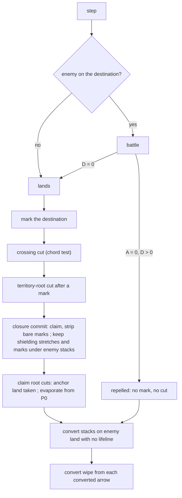

# spec-alignment — rules-core follows the P86 rulings

**Packet:** [P88 — Align rules-core with the P86 rulings](../../design/packets/P88-spec-alignment.md)
**SPEC:** §6.1 (cuts, the territory-root cut, anchor grades), §6.2 (cut and combat on one step), §6.3 (conversion, the convert wipe), §7 (what a claim clears)
**Register:** [spec-conflicts](../../research/spec-conflicts.md), rows C2, R1–R3, D1, D2
**Features:** [core](./spec-alignment.core.feature) · [edge cases](./spec-alignment.edge-cases.feature)
**Upstream:** [cuts](../cuts/cuts.md), [combat](../combat/combat.md),
[closure](../closure/closure.md), [raider-survives-claim](../raider-survives-claim/raider-survives-claim.md),
[encircled-path](../encircled-path/encircled-path.md), [trails](../trails/trails.md)

## Purpose

P86's audit found five places where the engine and SPEC.md part ways after
the human's rulings, and one ruling the engine already follows. Each is
small, each touches different code, and each keeps its own scenarios. The
principle behind most of them is the human's: "If the trail isn't cut, there
shouldn't be any evaporation." The other side of it holds too: when a trail's
lifeline *is* severed, by a cut or by a claim that takes its anchor, the
ordinary cut runs.

## The rules (all decided; quoted from SPEC.md after P86)

1. **R3. A cut needs a successful crossing.** An enemy step crosses a trail
   only when it lands. A repelled attack (*A* = 0) did not cross and causes
   no evaporation of the defender's trail (§6.1, §6.2), and it claims
   nothing either: closure needs a landing (§7). An attack that wipes the
   defender (*D* = 0) lands and cuts. When both sides are wiped, the engine
   today counts the step as landed. SPEC §11 item 5 leaves that open, so this
   packet pins today's behaviour and does not decide it.
2. **D1. The convert wipe runs from every converted arrow.** After a stack
   converts, the victim's trail evaporates from that arrow under the
   halt-at-first rule (§6.3). Converted stacks are not firebreaks.
3. **C2. A claim spares a territory-grade trail carrying its owner's stack,
   wherever the stack stands** (§7). Enemy trail on a claimed arrow is
   removed unless its stretch is territory grade on the post-claim board and
   carries at least one of its owner's stacks. A stretch with no owner stack
   on it is bare and is still removed.
4. **R2. A claim that takes a trail's anchoring land is a territory-root
   cut** (§6.1). When a claim takes the last clean feeder of a root point P0
   (an in-arrow of P0 that is the owner's territory and in no enemy trail)
   while the owner's trail leaves P0, evaporation runs from P0 under the
   halt-at-first rule. §6.3 then decides conversion by its ordinary rule: a
   stack on enemy land with no lifeline converts to the land's owner; a
   stack on neutral ground is stranded.
5. **D2. Only a clean feeder anchors.** A trail is territory grade only
   while some arrow of its stretch leaves a point P0 fed by an in-arrow that
   is the owner's territory and in no enemy trail (§6.1). This is the same
   predicate the territory-root cut uses, stated once.
6. **R1. A stack on its owner's land can be attacked.** A raider with a
   lifeline (stepping from its own territory, or from a territory-grade
   trail) may attack an enemy stack standing on that enemy's land (§5, §6.2,
   §6.3). No change; pinned so it cannot drift.

## Scope

In: the six rules above, as engine behaviour behind `RulesPort`.

Out:
- the claim walk and fill (P05b, P42); accrual (P08);
- who converts: the §6.3 predicate in `convertEncircled` is unchanged;
- adapters that restate a rule (`packages/web` findings, fx, bots). The
  register lists them. Their behaviour follows the port where they call it.

## Terms

| Term | Means |
|---|---|
| **lands** | the attacker ends the step on the destination arrow: no contact, or contact with *D* = 0 |
| **clean feeder** of P0 for player V | an in-arrow of P0 that is V's territory and in no other player's trail |
| **root point** of a stretch | a point P0 that some arrow of the stretch leaves |
| **post-claim board** | the claimed arrows written as the closer's territory, every trail still in place |
| **shielding stretch** | a stretch of a player other than the closer that is territory grade on the post-claim board and carries at least one of its owner's stacks |
| **bare** enemy trail on a claimed arrow | a mark that is not in a shielding stretch |

## Decisions (BSSN, recorded here)

1. **One step order, two guards.** `applyStep` keeps its order: combat →
   mark → crossing cut → territory-root cuts after a mark → closure commit →
   **claim root cuts (new)** → conversion and convert wipe. The crossing cut,
   the closure commit and the claim root cuts now run only when the step
   landed, as the mark and the mark's root cuts already do. A repelled step
   goes straight to the conversion check, which reads state on every step
   (§6.3). A mutual wipe (*A* and *D* both 0) is treated as landed, which is
   today's behaviour, pinned until SPEC §11 item 5 is decided.
2. **The strip leaves marks under enemy stacks (D1).** `stripClaim` removes
   bare enemy marks from claimed arrows, **except an arrow holding a group
   of that mark's owner**. Such a group is either on a shielding stretch (and
   its whole stretch stays, C2) or on a stretch that is not territory grade,
   in which case it stands on the closer's land with no lifeline and
   converts on this apply; the convert wipe then removes that arrow and runs
   outward. Bare claimed arrows are removed by the claim first, so a front
   from a converted arrow does not travel through them: trail that connects
   to the converted stack only through a bare claimed arrow is left as it is
   (dormant or stack grade), like any trail beyond a claim. This is the
   order SPEC states (§7 claims, then §6.3 converts), not a new rule.
3. **The shielding test drops its land condition (C2).** `shieldingOf` keeps
   a stretch when it is territory grade on the post-claim board and carries
   at least one group of its owner, wherever that group stands. The P87
   condition "on another player's territory" goes.
4. **Claim root cuts are computed against the board before the claim and
   fire on the board after it (R2).** For each player V other than the
   closer, in player order, and each point P0 in point order: if some claimed
   arrow was a **clean feeder** of P0 for V before the claim (V's territory
   and in no other player's trail), V's trail
   (after the strip) has an out-arrow at P0, and P0 has no clean feeder for V
   after the claim, then evaporate V's trail from P0 (`cuts.evaporateFrom`).
   They run after the strip and before conversion, so conversion reads the
   board the cut leaves.
5. **One clean-feeder predicate (D2).** `stretch.ts` exports the predicate
   "in-arrow of P0 that is V's territory and in no other player's trail".
   `stretchGrade`, `cuts.territoryRootCuts` and the claim root cut all use it.
   A stretch is territory grade when some arrow of it leaves a point with a
   clean feeder.
6. **No port change.** `RulesPort`, `Claim` and the contracts are unchanged.
   New helpers are module-private or injected into `makeClosureRules` /
   `makeCutRules` from the trail rules, as P87 did.

## One step, after P88

## Invariants (EARS)

1. When a step's attacker does not land, the system shall leave every other
   player's trail unchanged by that step's crossing.
2. When a step lands and its traversal crosses another player's trail, the
   system shall evaporate that trail from the crossing point under the
   halt-at-first rule.
3. When a stack converts, the system shall leave no arrow of the victim's
   trail that was reachable from the converted arrow through unoccupied,
   non-territory victim trail arrows not removed by the claim.
4. When a closure commits, the system shall keep every arrow of a stretch
   that is territory grade on the post-claim board and carries one of its
   owner's stacks.
5. When a closure takes the last clean feeder of a root point of another
   player's trail (a feeder that was clean before the claim), the system shall evaporate that trail from the root point
   under the halt-at-first rule.
6. The system shall report territory grade for a trail arrow only when its
   stretch leaves a point with a clean feeder for its owner.
7. The system shall not mutate the input state, and shall return equal
   outputs for equal inputs.

## Cases

The register's cases, as phase 2 builds them:
- **R3, D2, R1:** fixture boards (`support.ts` `anInterleaving`, `onBoard`).
- **D1, C2:** P87's generated-tiling closing (`raider-survives-claim.support.ts`
  `aClosing`, `aShieldedRaider`, `aRoadThroughThePocket`).
- **R2:** generated tiling, the ring `tiling:a:` `0,0,0 → 1,0,0 → 2,0,1 →
  1,1,1 → 0,2,2 → 0,1,2` with the first three arrows A's land and the last
  three A's trail; A closes from `0,1,2` onto `0,0,0`. B's land `f` =
  `tiling:a:1,1,2`; B's trail leaves `target(f)` outward. The search that
  found it is the register's R2 entry; phase 2 may re-derive it through the
  port rather than name arrows.

## Counts

Core: 11 scenarios. Edge cases: 10 scenarios. Invariants: 7. No §11 item.
