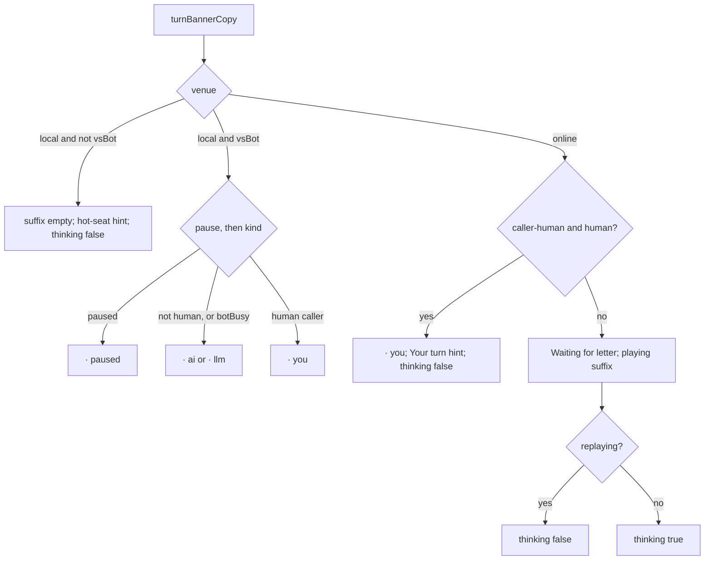

# turn-banner — the turn line never says "you" for a seat that isn't yours

**Packet:** [P101](../../design/packets/P101-turn-banner.md). Issue
[#120](https://github.com/hochgi/conquarrow/issues/120), items 1 and 2 only.
**SPEC:** not edited. No game rule is added, changed, or implied. Nothing is
owed to SPEC §11.
**Amends:** the in-play branch of `Hud.tsx` (the `vsBot && !botBusy` → ` · you`
suffix and the `Your turn` hint). Does not amend `isCallerToMove`, the submit
lock, the camera, or `activeIsAi`.
**Layer:** `packages/web` (`turnBanner.ts`, `online-parse.ts`, `Hud.tsx`,
`App.tsx`, `styles.css`) and one additive field on `InviteSeat` in
`packages/contracts`. No `online-api` change. `GET` game already adds `label`
on agent seats (`seatsForClient`). The client was dropping it. That is not a
new exchange, so there is no `SCENARIOS.md` and no new `@hochgi/test-kit` test.
**Features:** [core](./turn-banner.core.feature) ·
[edge cases](./turn-banner.edge-cases.feature)

10 core scenarios, 27 edge scenarios, 7 invariants. No diagram paths (no new
protocol).

## Purpose

While an agent or a heuristic seat is to move online, the banner must not claim
the turn is yours, and it must show that someone else is playing. The same pure
function produces the local hot-seat and local vs-bot lines, so the words live
in one place.

## Terms

| Term | Means |
|---|---|
| **letter** | the active player's id, `A`–`H`. Not `Player A` |
| **caller-human** | the active chair is a human seat whose `userHash` is the caller's |
| **caller-agent** | the active chair is an agent seat whose `userHash` is the caller's |
| **other** | every chair that is not proved to be one of those two |
| **owner name** | the display name inside an agent seat's `label`, when it has one |
| **thinking** | the banner shows the P94 spinner. Online only, and never during a replay |

`you` in this spec is the banner suffix ` · you` and the hint sentence that
starts `Your turn`. The phrase `your agent` is a different phrase and is
required for the caller's own agent. A test that rejects any string containing
the letters `you` is wrong.

## Decisions (adapter BSSN)

### D1 — one function owns the banner and the hint

`turnBannerCopy` (`packages/web/src/turnBanner.ts`) is pure. No clock, no DOM,
no I/O.

```
type TurnVenue = 'local' | 'online'
type TurnSeatKind = 'human' | 'agent' | 'heuristic' | 'byok'
type TurnRelation = 'caller-human' | 'caller-agent' | 'other'

turnBannerCopy({
  venue, letter, kind, relation, ownerName?,
  replaying, vsBot, pause, botBusy, byokActive,
  phase, movableCount, routeHint,
}) → { letter, suffix, banner, hint, thinking }
```

`banner` is `Turn: ` + `letter` + `suffix`. `suffix` is `''` or starts with
` · `. Hud colours `letter` with `styleFor` and appends the starvation note
after the suffix. The function does not own starvation, the tutorial banner,
or the victory banner. Those Hud branches stay and do not call the function.

The seat is named by its letter, not by `styleFor().label` (`Player A`). Colour
still comes from `styleFor`. Local hot-seat therefore reads `Turn: A` instead
of `Turn: Player A`. That is the one local copy delta. The conditions (no
suffix, no `Your turn`) stay.

### D2 — online copy

Online ignores `vsBot`, `pause`, `botBusy`, and `byokActive`.

`you` (suffix ` · you`, and the hint below) if and only if `relation` is
`caller-human` **and** `kind` is `human`. `thinking` is false. The hint is the
caller's own phase hint:

| phase | hint |
|---|---|
| `idle`, `movableCount === 0` | `No steps left — passing…` |
| `idle`, otherwise | `Your turn — gold-outlined stacks can still move` |
| `blocked` | `This stack has nowhere to go. Another gold stack is auto-selected when one finishes` |
| `route` | `routeHint` (already resolved; may be `''`) |

Those four sentences are today's `phaseHint` sentences, quoted so a later edit
of `Hud.tsx` cannot drift them. The `passing…` delay is not added or removed.

Otherwise (`thinking` is `!replaying`, hint is `Waiting for ${letter}…`, and a
route hint must not leak):

| kind and relation | suffix |
|---|---|
| `agent` and `caller-agent` | ` · your agent is playing…` |
| `agent`, any other relation | ` · ${name}'s agent is playing…` |
| `heuristic` or `byok` | ` · AI is playing…` |
| `human` | ` · ${letter} is playing…` |

`name` is `ownerName` when that is a non-empty string after trim; otherwise the
letter. The possessive is always a straight apostrophe plus `s` (`Ada's`,
`Chris's`). The ellipsis is U+2026, the same character as `AI seat is moving…`.

A `caller-human` relation on a non-human kind does not say `you`. It takes the
row above. A `caller-agent` relation on a non-agent kind does not say
`your agent`.

### D3 — local copy keeps today's conditions, and never says "you" for a bot

Local `thinking` is always false. Replay does not change local copy.

Order, first match wins, and only when `vsBot` is true. When `vsBot` is false
(hot-seat) the suffix is `''` and the hint is the phase table in D2 with the
idle-with-moves sentence `Gold-outlined stacks can still move` — never
`Your turn`.

| # | When | suffix | hint |
|---|---|---|---|
| 1 | `pause` is not `running` | ` · paused` | `pauseHint(pause)` |
| 2 | `kind` is not `human`, or `botBusy` | ` · llm` if `byokActive`, else ` · ai` | `LLM seat is thinking…` if `byokActive`, else `AI seat is moving…` |
| 3 | `kind` is `human` and `relation` is `caller-human` | ` · you` | the D2 caller phase hint |
| 4 | anything else | `''` | the hot-seat phase hint |

Row 2 is the one tightening of today's local frame. Today a non-human seat with
`botBusy` false took the ` · you` branch. It must not. A local bot seat says
` · ai` or ` · llm` whether or not it is busy yet. Pause still outranks that.

`pauseHint` is the existing function: manual is `Paused — bots will not move
until you resume`, idle is `Paused — this tab is in the background`. The word
`you` inside the manual pause sentence is that sentence, not the turn-ownership
`you`. The invariant below checks the suffix and whether the hint starts with
`Your turn`, not a substring search.

### D4 — thinking indicator

`thinking` is true if and only if `venue` is `online` and it is not the case
that `relation` is `caller-human` and `kind` is `human`, and `replaying` is
false.

Replay does not change the banner or the hint. It only suppresses the spinner.
The replay animation is the activity signal.

Hud, when `thinking` is true, sets `aria-busy` on the banner and renders
`<span className="spinner" aria-hidden="true" />` inside the banner, after the
suffix and before the starvation note. The spinner uses the existing
`p94-spin` keyframes and the same box as `.actions .spinner`. A new
`.banner .spinner` rule may repeat that box; it must not invent a second
animation. Under `prefers-reduced-motion: reduce` the duration is `2.4s`, the
same slowing P94 already applies to `.actions .spinner`. The spin is not
removed.

No DOM test. The PR phone check watches the spinner.

### D5 — online kind and ownership come from the game seats

`onlineTurnSeat` (same module) is pure.

```
onlineTurnSeat({ seats, userHash, players, active }) →
  { letter, kind, relation, ownerName? }
```

`letter` is `active`. Seat `i` is `players[i]` (P18, the same alignment
`isCallerToMove` uses).

| Fact | Result |
|---|---|
| `seats` is missing, `active` is not in `players`, or `seats[index]` is missing | `kind: 'human'`, `relation: 'other'`, no `ownerName`. Never `you` |
| `userHash` is missing | kind is still read off the seat; `relation` is `other` |
| human seat, `userHash` matches the seat's `userHash` | `caller-human` |
| agent seat, `userHash` matches the seat's `userHash` | `caller-agent` |
| anything else | `other` |

An unbound seat (`userHash` absent on the seat) is `other`, even when the
caller has a hash. A match on an agent seat is `caller-agent` even when the
caller has no human chair.

> **Amended by P105** ([seat-labels](../seat-labels/seat-labels.md)): `ownerName` is the agent chair's usable `name` (trimmed, not blank, not a reserved seat word, not `Player <A–F>`); `label`, `ownerNameFromLabel` and `seatsForClient` are gone.

`ownerName` is set only for an agent seat whose `label` is `Agent (${name})`
with `name` trimmed and non-empty. `Agent`, `Agent ()`, `Agent ( )`, a missing
label, and a label on a human or heuristic seat do not set it. The interior is
the slice between the first `Agent (` and the last `)`.

`GET` game already sends that label (`seatsForClient`: `Agent` or
`Agent (${displayName})`). `InviteSeat`'s agent variant gains an optional
`label?: string`. `parseSeat` keeps a non-empty string label on an agent and
drops a label on a human or a heuristic. No new request. No server change.

App passes `onlineTurnSeat(...)` into the copy function whenever the match is
online, from `board().seats` falling back to `inviteSeats()`, and from
`userHash()`. It does not read `aiSeatsRef` or `seatConfigsRef` for this copy.
`activeIsAi`, `aiChair`, the input lock, and the camera are not retargeted.

### D6 — local kind and relation are pure, and an unknown chair is not the caller

`localTurnSeat` (same module) is pure. App only calls it. It does not live in
`App.tsx`, and it is not a suppressed wiring line.

```
localTurnSeat({ configKind, logSeats, active }) →
  { kind, relation }
```

`logSeats` is `{ player, kind }[]`. Kind is `configKind` when that is defined,
otherwise the log row whose `player` string equals `active`. Config wins when
both exist.

| Fact | Result |
|---|---|
| kind is `human` | `relation: 'caller-human'`. No `ownerName` |
| kind is `heuristic`, `byok`, or `agent` | `relation: 'other'`. No `ownerName` |
| neither config nor a matching log row | `kind: 'human'`, `relation: 'other'`. Not the caller |

The last row is the opposite of treating a missing plan as the human at the
keyboard. `turnBannerCopy` then takes D3 row 4, so a versus-bot turn does not
say `you`. A lookup that always returned `human` and then mapped human to
`caller-human` would. That mapping is this function's, and it is tested.

`localConfigKind(seat)` is `seat?.kind`, and `undefined` when there is no seat.
App passes that into `localTurnSeat`. It does not read `activeSeat?.kind` for
the banner. The BYOK ready-check keeps its own existing read; this packet does
not retarget it.



## Invariants

1. When the suffix is not exactly ` · you`, the banner shall not claim the turn
   with the word `you`.
2. When the active seat is not the caller's human seat, the hint shall not
   start with `Your turn`.
3. When the venue is online and the active seat is not the caller's human seat
   and no replay is playing, `thinking` shall be true.
4. While a replay is playing, or the venue is local, `thinking` shall be false.
5. When online seat facts cannot prove the active chair is the caller's human
   seat, the derived relation shall not be `caller-human`.
6. When an online agent label carries a display name, the derived owner name
   shall be that name; otherwise it shall be absent.
7. The banner shall name the seat by its letter and shall not contain
   `Player `.

## Mutation

`pnpm test:mutation:changed` on this packet's lines. The decisions live in
`turnBannerCopy`, `onlineTurnSeat`, and the label branch of `parseSeat`. Those
have no suppression. `Hud.tsx` and `App.tsx` only wire the result; a changed
line there that Stryker mutates is suppressed with `no DOM harness` and a
pointer at the pure function, the same shape as P100's App pins. Do not
suppress a branch in `turnBanner.ts`. CSS is not mutated.

## Out of scope

Eliminated-seat greying and toast. The game-over summary. Raw `tiling:` ids in
copy. Changing the `passing…` delay. Camera lock, spectate, and retargeting
`activeIsAi` / `aiChair` / the input lock. The roster and the full seat label
with names everywhere (#119). Animation pacing. A new request for display
names.

## Phone check

Web has no DOM tests. On a phone, in a 3-seat online game (you, your agent, an
AI), watch one full round: your turn reads `Turn: A · you` and `Your turn`
with no spinner; your agent's turn reads `your agent is playing…`, the hint
`Waiting for …`, and the spinner, unless a replay is animating; the AI's turn
reads `AI is playing…` with the spinner. Reduced motion slows the spinner, it
does not remove it.
